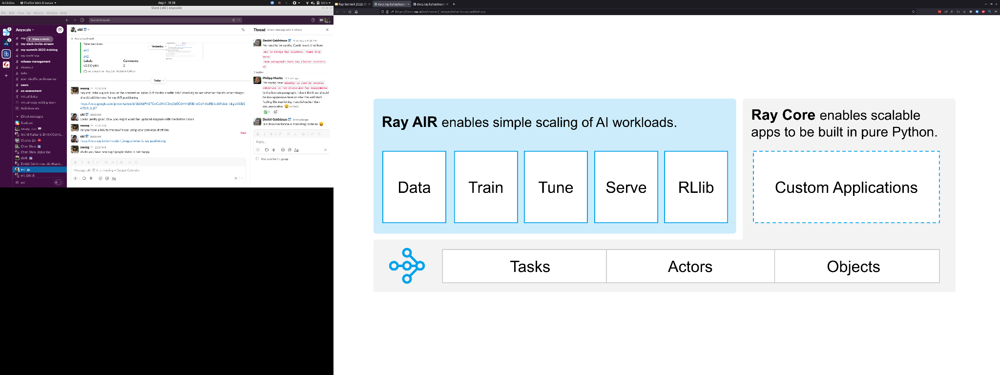

# Ray v2 Architecture 白皮书 · Overview（概述）中英对照

> **来源**：Ray v2 Architecture 白皮书（Ray Team，2022 年 10 月）· Overview 章
> **原文**：[Ray v2 Architecture（Google Docs）](https://docs.google.com/document/d/1tBw9A4j62ruI5omIJbMxly-la5w4q_TjyJgJL_jN2fI/preview)；英文全文副本见 [original/Ray-2.0-Architecture-whitepaper.md](../original/Ray-2.0-Architecture-whitepaper.md)
> **图片**：存于 `images/` 目录，按原文位置插入

---

## API philosophy（API 哲学）

Ray 旨在为分布式计算提供一个通用 API。实现这一目标的核心，是提供**简单而通用的编程抽象**，把繁重的工作交给系统去完成。正是这一理念，让开发者得以把 Ray 与现有的 Python [库](https://docs.ray.io/en/master/multiprocessing.html)和[系统](https://docs.ray.io/en/master/train/train.html)配合使用。

Ray aims to provide a universal API for distributed computing. A core part of achieving this goal is to provide **simple but general programming abstractions**, letting the system do all the hard work. This philosophy is what makes it possible as a developer to use Ray with existing Python [libraries](https://docs.ray.io/en/master/multiprocessing.html) and [systems](https://docs.ray.io/en/master/train/train.html).

·

Ray 程序员用少数几个 [Python 原语](https://docs.ray.io/en/master/walkthrough.html)来表达逻辑，而系统负责管理物理执行层面的问题，例如并行与[分布式内存管理](#object-management对象管理)。Ray 用户以「资源」为视角来思考集群管理，而系统则根据这些资源请求来管理[调度](#resource-management-and-scheduling资源管理与调度)与自动扩缩容。

A Ray programmer expresses their logic with a handful of [Python primitives](https://docs.ray.io/en/master/walkthrough.html), while the system manages physical execution concerns such as parallelism and [distributed memory management](#object-management). A Ray user thinks about cluster management in terms of resources, while the system manages [scheduling](#resource-management-and-scheduling) and autoscaling based on those resource requests.

·

*Ray 提供了任务（task）、Actor 与对象（object）的通用 API，用于构建分布式应用。*

*Ray provides a universal API of tasks, actors, and objects for building distributed applications.*

·

某些应用可能需要一组不同的系统级权衡，而这无法通过[核心抽象集](https://docs.ray.io/en/master/walkthrough.html)来表达。因此，Ray API 的第二个目标是允许应用对系统行为进行**细粒度控制**。这通过一组可配置参数来实现，这些参数可用于修改系统行为，例如[任务放置](#scheduling-policies调度策略)、[故障处理](#object-failure对象故障)与[应用生命周期](https://docs.ray.io/en/master/advanced.html#detached-actors)。

Some applications may require a different set of system-level tradeoffs that cannot be expressed through the [core set](https://docs.ray.io/en/master/walkthrough.html) of abstractions. Thus, a second goal in Ray's API is to allow the application **fine-grained control over system behavior**. This is accomplished through a set of configurable parameters that can be used to modify system behaviors such as [task placement](#scheduling-policies), [fault handling](#object-failure), and [application lifetime](https://docs.ray.io/en/master/advanced.html#detached-actors).

---

## System scope（系统范围）

Ray 旨在支持*通用的*分布式应用与库的开发与组合。具体而言，这包括粗粒度弹性工作负载（即[无服务器计算](https://medium.com/riselab/two-missing-links-in-serverless-computing-stateful-computation-and-placement-control-964c3236d18)的类型）、机器学习训练（如 [Ray AIR](https://docs.ray.io/en/master/ray-air/getting-started.html)）、在线推理（如 [Ray Serve](https://docs.ray.io/en/latest/serve/index.html)）、数据处理（如 [Ray Datasets](https://docs.ray.io/en/master/data/dataset.html)、[Modin](https://modin.readthedocs.io/en/latest/)、[Dask-on-Ray](https://github.com/ray-project/ray/pull/9857)），以及临时计算（如并行化 Python 应用、粘合不同的分布式框架）。

Ray seeks to enable the development and composition of distributed applications and libraries *in general*. Concretely, this includes coarse-grained elastic workloads (i.e., types of [serverless computing](https://medium.com/riselab/two-missing-links-in-serverless-computing-stateful-computation-and-placement-control-964c3236d18)), machine learning training (e.g., [Ray AIR](https://docs.ray.io/en/master/ray-air/getting-started.html)), online serving (e.g., [Ray Serve](https://docs.ray.io/en/latest/serve/index.html)), data processing (e.g., [Ray Datasets](https://docs.ray.io/en/master/data/dataset.html), [Modin](https://modin.readthedocs.io/en/latest/), [Dask-on-Ray](https://github.com/ray-project/ray/pull/9857)), and ad-hoc computation (e.g., parallelizing Python apps, gluing together different distributed frameworks).

·

Ray 的 API 让开发者能够轻松地在单个分布式应用中组合多个库。例如，Ray 的任务和 Actor 可以调用同样运行在 Ray 中的分布式训练（如 [torch.distributed](https://docs.ray.io/en/master/raysgd/raysgd_pytorch.html)）或在线[推理工作负载](https://docs.ray.io/en/master/serve/)，也可以被它们调用。[Ray AI Runtime (AIR)](https://docs.ray.io/en/master/ray-air/getting-started.html)正是这样构建的——在底层组合其他 Ray 库。从这个意义上说，Ray 是一个出色的「分布式胶水」系统，因为它的 API 足够通用且高性能，可以作为多种不同工作负载类型之间的接口。

Ray's API enables developers to easily compose multiple libraries within a single distributed application. For example, Ray tasks and actors may call into or be called from distributed training (e.g., [torch.distributed](https://docs.ray.io/en/master/raysgd/raysgd_pytorch.html)) or online [serving workloads](https://docs.ray.io/en/master/serve/) also running in Ray. This is how the [Ray AI Runtime (AIR)](https://docs.ray.io/en/master/ray-air/getting-started.html) is built, by composing together other Ray libraries under the hood. In this sense, Ray makes for an excellent "distributed glue" system, because its API is general and performant enough to serve as the interface between many different workload types.

---

## System design goals（系统设计目标）

驱动 Ray 架构的核心原则是 **API 简洁性**与**通用性**，而核心系统目标是**性能**（低开销与水平扩展）与**可靠性**。有时，我们愿意牺牲其他理想目标（如*架构简洁性*）来换取这些核心目标。例如，Ray 包含[分布式引用计数](#reference-counting引用计数)与[分布式内存](#heading=h.rnw6v42ykv7t)等组件，它们增加了架构复杂度，但却是性能与可靠性所必需的。

The core principles that drive Ray's architecture are **API simplicity** and **generality**, while the core system goals are **performance** (low overhead and horizontal scalability) and **reliability**. At times, we are willing to sacrifice other desirable goals such as *architectural simplicity* in return for these core goals. For example, Ray includes components such as [distributed reference counting](#reference-counting) and [distributed memory](#heading=h.rnw6v42ykv7t), which add to architectural complexity, but are needed for performance and reliability.

·

在性能方面，Ray 构建于 [gRPC](https://grpc.io/) 之上，并且在许多情况下能够[达到甚至超过](https://medium.com/riselab/optimizing-distributed-futures-over-grpc-f34c01b7905c)朴素使用 gRPC 的性能。与单纯使用 gRPC 相比，Ray 让应用更容易利用[并行与分布式执行](#heading=h.uzsuxxjrr910)、[分布式内存共享](#object-management对象管理)（通过共享内存对象存储），以及动态创建轻量级服务（即 [Actor](https://docs.ray.io/en/master/ray-core/actors.html#actor-guide)）。

For performance, Ray is built on top of [gRPC](https://grpc.io/) and can in many cases [match or exceed](https://medium.com/riselab/optimizing-distributed-futures-over-grpc-f34c01b7905c) the performance of naive use of gRPC. Compared to gRPC alone, Ray makes it simpler for an application to leverage [parallel and distributed execution](#heading=h.uzsuxxjrr910), [distributed memory sharing](#object-management) (via a shared memory object store), and dynamic creation of lightweight services (i.e. [actors](https://docs.ray.io/en/master/ray-core/actors.html#actor-guide)).

·

在可靠性方面，Ray 的内部协议被设计为在故障期间确保正确性，同时为常见情况增加低开销。Ray 实现了[分布式引用计数协议](#reference-counting引用计数)以确保[内存安全](#memory-management内存管理)，并提供[多种](#object-failure对象故障)[选项](#actor-death)从故障中恢复。

For reliability, Ray's internal protocols are designed to ensure correctness during failures while adding low overhead to the common case. Ray implements a [distributed reference counting protocol](#reference-counting) to ensure [memory safety](#memory-management) and provides [various](#object-failure) [options](#actor-death) to recover from failures.

·

由于 Ray 用户以「资源」而非「机器」的视角来表达计算，Ray 应用可以透明地从笔记本电脑扩展到集群，无需任何代码改动。Ray 的[分布式调度器](#distributed-scheduler分布式调度器)与[对象管理器](#heading=h.rnw6v42ykv7t)被设计为以低开销支持这种无缝扩展。

Since a Ray user thinks about expressing their computation in terms of resources instead of machines, Ray applications can transparently scale from a laptop to a cluster without any code changes. Ray's [distributed scheduler](#distributed-scheduler) and [object manager](#heading=h.rnw6v42ykv7t) are designed to enable this seamless scaling, with low overheads.

---

## Related systems（相关系统）

下表将 Ray 与几个相关的系统类别进行比较。注意我们省略了更高层库的比较（如 [RLlib](https://docs.ray.io/en/master/rllib.html)、[Tune](https://docs.ray.io/en/master/tune/index.html)、[RaySGD](https://docs.ray.io/en/master/raysgd/raysgd.html)、[Serve](https://docs.ray.io/en/master/serve/index.html)、[Modin](https://github.com/modin-project/modin)、[Dask-on-Ray](https://github.com/ray-project/ray/pull/9857)、[MARS-on-Ray](https://github.com/mars-project/mars/pull/1508)）；这类比较超出了本文档的范围，本文档仅关注 Ray core。你也可以参考 [Ray 上的社区库完整列表](https://docs.ray.io/en/master/ray-libraries.html)。

The following table compares Ray to several related system categories. Note that we omit higher-level library comparisons (e.g., [RLlib](https://docs.ray.io/en/master/rllib.html), [Tune](https://docs.ray.io/en/master/tune/index.html), [RaySGD](https://docs.ray.io/en/master/raysgd/raysgd.html), [Serve](https://docs.ray.io/en/master/serve/index.html), [Modin](https://github.com/modin-project/modin), [Dask-on-Ray](https://github.com/ray-project/ray/pull/9857), [MARS-on-Ray](https://github.com/mars-project/mars/pull/1508)); such comparisons are outside the scope of this document, which focuses on Ray core only. You may also refer to the [full list of community libraries on Ray](https://docs.ray.io/en/master/ray-libraries.html).

·

- **集群编排器 Cluster Orchestrators**：Ray 可以运行在 [Kubernetes](https://docs.ray.io/en/latest/cluster/kubernetes/index.html) 或 [SLURM](https://docs.ray.io/en/latest/cluster/slurm.html) 等集群编排器之上，提供更轻量、与语言集成的原语（即任务和 Actor，而非容器和服务）。— Ray can run on top of cluster orchestrators like [Kubernetes](https://docs.ray.io/en/latest/cluster/kubernetes/index.html) or [SLURM](https://docs.ray.io/en/latest/cluster/slurm.html) to offer lighter weight, language integrated primitives, i.e., tasks and actors instead of containers and services.

- **并行化框架 Parallelization Frameworks**：与 [multiprocessing](https://docs.python.org/3/library/multiprocessing.html) 或 [Celery](https://github.com/celery/celery) 等 Python 并行化框架相比，Ray 提供了更通用、更高性能的 API。Ray 系统还显式支持[内存共享](#object-management对象管理)。— Compared to Python parallelization frameworks such as [multiprocessing](https://docs.python.org/3/library/multiprocessing.html) or [Celery](https://github.com/celery/celery), Ray offers a more general, higher-performance API. The Ray system also explicitly supports [memory sharing](#object-management).

- **数据处理框架 Data Processing Frameworks**：与 [Spark](https://spark.apache.org/)、[Flink](https://flink.apache.org/)、[MARS](https://github.com/mars-project/mars) 或 [Dask](https://dask.org/) 等数据处理框架相比，Ray 提供了更底层、更窄的 API。这使得 API 更灵活，更适合作为「分布式胶水」框架。另一方面，Ray 对数据模式、关系表或流式数据流没有内建理解；这类功能仅通过库来提供（如 [Modin](https://github.com/modin-project/modin)、[Dask-on-Ray](https://github.com/ray-project/ray/pull/9857)、[MARS-on-Ray](https://github.com/mars-project/mars/pull/1508)）。— Compared to data processing frameworks such as [Spark](https://spark.apache.org/), [Flink](https://flink.apache.org/), [MARS](https://github.com/mars-project/mars), or [Dask](https://dask.org/), Ray offers a lower-level and narrower API. This makes the API more flexible and more suited as a "distributed glue" framework. On the other hand, Ray has no inherent understanding of data schemas, relational tables, or streaming dataflow; such functionality is provided through libraries only (e.g., [Modin](https://github.com/modin-project/modin), [Dask-on-Ray](https://github.com/ray-project/ray/pull/9857), [MARS-on-Ray](https://github.com/mars-project/mars/pull/1508)).

- **Actor 框架 Actor Frameworks**：与 [Erlang](https://www.erlang.org/) 和 [Akka](https://akka.io/) 等专用 Actor 框架不同，Ray 与现有编程语言集成，支持跨语言操作和语言原生库的使用。Ray 系统还透明地管理[无状态计算的并行](#lifetime-of-a-task任务的生命周期)，并显式支持 Actor 之间的[内存共享](#object-management对象管理)。— Unlike specialized actor frameworks such as [Erlang](https://www.erlang.org/) and [Akka](https://akka.io/), Ray integrates with existing programming languages, enabling cross language operation and the use of language native libraries. The Ray system also transparently manages [parallelism of stateless computation](#lifetime-of-a-task) and explicitly supports [memory sharing](#object-management) between actors.

- **HPC 系统 HPC Systems**：许多 HPC 系统暴露消息传递接口，这比任务和 Actor 更低层。这可以给应用更大的灵活性，但可能以开发成本为代价。许多这类系统和库（如 [NCCL](https://developer.nvidia.com/nccl)、[MPI](https://en.wikipedia.org/wiki/Message_Passing_Interface)）还提供优化的集合通信原语（如 [allreduce](https://mpitutorial.com/tutorials/mpi-reduce-and-allreduce/)）。Ray 应用可以通过在 Ray Actor 组之间初始化通信组来利用这些原语（如 RaySGD 使用 [torch distributed](https://pytorch.org/docs/stable/distributed.html)）。— Many HPC systems expose a message-passing interface, which is a lower-level interface than tasks and actors. This can allow the application greater flexibility, but potentially at the cost of developer effort. Many of these systems and libraries (e.g., [NCCL](https://developer.nvidia.com/nccl), [MPI](https://en.wikipedia.org/wiki/Message_Passing_Interface)) also offer optimized collective communication primitives (e.g., [allreduce](https://mpitutorial.com/tutorials/mpi-reduce-and-allreduce/)). Ray apps can leverage such primitives by initializing communication groups between sets of Ray actors (e.g, as RaySGD does with [torch distributed](https://pytorch.org/docs/stable/distributed.html)).

---

## New in 2.0 whitepaper（2.0 白皮书的新内容）

自 [1.x 白皮书](https://docs.google.com/document/d/1lAy0Owi-vPz2jEqBSaHNQcy2IBSDEHyXNOQZlGuj93c/preview)以来：

* 全局控制存储（Global Control Store）现在更名为全局控制**服务**（Global Control Service，GCS），并采用了全新[设计](#overview-1)以简化协调与提高可靠性。
* 分布式调度器提供了扩展的功能与灵活性，包括[调度策略](#scheduling-policies)与[放置组](#placement-groups)。
* 可靠性与容错方面的总体改进，包括用于从节点故障中恢复的[对象重建](#object-failure)与 [GCS 容错](#fault-tolerance-1)。
* 用于管理与交互 [Ray 集群](#cluster-management)的扩展工具集，包括作业提交、KubeRay（Ray on Kubernetes）与应用可观测性。

Since the [1.x whitepaper](https://docs.google.com/document/d/1lAy0Owi-vPz2jEqBSaHNQcy2IBSDEHyXNOQZlGuj93c/preview):

* The Global Control Store is now known as the Global Control **Service** (GCS) and features a completely updated [design](#overview-1) to simplify coordination and reliability.
* The distributed scheduler offers expanded functionality and flexibility, including [scheduling policies](#scheduling-policies) and [placement groups](#placement-groups).
* General improvements in reliability and fault tolerance, including [object reconstruction](#object-failure) to recover from node failures and [GCS fault tolerance](#fault-tolerance-1).
* Expanded toolset for managing and interacting with [Ray clusters](#cluster-management), featuring job submission, KubeRay (Ray on Kubernetes), and application observability.
