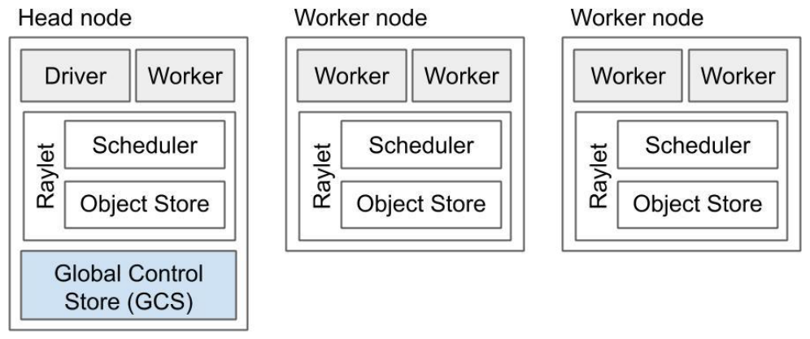
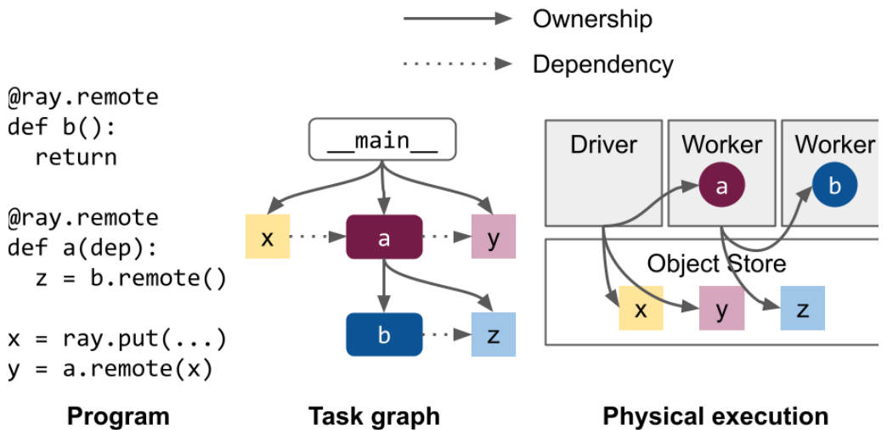
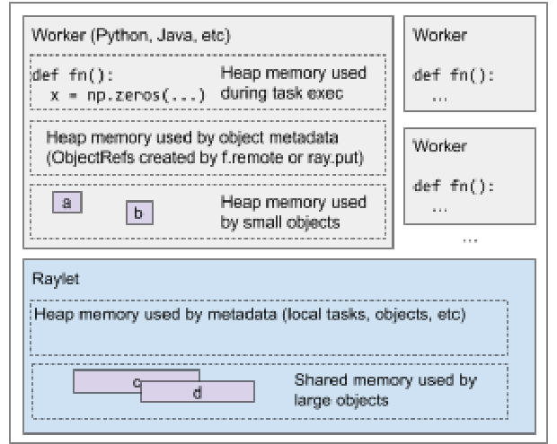
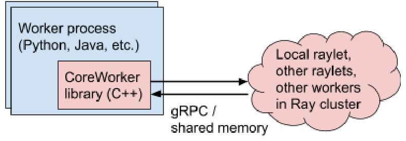
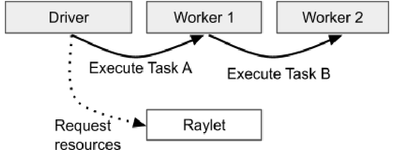
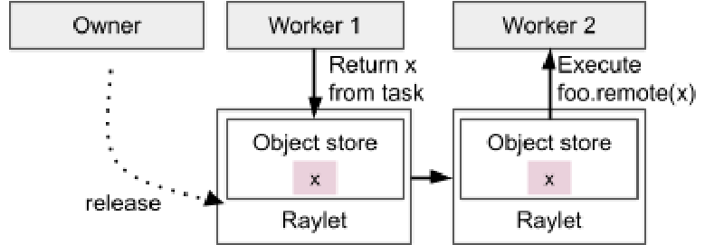
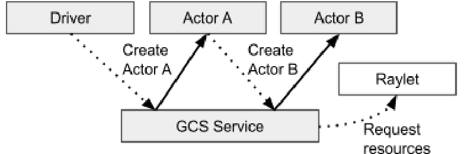

# Ray v2 Architecture 白皮书 · Architecture Overview（架构概览）中英对照

> **来源**：Ray v2 Architecture 白皮书（Ray Team，2022 年 10 月）· Architecture Overview 章
> **原文**：[Ray v2 Architecture（Google Docs）](https://docs.google.com/document/d/1tBw9A4j62ruI5omIJbMxly-la5w4q_TjyJgJL_jN2fI/preview)；英文全文副本见 [original/Ray-2.0-Architecture-whitepaper.md](../original/Ray-2.0-Architecture-whitepaper.md)
> **图片**：存于 `images/` 目录，按原文位置插入

---

## Application concepts（应用概念）

- **任务 Task** —— 一次远程函数调用。这是一次在不同于调用方的进程（可能在不同的机器上）执行的函数调用。任务可以是无状态的（一个 `@ray.remote` 函数），也可以是有状态的（`@ray.remote` 类的方法，见下方 *Actor*）。任务与调用方异步执行：`.remote()` 调用立即返回一个或多个 `ObjectRef`（future），可用于取回返回值。— *Task* \- A remote function invocation. This is a single function invocation that executes on a process different from the caller, and potentially on a different machine. A task can be stateless (a `@ray.remote` function) or stateful (a method of a `@ray.remote` class - see *Actor* below). A task is executed asynchronously with the caller: the `.remote()` call immediately returns one or more `ObjectRefs` (futures) that can be used to retrieve the return value(s).

- **对象 Object** —— 一个应用值。这些值由任务返回，或通过 `ray.put` 创建。对象是**不可变**的：创建之后无法修改。worker 可以通过 `ObjectRef` 引用一个对象。— *Object* \- An application value. These are values that are returned by a task or created through `ray.put`. Objects are **immutable**: they cannot be modified once created. A worker can refer to an object using an `ObjectRef`.

- **Actor** —— 一个有状态的 worker 进程（`@ray.remote` 类的一个实例）。Actor 任务必须通过*句柄*（handle，即对某个特定 Actor 实例的 Python 引用）来提交，并且可以在执行期间修改该 Actor 的内部状态。— *Actor* \- a stateful worker process (an instance of a `@ray.remote` class). Actor tasks must be submitted with a *handle*, or a Python reference to a specific instance of an actor, and can modify the actor's internal state during execution.

- **Driver** —— 程序根，即「主」程序。这是运行 `ray.init()` 的代码。— *Driver* \- The program root, or the "main" program. This is the code that runs `ray.init()`.

- [**Job**](https://docs.ray.io/en/latest/cluster/running-applications/job-submission/index.html) —— 从同一个 driver（递归地）起源的任务、对象与 Actor 的集合，以及它们的运行时环境。driver 与 job 之间是 1:1 映射。— [*Job*](https://docs.ray.io/en/latest/cluster/running-applications/job-submission/index.html) \- The collection of tasks, objects, and actors originating (recursively) from the same driver, and their runtime environment. There is a 1:1 mapping between drivers and jobs.

---

## Design（设计）

### Components（组件）



*一个 Ray 集群。*

*A Ray cluster.*

·

一个 Ray 集群由一个或多个 worker **节点**组成，每个节点由以下物理进程构成：

A Ray cluster consists of one or more worker **nodes**, each of which consists of the following physical processes:

1. 一个或多个 **worker 进程**，负责任务的提交与执行。worker 进程要么是无状态的（可被复用来执行任何 `@ray.remote` 函数），要么是 Actor（只能执行其 `@ray.remote` 类所定义的方法）。每个 worker 进程与一个特定的 job 关联。初始 worker 的默认数量等于机器上的 CPU 数量。每个 worker 存储：
   1. 一张[**所有权（ownership）**](#ownership所有权)**表**。即该 worker 持有引用的对象的系统元数据，例如用于存储引用计数与对象位置。
   2. 一个***[进程内存储（in-process store）](#object-management对象管理)***，用于存放小对象。
2. 一个 **raylet**。raylet 管理每个节点上的共享资源。与 worker 进程不同，raylet 被所有并发运行的 job 共享。raylet 有两个主要组件，运行在独立的线程上：
   1. 一个**调度器（scheduler）**。负责资源管理、任务放置，以及满足存储在分布式对象存储中的任务参数。集群中的各个调度器共同构成 Ray 的[**分布式调度器**](#distributed-scheduler分布式调度器)。
   2. 一个**共享内存对象存储**（也称为 [Plasma Object Store](https://docs.ray.io/en/latest/ray-core/objects/serialization.html#plasma-store)）。负责存储、传输与落盘大对象。集群中的各个对象存储共同构成 Ray 的[**分布式对象存储**](#object-management对象管理)。

每个 worker 进程和 raylet 都被分配一个唯一的 28 字节标识符，以及一个 IP 地址和端口。后续组件可以复用相同的地址和端口（例如，如果之前的 worker 进程死亡），但唯一 ID 永不复用（即进程死亡后 ID 会被 tombstone）。worker 进程与其本地 raylet 进程命运共享（fate-share）。

其中一个 worker 节点被指定为 **head 节点**。除了上述进程外，head 节点还承载：

1. [**全局控制服务（Global Control Service，GCS）**](#global-control-service全局控制服务)。GCS 是一个管理集群级元数据的服务器，例如 Actor 的位置，这些元数据以键值对的形式存储，并可被 worker 本地缓存。GCS 还管理少量集群级操作，包括[放置组](#placement-groups放置组)和 [Actor](#actor-management)Actor 管理的调度，以及[集群节点成员关系](#object-management)的判定。一般来说，GCS 管理的是访问频率较低、但很可能被集群中大多数或全部 worker 使用的元数据。这是为了确保 GCS 的性能不会成为应用性能的关键瓶颈。[GCS 容错](#fault-tolerance-1)是 Ray 2.0 的新特性，允许 GCS 运行在任意节点甚至多个节点上，而非只能在指定的 head 节点上。
2. **driver 进程**。driver 是一个特殊的 worker 进程，执行顶层应用（例如 Python 中的 `__main__`）。它可以提交任务，但自身不能执行任何任务。注意 driver 进程可以运行在任何节点上，但默认通常运行在 head 节点上。
3. 其他处理[作业提交](#bookmark=id.1tkg79aoqdnx)、[自动扩缩容](#bookmark=id.2239nqnu4bzp)等事务的**集群级服务**。

### Ownership（所有权）



大部分系统元数据按照一个名为*所有权（ownership）*的去中心化概念来管理。这个概念意味着：应用中的每个 `ObjectRef` 都由单个 worker 进程来管理。这个 worker（即「owner」）负责确保创建该值的任务得以执行，并协助把 `ObjectRef` 解析为其底层值。

Most of the system metadata is managed according to a decentralized concept called *ownership.* This concept means that each `ObjectRef` in the application will be managed by a single worker process. This worker, or the "owner" is responsible for ensuring execution of the task that creates the value and facilitating the resolution of an `ObjectRef` to its underlying value.

·

有两种创建 ObjectRef 的方式。在这两种情况下，owner 都是调用这段代码的 `x_ref` 所在的 worker 进程。

There are two ways to create an ObjectRef. In both cases, the owner is the worker process of x_ref that calls this code.

```
1. x_ref = f.remote()
2. x_ref = ray.put()
```

换言之，owner 就是生成初始 ObjectRef 的那个 worker。注意，这个 worker 可能不同于创建该 ObjectRef **值**的 worker。例如，如果 ObjectRef 由某个任务返回，那么值将由一个远程 worker 创建。

In other words, the owner is the worker that generates the initial ObjectRef. Note that this may be a different worker from the one that creates the **value** of the ObjectRef. If, for example, the ObjectRef is returned by a task, then the value will be created by a remote worker.

·

所有权带来以下好处（与 Ray 0.8 之前更中心化的设计相比）：

Ownership has the following benefits (compared to the more centralized design used in Ray versions <0.8):

1. 低任务延迟（约 1 次 RTT，<200us）。频繁访问的系统元数据就位于必须更新它的进程本地。
2. 高吞吐（[每个 client 约 10k tasks/s](https://github.com/ray-project/ray/blob/master/release/release_logs/2.0.0/microbenchmark.json)；通过嵌套的远程函数调用，系统元数据自然分布在多个 worker 进程上，从而线性扩展到集群中每秒数百万个任务）。
3. 简化的架构。owner 集中了安全地垃圾回收对象与系统元数据所需的逻辑。
4. 更高的可靠性。可以根据应用结构把 worker 故障彼此隔离，例如一个远程调用的失败不会影响另一个。

1. Low task latency (~1 RTT, <200us). Frequently accessed system metadata is local to the process that must update it.
2. High throughput ([~10k tasks/s per client](https://github.com/ray-project/ray/blob/master/release/release_logs/2.0.0/microbenchmark.json); linear scaling to millions of tasks/s in a cluster), as system metadata is naturally distributed over multiple worker processes through nested remote function calls.
3. Simplified architecture. The owner centralizes logic needed to safely garbage collect objects and system metadata.
4. Improved reliability. Worker failures can be isolated from one another based on the application structure, e.g., the failure of one remote call will not affect another.

所有权带来的一些权衡是：

Some of the trade-offs that come with ownership are:

1. 要解析一个 `ObjectRef`，其 owner 必须是**可达**的。这意味着对象会与其 owner 命运共享。关于对象恢复与持久化，详见[对象故障](#object-failure对象故障)与[对象落盘](#heading=h.hb8w34w0hf6a)。
2. 所有权目前无法转移。

1. To resolve an `ObjectRef`, the object's owner must be **reachable**. This means that an object will fate-share with its owner. See [Object failures](#object-failure) and [Object spilling](#heading=h.hb8w34w0hf6a) for more information about object recovery and persistence.
2. Ownership currently cannot be transferred.

### Memory model（内存模型）



*典型 Ray 节点使用的内存类型。GCS（未显示）包含节点与 Actor 等集群级元数据。*

*Types of memory used for a typical Ray node. The GCS (not shown) contains cluster-level metadata such as for nodes and actors.*

·

Ray 可能以下列方式使用内存：

Ray may use memory in the following ways:

1. **Ray worker 在任务或 Actor 执行期间使用的堆内存。** Ray worker 在执行任务或 Actor 时运行用户定义的代码。由于 Ray 的任务和 Actor 通常并行运行（最多到核数），应用开发者应当注意每个任务各自的堆内存使用。如果堆内存压力过高，Ray 会优先尝试杀死一个内存占用大的 worker，以保护对象存储中的系统级状态与其他系统级进程。
2. **大 Ray 对象使用的共享内存**（由 `ray.put()` 创建、或由 Ray 任务返回的值）。当 worker 调用 `ray.put()` 或从任务返回时，它把提供的值拷贝进 Ray 的共享内存对象存储。随后 Ray 会在整个集群中[提供这些对象](#object-resolution对象解析)，在故障时尝试[恢复](#object-failure对象故障)它们，若对象存储超过其配置容量则[落盘](#heading=h.7ce0zjt0shwh)，并在所有 ObjectRef 离开作用域后[垃圾回收](#reference-counting引用计数)它们。对于可[零拷贝反序列化](https://docs.ray.io/en/latest/ray-core/objects/serialization.html)的值，把 ObjectRef 传给 `ray.get` 或作为任务参数，会给 worker 返回一个直接指向共享内存缓冲区的指针。所有其他值则会被反序列化到接收 worker 的堆内存上。
3. **小 Ray 对象使用的堆内存**（由 Ray 任务返回）。如果对象足够小（默认 100KB），Ray 会直接把值存储在 owner 的「进程内」对象存储中，而不是 raylet 的共享内存对象存储。任何读取该对象的 worker（例如通过 `ray.get`）会把值直接拷贝进自己的堆内存。Ray 也会通过与处理大对象相同的协议，自动垃圾回收这些小对象。
4. **Ray 元数据使用的堆内存。** 这是 Ray 为管理应用元数据而分配的内存。大部分元数据以任务描述（task specification）或关于对象的元数据（如引用计数）的形式存在。截至 Ray v2.0，预计每个仍在作用域内的 ObjectRef 的总元数据开销为几 KB。下面是各系统级进程及其预期内存占用规模的简要总结：
   1. [GCS](#global-control-service全局控制服务)：# 总 Actor 数、# 总节点数、# 总放置组数
   2. raylet：# 本地排队的任务数、这些任务的 # 对象参数、本地共享内存或本地磁盘中存储的 # 对象数
   3. Worker：# 已提交但仍待处理、或可能通过[血缘重建](#large-objects-and-lineage-reconstruction大对象与血缘重建)被重新执行的任务数、# 拥有的对象数、# 语言前端作用域内的对象数

1. **Heap memory used by Ray workers during task or actor execution.** Ray workers execute user-defined code when executing tasks or actors. Because Ray tasks and actors usually run in parallel, up to the number of cores, the application developer should be cognizant of each task's individual heap memory usage. If heap memory pressure is too high, Ray will attempt to kill a memory-hungry worker first, to protect the system-level state in the object store and other system-level processes.
2. **Shared memory used by large Ray objects** (values created by `ray.put()` or returned by a Ray task). When a worker calls `ray.put()` or returns from a task, it copies the provided values into Ray's shared memory object store. Ray will then [make these objects available](#object-resolution) throughout the cluster, attempt to [recover](#object-failure) them in case of a failure, [spill](#heading=h.7ce0zjt0shwh) them if the object store exceeds its configured capacity, and [garbage-collect](#reference-counting) them once all ObjectRefs have gone out of scope. For values that can be [zero-copy deserialized](https://docs.ray.io/en/latest/ray-core/objects/serialization.html), passing the ObjectRef to `ray.get` or as a task argument will return a direct pointer to the shared memory buffer to the worker. All other values will be deserialized onto the receiver worker's heap memory.
3. **Heap memory used by small Ray objects** (returned by a Ray task). If an object is small enough (default 100KB), Ray will store the values directly in the owner's "in-memory" object store instead of the Raylet shared memory object store. Any workers that read the object (e.g., through `ray.get`) will copy the value directly into their own heap memory. Ray also automatically garbage-collects these objects through the same protocol as for large objects.
4. **Heap memory used by Ray metadata.** This is memory allocated by Ray to manage metadata for the application. The majority of the metadata is in the form of a task specification or metadata about an object (such as the reference count). As of Ray v2.0, the total metadata overhead is expected to be a few KB per ObjectRef that is still in scope. Here is a brief summary of the system-level processes and their expected memory footprint scale:
   1. [GCS](#global-control-service): # total actors, # total nodes, # total placement groups
   2. Raylet: # tasks queued locally, # object arguments of these tasks, # objects stored in local shared memory or local disk
   3. Worker: # tasks submitted that are still pending or that may get re-executed through [lineage reconstruction](#large-objects-and-lineage-reconstruction), # owned objects, # objects in scope at the language frontend

### Language Runtime（语言运行时）

所有 Ray 核心组件都用 C++ 实现。Ray 通过一个名为「core worker」的通用嵌入式 C++ 库，支持 Python、Java 以及（实验性的）C++ 前端。这个库实现了所有权表、进程内存储，并管理与其它 worker 和 raylet 的 gRPC 通信。由于该库以 C++ 实现，所有语言运行时共享同一个高性能的 Ray worker 协议实现。

All Ray core components are implemented in C++. Ray supports Python, Java, and (experimental) C++ frontends via a common embedded C++ library called the "core worker." This library implements the ownership table, in-process store, and manages gRPC communication with other workers and raylets. Since the library is implemented in C++, all language runtimes share a common high-performance implementation of the Ray worker protocol.

·



*Ray worker 通过 CoreWorker 库与其他 Ray 进程交互。*

*Ray workers interact with other Ray processes through the CoreWorker library.*

·

代码引用：

Code references:

* Core worker 源码：[src/ray/core_worker/core_worker.h](https://github.com/ray-project/ray/blob/ea2984cea9823e703ae29902fc49ef8ece8f5b66/src/ray/core_worker/core_worker.h)。这段代码是各类协议的骨干，涉及[普通任务分发](https://github.com/ray-project/ray/blob/ea2984cea9823e703ae29902fc49ef8ece8f5b66/src/ray/core_worker/transport/normal_task_submitter.h)、[Actor 任务分发](https://github.com/ray-project/ray/blob/ea2984cea9823e703ae29902fc49ef8ece8f5b66/src/ray/core_worker/transport/actor_task_submitter.h)、[进程内存储](https://github.com/ray-project/ray/blob/ea2984cea9823e703ae29902fc49ef8ece8f5b66/src/mock/ray/core_worker/memory_store.h)与[内存管理](https://github.com/ray-project/ray/blob/ea2984cea9823e703ae29902fc49ef8ece8f5b66/src/mock/ray/core_worker/reference_count.h)。
* Python 语言绑定：[python/ray/includes/libcoreworker.pxd](https://github.com/ray-project/ray/blob/ea2984cea9823e703ae29902fc49ef8ece8f5b66/python/ray/includes/libcoreworker.pxd)
* Java 语言绑定：[src/ray/core_worker/lib/java](https://github.com/ray-project/ray/tree/ea2984cea9823e703ae29902fc49ef8ece8f5b66/src/ray/core_worker/lib/java)

---

## Lifetime of a Task（任务的生命周期）

owner 负责确保已提交的任务得以执行，并协助把返回的 `ObjectRef` 解析为其底层值。

The owner is responsible for ensuring execution of a submitted task and facilitating the resolution of the returned `ObjectRef` to its underlying value.

·



*提交任务的进程被视为结果的 owner，并负责从 raylet 获取资源来执行任务。这里，driver 拥有 `A` 的结果，`Worker 1` 拥有 `B` 的结果。*

*The process that submits a task is considered to be the owner of the result and is responsible for acquiring resources from a raylet to execute the task. Here, the driver owns the result of `A`, and `Worker 1` owns the result of `B`.*

·

owner 可以把普通的 Python 对象作为任务参数传递。如果任务参数的值较小，它会直接从 owner 的进程内对象存储拷贝进任务描述，供执行任务的 worker 引用。

The owner can pass normal Python objects as task arguments. If a task argument's value is small, it is copied directly from the owner's in-process object store into the task specification, where it can be referenced by the executing worker.

·

如果任务的参数较大，owner 会先在底层对该对象调用 `ray.put()`，然后把 ObjectRef 作为任务参数传递。注意 Ray 对象**不会**被自动 memoize 或去重；如果同一个大 Python 对象被传给两个不同的任务，会导致两次独立的 `ray.put()` 调用和两个独立的对象。这就是为什么当同一个对象需要传给多个任务时，建议[显式调用 `ray.put()`](https://docs.ray.io/en/master/ray-core/patterns/pass-large-arg-by-value.html)。

If a task's argument is large, the owner first calls `ray.put()` on the object under the hood, then passes the ObjectRef as the task argument. Note that Ray objects are **not** automatically memoized or deduplicated; if the same large Python object is passed to two different tasks, it will result in two separate `ray.put()` calls and two separate objects. This is why it is recommended to [call `ray.put()` explicitly](https://docs.ray.io/en/master/ray-core/patterns/pass-large-arg-by-value.html) if the same object needs to be passed to multiple tasks.

·

owner 也可以把其他 ObjectRef 作为任务参数。任务提交时，owner 会等待所有 ObjectRef 参数变为可用。注意这些依赖不必是本地可用的；只要它们在集群中任意位置可用，owner 就认为依赖已就绪。如果 ObjectRef 的物理值较小，owner 直接把值拷贝进任务描述，与处理小的 Python 值类似。否则，owner 把 ObjectRef 元数据附加到任务描述上，任务执行器必须在执行任务之前把 ObjectRef 解析为物理值。这是为了避免把大参数传输给任务调用方。

The owner can also pass other ObjectRefs as task arguments. When the task is submitted, the owner waits for any ObjectRef arguments to become available. Note that the dependencies need not be local; the owner considers the dependencies to be ready as soon as they are available anywhere in the cluster. If the ObjectRef's physical value is small, then the owner copies the value directly into the task specification, similar to small Python values. Otherwise, the owner attaches the ObjectRef metadata to the task specification, and the task executor must resolve the ObjectRef to the physical value before executing the task. This is to avoid having to transfer large arguments to the task caller.

·

一旦所有任务依赖就绪，owner 就向分布式调度器请求资源来执行任务。分布式调度器尝试获取资源，并通过[分布式内存](#memory-management内存管理)把任务描述中的任何 ObjectRef 参数拉取到本地节点。一旦资源与参数都可用，[调度器](#heading=h.nlgxsjhlk6h2)就批准该请求，并回复一个现已*租给*该 owner 的 worker 的地址。

Once all task dependencies are ready, the owner requests resources from the distributed scheduler to execute the task. The distributed scheduler attempts to acquire the resources and fetch any ObjectRef arguments in the task specification to the local node, through [distributed memory](#memory-management). Once both the resources and arguments are available, the [scheduler](#heading=h.nlgxsjhlk6h2) grants the request and responds with the address of a worker that is now *leased* to the owner.

·

owner 通过 gRPC 把任务描述发送给被租用的 worker，从而[调度](#resource-fulfillment资源满足)该任务。执行完任务后，worker 必须存储返回值。如果返回值较小，worker 直接把值内联返回给 owner，由 owner 拷贝到其进程内对象存储。如果返回值较大，worker 把对象存入其本地共享内存存储，并回复 owner 表示这些对象现在位于分布式内存中。与把 ObjectRef 作为任务参数传递类似，这使 owner 无需把返回值拉到本地节点就能引用它们。

The owner [schedules](#resource-fulfillment) the task by sending the task specification over gRPC to the leased worker. After executing the task, the worker must store the return values. If the return values are small, the worker returns the values inline directly to the owner, which copies them to its in-process object store. If the return values are large, the worker stores the objects in its local shared memory store and replies to the owner indicating that the objects are now in distributed memory. Similar to passing ObjectRefs as task arguments, this allows the owner to refer to the return values without having to fetch them to its local node.

·

当 Ray 任务首次被调用时，其定义会被 pickle，然后存储到 GCS 中。之后，被租用的 worker 会拉取这个 pickle 过的函数定义，并 unpickle 它来运行任务。

When a Ray task is first called, its definition is pickled and then stored in the GCS. Later on the leased worker will fetch the pickled function definition and unpickle it to run the task.

·

任务可能以错误结束。Ray 区分两种类型的任务错误：

Tasks can end in an error. Ray distinguishes between two types of task errors:

1. **应用级（Application-level）**。即 worker 进程仍存活、但任务以错误结束的任何情况。例如，一个在 Python 中抛出 `IndexError` 的任务。
2. **系统级（System-level）**。即 worker 进程意外死亡的任何情况。例如，一个段错误（segfault）的进程，或 worker 的本地 raylet 死亡。

1. Application-level. This is any scenario where the worker process is alive, but the task ends in an error. For example, a task that throws an `IndexError` in Python.
2. System-level. This is any scenario where the worker process dies unexpectedly. For example, a process that segfaults, or if the worker's local raylet dies.

因应用级错误而失败的任务，默认不会自动重试。异常会被捕获并作为任务的返回值存储。在 2.0 中，用户可以传入一个应用级异常白名单，允许 Ray 自动重试这些异常。因系统级错误而失败的任务，最多可以自动重试指定次数。

Tasks that fail due to application-level errors by default are not automatically retried. The exception is caught and stored as the return value of the task. In 2.0, users can pass a whitelist of application-level exceptions that may be automatically retried by Ray. Tasks that fail due to system-level errors may be automatically retried up to a specified number of attempts.

·

代码引用：

Code references:

* 每个 worker 的骨干：[src/ray/core_worker/core_worker.cc](https://github.com/ray-project/ray/blob/master/src/ray/core_worker/core_worker.cc)
* 任务描述定义：[src/ray/common/task/task_spec.h](https://github.com/ray-project/ray/blob/master/src/ray/common/task/task_spec.h)
* 任务描述 protobuf 定义：[src/ray/protobuf/common.proto](https://github.com/ray-project/ray/blob/master/src/ray/protobuf/common.proto)
* 请求 worker 租约并把任务发送给被租用 worker 的调用方代码：[src/ray/core_worker/transport/direct_task_transport.cc](https://github.com/ray-project/ray/blob/master/src/ray/core_worker/transport/direct_task_transport.cc)
* 请求 worker 租约之前的本地依赖解析：[src/ray/core_worker/transport/dependency_resolver.cc](https://github.com/ray-project/ray/blob/master/src/ray/core_worker/transport/dependency_resolver.cc)
* 所有仍待处理的已调用任务的管理器：[src/ray/core_worker/task_manager.cc](https://github.com/ray-project/ray/blob/master/src/ray/core_worker/task_manager.cc)
* 运行在 Python worker 上、用于拉取函数定义的组件：[python/ray/_private/function_manager.py](https://github.com/ray-project/ray/blob/master/python/ray/_private/function_manager.py)

---

## Lifetime of an Object（对象的生命周期）



*Ray 中的分布式内存管理。worker 可以创建与获取对象。owner 负责确定对象何时可以安全释放。*

*Distributed memory management in Ray. Workers can create and get objects. The owner is responsible for determining when the object is safe to release.*

·

对象是一个不可变的值，可以在 Ray 集群的任何位置存储与被引用。对象的[owner](#ownership所有权)是创建初始 `ObjectRef` 的那个 worker——通过提交创建任务或调用 `ray.put`。owner 管理对象的生命周期。Ray 保证：如果 owner 存活，对象最终可以被解析为其值（或者在 worker 失败的情况下抛出错误）。如果 owner 已死，那么即使对象仍有物理副本，尝试获取其值也会抛出异常。

An object is an immutable value that can be stored and referred to from anywhere in the Ray cluster. The [owner](#ownership) of an object is the worker that created the initial `ObjectRef`, by submitting the creating task or calling `ray.put`. The owner manages the lifetime of the object. Ray guarantees that if the owner is alive, the object may eventually be resolved to its value (or an error is thrown in the case of worker failure). If the owner is dead, an attempt to get the object's value will throw an exception, even if there are still physical copies of the object.

·

每个 worker 为它所拥有的对象存储引用计数。关于引用如何被跟踪，详见[引用计数](#reference-counting引用计数)。引用只在以下操作中被计数：

Each worker stores a ref count for the objects that it owns. See [Reference Counting](#reference-counting) for more information on how references are tracked. References are only counted during these operations:

1. 把一个 `ObjectRef` 或一个包含 `ObjectRef` 的对象作为参数传给任务。
2. 从一个任务返回一个 `ObjectRef` 或一个包含 `ObjectRef` 的对象。

1. Passing an `ObjectRef` or an object that contains an `ObjectRef` as an argument to a task.
2. Returning an `ObjectRef` or an object that contains an `ObjectRef` from a task.

对象可以存储在 owner 的进程内内存存储中，或分布式对象存储中。进程内内存存储分配在 owner 的堆上，不强制容量限制。这是因为 Ray 只在这个存储中存放小对象；作用域内小对象过多可能导致 owner 进程因内存不足而被杀死。存储在分布式对象存储中的对象，先存于共享内存中。共享内存对象存储强制一个用户可配置的容量上限（默认是机器 RAM 的 30%），并在达到容量时[落盘](#object-spilling对象落盘)到本地磁盘。这一[设计](#object-management对象管理)旨在降低每个对象的内存占用与解析耗时。

Objects can be stored in the owner's in-process memory store or in the distributed object store. The in-process memory store is allocated on the owner's heap and does not enforce a capacity limit. This is because Ray only stores small objects in this store; an excessive number of small objects in scope may cause the owner process to be killed from out-of-memory. Objects stored in the distributed object store are first stored in shared memory. The shared memory object store enforces a user-configurable capacity limit (default 30% of machine RAM) and [spills](#object-spilling) objects to local disk on reaching capacity. This [decision](#object-management) is meant to reduce the memory footprint and resolution time for each object.

·

在没有故障的情况下，owner 保证：只要对象仍在作用域内（引用计数非零），至少一份对象副本最终会可用。详见[内存管理](#memory-management内存管理)。

When there are no failures, the owner guarantees that at least one copy of an object will eventually become available as long as the object is still in scope (nonzero ref count). See [Memory Management](#memory-management) for more details.

·

有两种方式把一个 `ObjectRef` 解析为其值：

There are two ways to resolve an `ObjectRef` to its value:

1. 对一个（或多个）`ObjectRef` 调用 `ray.get`。
2. 把一个 `ObjectRef` 作为参数传给任务。执行任务的 worker 会解析这些 `ObjectRef`，并把任务参数替换为解析后的值。

1. Calling `ray.get` on an `ObjectRef(s)`.
2. Passing an `ObjectRef` as an argument to a task. The executing worker will resolve the `ObjectRef`s and replace the task arguments with the resolved values.

当对象较小时，可以通过直接从 owner 的进程内存储中取出来解析它。大对象存储在分布式对象存储中，必须用分布式协议来解析。详见[对象解析](#object-resolution对象解析)。

When an object is small, it can be resolved by retrieving it directly from the owner's in-process store. Large objects are stored in the distributed object store and must be resolved with a distributed protocol. See [Object Resolution](#object-resolution) for more details.

·

当没有系统级[故障](#object-failure对象故障)时，解析保证最终会成功，但可能抛出应用级异常。如果有故障，解析可能抛出系统级异常（例如 `ray.exceptions.WorkerCrashedError`），但绝不会挂起。一个对象可能失败的情况：它存储在分布式内存中，且其所有副本都因 raylet 故障而丢失。Ray 会尝试通过[重建](#large-objects-and-lineage-reconstruction大对象与血缘重建)来自动恢复这类丢失的对象。如果对象的 owner 进程死亡，对象也会失败。

When there are no system-level [failures](#object-failure), resolution is guaranteed to eventually succeed but may throw an application-level exception. If there are failures, resolution may throw a system-level exception (e.g., ray.exceptions.WorkerCrashedError) but will never hang. An object can fail if it is stored in distributed memory and all copies of the object are lost through raylet failure(s). Ray attempts to automatically recover such lost objects through [reconstruction](#large-objects-and-lineage-reconstruction). An object also fails if its owner process dies.

·

代码引用：

Code references:

* 进程内对象存储（用于小对象）：[src/ray/core_worker/store_provider/memory_store/memory_store.cc](https://github.com/ray-project/ray/blob/master/src/ray/core_worker/store_provider/memory_store/memory_store.cc)
* 访问共享内存对象存储的 worker 客户端（用于访问大对象）：[src/ray/core_worker/store_provider/plasma_store_provider.cc](https://github.com/ray-project/ray/blob/master/src/ray/core_worker/store_provider/plasma_store_provider.cc)
* 每个 worker 上的引用计数类：[src/ray/core_worker/reference_count.cc](https://github.com/ray-project/ray/blob/master/src/ray/core_worker/reference_count.cc)
* 分布式对象传输管理器：[src/ray/object_manager/object_manager.cc](https://github.com/ray-project/ray/blob/master/src/ray/object_manager/object_manager.cc)
* 本地对象管理器（管理「[主副本](#memory-management内存管理)」或需要落盘的对象）：[src/ray/raylet/local_object_manager.cc](https://github.com/ray-project/ray/blob/master/src/ray/raylet/local_object_manager.cc)

---

## Lifetime of an Actor（Actor 的生命周期）

Actor 的生命周期与元数据（例如 IP 地址和端口）由 GCS 管理。Actor 的每个 client 可以在本地缓存这些元数据，并用它直接通过 gRPC 向 Actor 发送任务。

Actor lifetimes and metadata (e.g., IP address and port) are managed by the GCS. Each client of the actor may cache this metadata locally and use it to send tasks to the actor directly over gRPC.

·



*与完全去中心化、由任务 owner 管理的任务提交不同，Actor 的生命周期由 GCS 服务集中管理。*

*Unlike task submission, which is fully decentralized and managed by the owner of the task, actor lifetimes are managed centrally by the GCS service.*

·

在 Python 中创建 Actor 时，创建它的 worker 会构建一个特殊任务，称为「Actor 创建任务」，用来运行该 Actor 的 Python 构造函数。与[非 Actor 任务](#lifetime-of-a-task任务的生命周期)类似，创建 worker 会等待创建任务的所有依赖就绪。完成后，创建 worker 异步地向 GCS 注册该 Actor。然后 GCS 通过调度 Actor 创建任务来创建 Actor。这与非 Actor 任务的调度类似，区别在于：其指定的资源是在 Actor 进程的整个生命周期内获取的。

When an actor is created in Python, the creating worker builds a special task known as an actor creation task that runs the actor's Python constructor. The creating worker waits for any dependencies of the creation task to become ready, similar to [non-actor tasks](#lifetime-of-a-task). Once this completes, the creating worker asynchronously registers the actor with the GCS. The GCS then creates the actor by scheduling the actor creation task. This is similar to scheduling for non-actor tasks, except that its specified resources are acquired for the lifetime of the actor process.

·

与此同时，创建 Actor 的 Python 调用会立即返回一个「Actor 句柄」，即便 Actor 创建任务尚未被调度也可以使用。后续以该 Actor 句柄为参数的任务，会等到 Actor 创建任务完成后才被调度。详见 [Actor 创建](#actor-creation)。

Meanwhile, the Python call to create the actor immediately returns an "actor handle" that can be used even if the actor creation task has not yet been scheduled. Subsequent tasks that take the actor handle as an argument will not be scheduled until the actor creation task has completed. See [Actor Creation](#actor-creation) for more details.

·

Actor 的任务执行与普通任务类似：它们返回 future，通过 gRPC 直接提交到 Actor 进程，并且只有在所有 `ObjectRef` 依赖都被解析后才会运行。有两个主要区别：

Task execution for actors is similar to that of normal tasks: they return futures, are submitted directly to the actor process via gRPC, and will not run until all `ObjectRef` dependencies have been resolved. There are two main differences:

1. 默认情况下，执行 Actor 任务不需要从调度器获取资源。这是因为 Actor 在其创建任务被调度时，已经为其整个生命周期授予了资源。
2. 对于 Actor 的每个调用方，任务按其提交的顺序执行。这是因为这些任务被假定会修改 Actor 的状态。

1. By default, resources do not need to be acquired from the scheduler to execute an actor task. This is because the actor has already been granted resources for its lifetime, when its creation task was scheduled.
2. For each caller of an actor, the tasks are executed in the same order that they are submitted. This is because the tasks are assumed to modify the actor state.

·

当 Actor 的创建者退出、或集群中不再有待处理任务或处于作用域内的句柄时，Actor 会被自动清理（关于如何判定，详见[引用计数](#heading=h.stpeb0uo0lxq)）。注意这对 [detached Actor](https://docs.ray.io/en/master/advanced.html#detached-actors) 并不成立——detached Actor 被设计为长生命周期的 Actor，可以通过名字引用，且必须使用 `ray.kill(no_restart=True)` 显式清理。关于 Actor 故障，详见 [Actor 死亡](#actor-death)。

An actor will be automatically cleaned up when either its creator exits, or there are no more pending tasks or handles in scope in the cluster (see [Reference Counting](#heading=h.stpeb0uo0lxq) for details on how this is determined). Note that this is not true for [detached actors](https://docs.ray.io/en/master/advanced.html#detached-actors), which are designed to be long-lived actors that can be referenced by name and must be explicitly cleaned up using `ray.kill(no_restart=True)`. See [Actor Death](#actor-death) for more information on actor failures.

·

在某些情况下，可能希望打破「Actor 任务必须按提交顺序串行执行」的要求。为支持这类用例，Ray 还提供了 [Actor 并发](https://docs.ray.io/en/latest/ray-core/actors/async_api.html?highlight=max_concurrency%20actors#threaded-actors)的选项：通过[异步 Actor](https://docs.ray.io/en/latest/async_api.html#asyncio-concurrency-for-actors)使用 [asyncio](https://docs.python.org/3/library/asyncio.html) 事件循环并发运行任务，或通过[线程化 Actor](https://docs.ray.io/en/latest/ray-core/actors/async_api.html#threaded-actors)使用线程并行运行多个任务。从调用方的角度看，向这些 Actor 提交任务与向普通 Actor 提交任务是一样的。唯一的区别在于：任务在 Actor 上运行时，会被投递到后台线程或线程池，而不是直接在主线程上运行。任务提交和 `ray.get` 等 Ray API 是线程安全的，但 Actor 代码内的其他线程安全由用户负责。

In some cases, it may be desirable to break the requirement that actor tasks run sequentially, in the order that they are submitted. To support such use cases, Ray also provides an option for [actor concurrency](https://docs.ray.io/en/latest/ray-core/actors/async_api.html?highlight=max_concurrency%20actors#threaded-actors), via [async actors](https://docs.ray.io/en/latest/async_api.html#asyncio-concurrency-for-actors) that can concurrently run tasks using an [asyncio](https://docs.python.org/3/library/asyncio.html) event loop, or [threaded actors](https://docs.ray.io/en/latest/ray-core/actors/async_api.html#threaded-actors) that run multiple tasks in parallel using threads. Submitting tasks to these actors is the same from the caller's perspective as submitting tasks to a regular actor. The only difference is that when the task is run on the actor, it is posted to a background thread or thread pool instead of running directly on the main thread. Ray APIs such as task submission and ray.get are thread-safe, but the user is responsible for all other thread safety within the actor code.

·

代码引用：

Code references:

* 每个 worker 的骨干：[src/ray/core_worker/core_worker.cc](https://github.com/ray-project/ray/blob/master/src/ray/core_worker/core_worker.cc)
* 发送与执行 Actor 任务：[src/ray/core_worker/transport/direct_actor_transport.cc](https://github.com/ray-project/ray/blob/master/src/ray/core_worker/transport/direct_actor_transport.cc)
* 管理 Actor 生命周期的 GCS 管理器：[src/ray/gcs/gcs_server/gcs_actor_manager.cc](https://github.com/ray-project/ray/blob/master/src/ray/gcs/gcs_server/gcs_actor_manager.cc)
* 创建 Actor 的 GCS 调度器：[src/ray/gcs/gcs_server/gcs_actor_scheduler.cc](https://github.com/ray-project/ray/blob/master/src/ray/gcs/gcs_server/gcs_actor_scheduler.cc)
* [src/ray/protobuf/core_worker.proto](https://github.com/ray-project/ray/blob/master/src/ray/protobuf/core_worker.proto)
