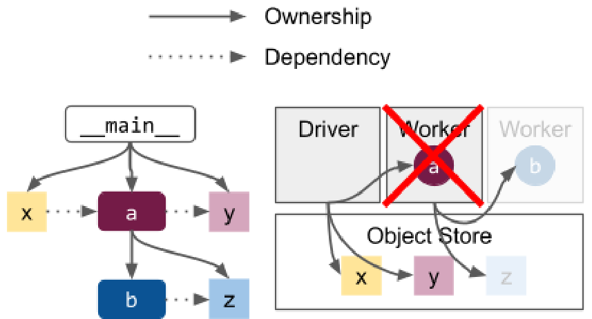

# Ray v2 Architecture 白皮书 · Failure Model（故障模型）中英对照

> **来源**：Ray v2 Architecture 白皮书（Ray Team，2022 年 10 月）· Failure Model 章
> **原文**：[Ray v2 Architecture（Google Docs）](https://docs.google.com/document/d/1tBw9A4j62ruI5omIJbMxly-la5w4q_TjyJgJL_jN2fI/preview)；英文全文副本见 [original/Ray-2.0-Architecture-whitepaper.md](../original/Ray-2.0-Architecture-whitepaper.md)
> **图片**：存于 `images/` 目录，按原文位置插入

---

## System Model（系统模型）

Ray worker 节点被设计为同构的，因此任何单个节点丢失都不会拖垮整个集群。当前唯一的例外是 head 节点，因为它承载着 GCS。在 2.0 中，我们为 [GCS 容错](#fault-tolerance-1)增加了实验性支持，允许 GCS 在最小化对集群其余部分干扰的情况下被重启。

Ray worker nodes are designed to be homogeneous, so that any single node may be lost without bringing down the entire cluster. The current exception to this is the head node, since it hosts the GCS. In 2.0, we have added experimental support for [GCS fault tolerance](#fault-tolerance-1), which allows the GCS to be restarted while minimizing disturbance to the rest of the cluster.

·

所有节点都被分配一个唯一标识符，并通过[心跳](#node-management)相互通信。GCS 负责判定集群成员关系，即哪些节点当前是存活的。GCS 会对任何超时的节点 ID 做 tombstone 处理，这意味着要在该节点上启动一个新的 raylet 时必须使用不同的节点 ID，才能复用物理资源。一个仍存活的 raylet 如果得知自己已被判定超时，就会退出。节点故障检测目前不处理网络分区：如果一个 worker 节点与 GCS 发生分区，它会被判定超时并标记为死亡。

All nodes are assigned a unique identifier and communicate with each other through [heartbeats](#node-management). The GCS is responsible for deciding the membership of a cluster, i.e. which nodes are currently alive. The GCS tombstones any node ID that times out, meaning that a new raylet must be started on that node with a different node ID in order to reuse the physical resources. A raylet that is still alive exits if it hears that it has been timed out. Failure detection of a node currently does not handle network partitions: if a worker node is partitioned from the GCS, it will be timed out and marked as dead.

·

每个 raylet 都会把任何**本地** worker 进程的死亡上报给 GCS。GCS 广播这些故障事件，并用它们来处理 [Actor 死亡](#actor-death)。所有 worker 进程都与其所在节点上的 raylet 命运共享。

Each raylet reports the death of any **local** worker process to the GCS. The GCS broadcasts these failure events and uses them to handle [actor death](#actor-death). All worker processes fate-share with the raylet on their node.

·

raylet 负责防止单个 worker 进程失败后集群资源与系统状态的泄漏。对于（本地或远程的）已失败的 worker 进程，每个 raylet 负责：

The raylets are responsible for preventing leaks in cluster resources and system state after individual worker process failures. For a worker process (local or remote) that has failed, each raylet is responsible for:

* 释放任务执行所需的集群资源，例如 CPU。做法是杀死所有被租给该失败 worker 的 worker（见[资源满足](#resource-fulfillment)）。该失败 worker 发出的任何未完成的资源请求也会被取消。— Freeing cluster resources, such as CPUs, needed for task execution. This is done by killing any workers that were leased to the failed worker (see [Resource Fulfillment](#resource-fulfillment)). Any outstanding resource requests made by the failed worker are also canceled.
* 释放该 worker 所拥有对象占用的分布式对象存储内存（见[内存管理](#memory-management)）。这也会清理对象目录中相关联的条目。— Freeing any distributed object store memory used for objects owned by that worker (see [Memory Management](#memory-management)). This also cleans up the associated entries in the object directory.

---

## Application Model（应用模型）

系统故障模型意味着，Ray 图（graph）中的任务和对象会与其 owner *命运共享*。例如，在这个场景中，如果运行 `a` 的 worker 失败，那么在其子树中创建的任何对象和任务（图中灰显的 `b` 和 `z`）都会被回收。如果 `b` 是在 `a` 子树中创建的 Actor，情况也一样（见 [Actor 死亡](#actor-death)）。这带来几个影响：

The system failure model implies that tasks and objects in a Ray graph will *fate-share* with their owner. For example, if the worker running `a` fails in this scenario, then any objects and tasks that were created in its subtree (the grayed out `b` and `z`) will be collected. The same applies if `b` were an actor created in `a`'s subtree (see [Actor Death](#actor-death)). This has a few implications:

* 任何其他存活进程如果试图获取这类对象的值，都会收到一个应用级异常。例如，如果 `z` 的 ObjectRef 在上述场景中已被传回 driver，driver 会在 `ray.get(z)` 时收到一个错误。— Any other live process will receive an application-level exception if trying to get the value of such an object. For example, if the `z` ObjectRef had been passed back to the driver in the above scenario, the driver would receive an error on `ray.get(z)`.
* 通过修改程序把不同任务放在不同子树中（即通过嵌套函数调用），可以彼此隔离故障。— Failures can be isolated from one another by modifying the program to place different tasks in different subtrees (i.e. through nested function calls).
* 应用会与 driver 命运共享，driver 是所有权树的根。— The application will fate-share with the driver, which is the root of the ownership tree.

避免命运共享行为的主要应用手段是使用 [detached Actor](#actor-death)，它可以活过其原始 driver 的生命周期，并且只能通过程序中的显式调用来销毁。detached Actor 自身可以拥有任何其他任务和对象，这些任务和对象在被销毁后反过来与该 Actor 命运共享。

The main application option to avoid fate-sharing behavior is to use a [detached actor](#actor-death), which may live past the lifetime of its original driver and can only be destroyed through an explicit call from the program. The detached actor itself can own any other tasks and objects, which in turn will fate-share with the actor once destroyed.

·

Ray 提供了一些选项来辅助透明恢复，包括自动[任务重试](https://docs.ray.io/en/latest/ray-core/tasks/fault-tolerance.html)和 [Actor 重启](https://docs.ray.io/en/latest/ray-core/actors/fault-tolerance.html)。自 v1.3 起，[对象落盘](https://www.google.com/url?q=https://docs.google.com/document/d/1lAy0Owi-vPz2jEqBSaHNQcy2IBSDEHyXNOQZlGuj93c/edit?pli%3D1%23heading%3Dh.7ce0zjt0shwh&sa=D&source=editors&ust=1619659972081000&usg=AOvVaw32OCMijOnRdBmCyimba4xs)也可以让对象在其 owner 生命周期之后继续存在。自 v2.0 起，Ray 默认对非 Actor 任务启用[对象重建](#object-failure)。

Ray provides some options to aid in transparent recovery, including automatic [task retries](https://docs.ray.io/en/latest/ray-core/tasks/fault-tolerance.html) and [actor restart](https://docs.ray.io/en/latest/ray-core/actors/fault-tolerance.html). As of v1.3, [object spilling](https://www.google.com/url?q=https://docs.google.com/document/d/1lAy0Owi-vPz2jEqBSaHNQcy2IBSDEHyXNOQZlGuj93c/edit?pli%3D1%23heading%3Dh.7ce0zjt0shwh&sa=D&source=editors&ust=1619659972081000&usg=AOvVaw32OCMijOnRdBmCyimba4xs) can also be used to allow objects to persist past the lifetime of their owner. As of v2.0, Ray enables [object reconstruction](#object-failure) by default for non-actor tasks.
