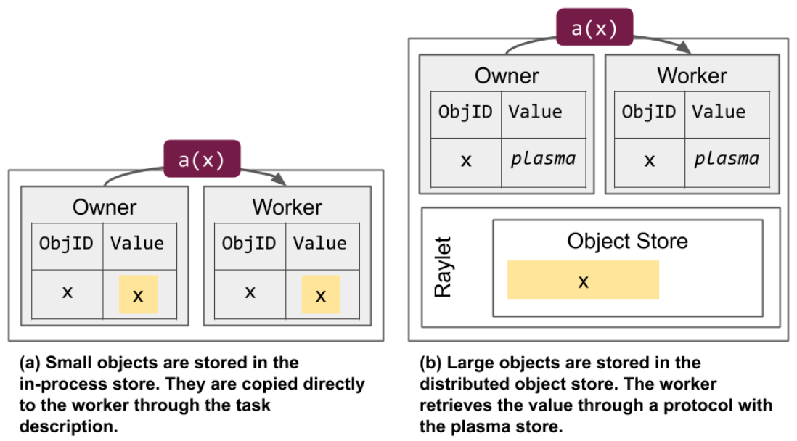
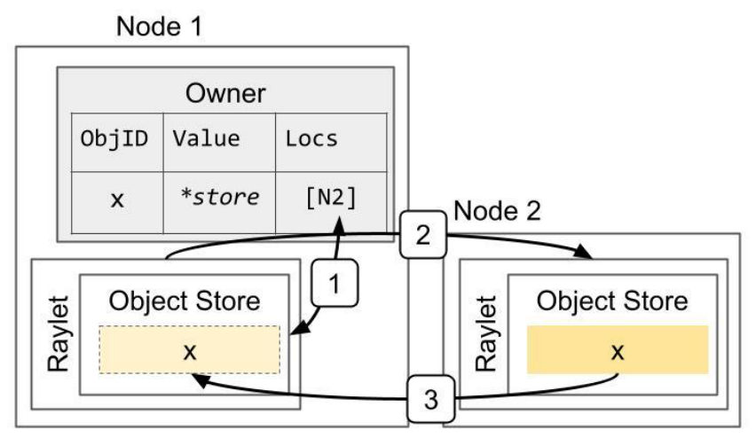
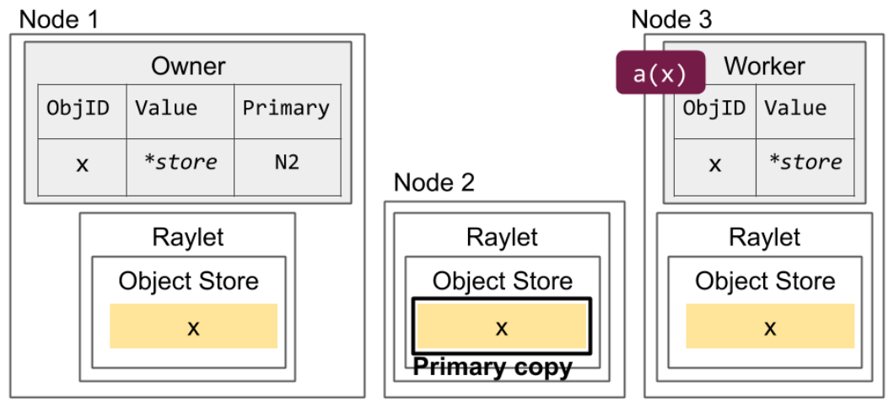
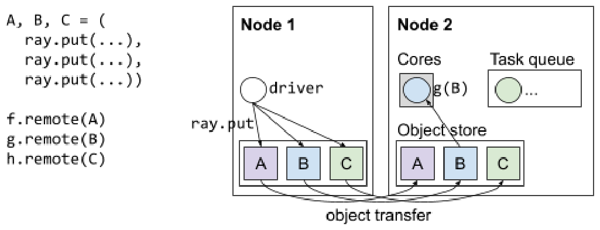
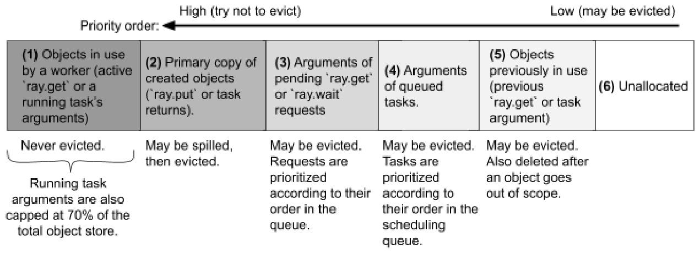
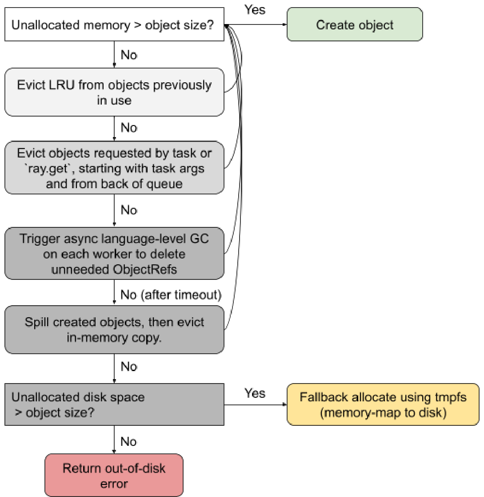
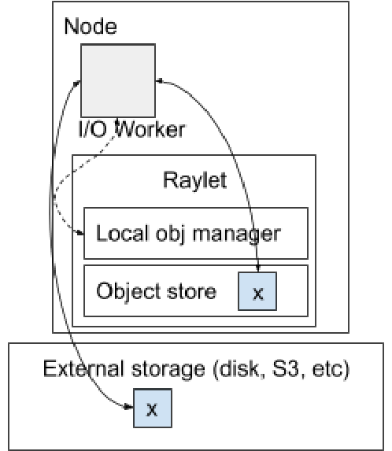

# Ray v2 Architecture 白皮书 · Object Management（对象管理）中英对照

> **来源**：Ray v2 Architecture 白皮书，Ray Team，2022 年 10 月 · Object Management 章
> **原文**：[Ray v2 Architecture（Google Docs）](https://docs.google.com/document/d/1tBw9A4j62ruI5omIJbMxly-la5w4q_TjyJgJL_jN2fI/preview)；英文全文副本见 [original/Ray-2.0-Architecture-whitepaper.md](../original/Ray-2.0-Architecture-whitepaper.md)
> **图片**：共 7 张，由 PDF 原位渲染（200 DPI），存于 `images/`，按原文位置插入
>
> 每段为「中文译文 + 英文原文」上下对照。代码块按 PDF 原始换行重建（官方 md 导出丢失了换行）。

---



*进程内存储（in-process store）与分布式对象存储（distributed object store）的对比。图中展示了提交一个依赖对象 `x` 的任务 `a` 时，两种内存分配方式的差异。*

*In-process store vs the distributed object store. This shows the differences in how memory is allocated when submitting a task (`a`) that depends on an object (`x`).*

---

一般而言，小对象存储在其 owner 的**进程内存储**中，大对象则存储在**分布式对象存储**中。这样设计是为了降低每个对象的内存占用与解析耗时。注意在后一种情况下，进程内存储中仍会存放一个占位对象（placeholder object），用于标示该对象实际存放在分布式对象存储里。

In general, small objects are stored in their owner’s **in-process store** while large objects are stored in the **distributed object store**. This decision is meant to reduce the memory footprint and resolution time for each object. Note that in the latter case, a placeholder object is stored in the in-process store to indicate the object is actually stored in the distributed object store.

---

进程内存储中的对象可以通过直接内存拷贝快速解析，但当被多个进程引用时，由于会产生额外副本，内存占用可能更高。单个 worker 的进程内存储容量还受限于该机器的内存容量，这也限制了任一时刻可被引用的此类对象总数。对于被反复引用的对象，吞吐还可能受 owner 进程处理能力的制约。

Objects in the in-process store can be resolved quickly through a direct memory copy but may have a higher memory footprint when referenced by many processes due to the additional copies. The capacity of a single worker’s in-process store is also limited to the memory capacity of that machine, limiting the total number of such objects that can be in reference at any given time. For objects that are referenced many times, throughput may also be limited by the processing capacity of the owner process.

---

相比之下，解析分布式对象存储中的对象，至少需要一次从 worker 到其本地共享内存存储的 RPC；如果本地共享内存存储中还没有该对象的副本，则需要更多次 RPC。另一方面，由于共享内存存储基于共享内存实现，同一节点上的多个 worker 可以引用同一份对象副本。若该对象支持[零拷贝反序列化](https://docs.ray.io/en/latest/ray-core/objects/serialization.html)，就能降低整体内存占用。使用分布式内存还让进程得以引用并不在本地的对象——也就是说，一个进程可以引用总大小超过单机内存容量的对象集合。最后，由于一个对象的多个副本可以分布在不同节点上，吞吐能够随分布式对象存储的节点数一起扩展。

In contrast, resolution of an object in the distributed object store requires at least one RPC from the worker to the worker’s local shared memory store. Additional RPCs may be required if the worker’s local shared memory store does not yet contain a copy of the object. On the other hand, because the shared memory store is implemented with shared memory, multiple workers on the same node can reference the same copy of an object. This can reduce the overall memory footprint if an object can be [deserialized with zero copies](https://docs.ray.io/en/latest/ray-core/objects/serialization.html). The use of distributed memory also allows a process to reference an object without having the object local, meaning that a process can reference objects whose total size exceeds the memory capacity of a single machine. Finally, throughput can scale with the number of nodes in the distributed object store, as multiple copies of an object may be stored at different nodes.

---

代码引用：

Code references:

---

* [src/ray/core_worker/store_provider/memory_store/memory_store.cc](https://github.com/ray-project/ray/blob/master/src/ray/core_worker/store_provider/memory_store/memory_store.cc)
* [src/ray/core_worker/store_provider/plasma_store_provider.cc](https://github.com/ray-project/ray/blob/master/src/ray/core_worker/store_provider/plasma_store_provider.cc)
* [src/ray/common/buffer.h](https://github.com/ray-project/ray/blob/master/src/ray/common/buffer.h)
* [src/ray/protobuf/object_manager.proto](https://github.com/ray-project/ray/blob/master/src/ray/protobuf/object_manager.proto)

---

## Object resolution（对象解析）

---

**解析（resolution）** 是把 `ObjectRef` 转换为底层物理值的过程，即调用 `ray.get` 或将其作为任务参数传递时发生的事情。`ObjectRef` 由两个字段构成：

*Resolution* is the process by which an `ObjectRef` is converted to the underlying physical value, i.e. when calling `ray.get` or passing as a task argument. The `ObjectRef` comprises two fields:

---

* 一个唯一的 28 字节[标识符](https://github.com/ray-project/ray/blob/master/src/ray/design_docs/id_specification.md)。它由「产生该对象的任务 ID」与「该任务目前已创建的对象个数」拼接而成。
* 该对象 owner（一个 worker 进程）的地址。它包含该 worker 进程的唯一 ID、IP 地址与端口，以及本地 raylet 的唯一 ID。

* A unique 28-byte [identifier](https://github.com/ray-project/ray/blob/master/src/ray/design_docs/id_specification.md). This is a concatenation of the ID of the task[^4] that produced the object and the integer number of objects created by that task so far.
* The address of the object’s owner (a worker process). This consists of the worker process’s unique ID, IP address and port, and local raylet’s unique ID.

---

小对象的解析方式是直接从 owner 的进程内存储中拷贝。例如，若 owner 调用 `ray.get`，系统会从本地进程内存储中查找并反序列化该值；若 owner 提交了一个依赖该对象的任务，它会把值直接拷贝进任务描述（task specification）中，即对该对象做**内联（inline）**。同理，若某个借用者（borrower）尝试解析该值，对象值会直接从 owner 处拷贝，绕过下一节描述的大对象解析协议。

Small objects are resolved by copying them directly from the owner’s in-process store. For example, if the owner calls `ray.get`, the system looks up and deserializes the value from the local in-process store. If the owner submits a dependent task, it *inlines* the object by copying the value directly into the task specification. Similarly, if a borrower attempts to resolve the value, the object value is copied directly from the owner, bypassing the large object resolution protocol described in the next section.

---



*解析一个大对象。对象 x 最初创建于 Node 2 上，例如因为返回该值的任务在该节点执行。图中展示了 owner（即任务的调用方）调用 `ray.get` 时的步骤：1）在 owner 处查找对象的位置；2）选定一个位置并发送获取对象副本的请求；3）接收对象。*

*Resolving a large object. The object x is initially created on Node 2, e.g., because the task that returned the value ran on that node. This shows the steps when the owner (the caller of the task) calls `ray.get`: 1) Lookup object’s locations at the owner. 2) Select a location and send a request for a copy of the object. 3) Receive the object.*

---

大对象存储在分布式对象存储中，必须通过一个分布式协议来解析。如果该对象已经存在于引用持有者（reference holder）的本地共享内存存储中，持有者可以通过 IPC 获取该对象。这会返回一个指向共享内存的指针，而该内存可能同时被同节点上的其他 worker 引用。

Large objects are stored in the distributed object store and must be resolved with a distributed protocol. If the object is already stored in the reference holder’s local shared memory store, the reference holder can retrieve the object over IPC. This returns a pointer to shared memory that may be simultaneously referenced by other workers on the same node.

---

如果对象在本地共享内存存储中不可用，引用持有者会通知其本地 raylet，由后者尝试从远端 raylet 拉取一份副本。raylet 会从对象目录（object directory）中查出位置，并向其中一个 raylet 请求传输。自 Ray v1.3+ 起，对象目录存储在各个 owner 处（此前存储在 GCS 中）。

If the object is not available in the local shared memory store, the reference holder notifies its local raylet, which then attempts to fetch a copy from a remote raylet. The raylet looks up the locations from the object directory and requests a transfer from one of these raylets. The object directory is stored at the owners as of Ray v1.3+ (previously it was stored in the GCS).

---

代码引用：

Code references:

---

* [src/ray/common/id.h](https://github.com/ray-project/ray/blob/master/src/ray/common/id.h)
* [src/ray/object_manager/ownership_based_object_directory.h](https://github.com/ray-project/ray/blob/master/src/ray/object_manager/ownership_based_object_directory.h)

---

## Memory management（内存管理）

---

对远程任务而言，对象值由执行该任务的 worker 计算得出。若值较小，该 worker 会直接把值回复给 owner，值随即被拷贝进 owner 的进程内存储。当所有引用都离开作用域后，该值被删除。

For remote tasks, the object value is computed by the executing worker. If the value is small, the worker replies directly to the owner with the value, which is copied into the owner’s in-process store. This value is deleted once all [references](#reference-counting) go out of scope.

---



*主副本（primary copy）与可驱逐副本的对比。主副本（Node 2）不可被驱逐；而 Node 1（经由 `ray.get` 产生）和 Node 3（经由任务提交产生）上的副本在内存压力下可以被驱逐。*

*Primary copy versus evictable copies. The primary copy (Node 2) is ineligible for eviction. However, the copies on Nodes 1 (created through `ray.get`) and 3 (created through task submission) can be evicted under memory pressure.*

---

若值较大，执行任务的 worker 会把值存入其本地共享内存存储。这份共享内存对象的最初副本被称为**主副本（primary copy）**。主副本的特殊之处在于：只要还有引用处于作用域内，它就不会被驱逐。raylet 通过持有该对象所在物理共享内存缓冲区的一个引用来「固定（pin）」主副本，从而阻止对象存储将其驱逐。相对地，该对象的其他副本在本地内存压力下可能被 LRU 驱逐——除非有 Python worker 正在使用该对象。

If the value is large, the executing worker stores the value in its local shared memory store. This initial copy of a shared memory object is known as the *primary copy*. The primary copy is unique in that it will not be evicted as long as there is a [reference](#reference-counting) in scope. The raylet “pins” the primary copy by holding a reference to the physical shared memory buffer where the object is stored, which prevents the object store from evicting it. In contrast, other copies of the object may get evicted by LRU if under local memory pressure, unless a Python worker is actively using the object.

---

多数情况下，主副本就是该对象最先被创建的那份副本。如果最初副本因故障丢失，owner 会根据该对象现存的位置信息，尝试指定一个新的主副本。

In most cases, the primary copy is the first copy of the object to be created. If the initial copy is lost through a [failure](#object-failure), the owner will attempt to designate a new primary copy based on the object’s available locations.

---

一旦对象的引用计数归零，该对象的所有副本最终都会被自动垃圾回收。小对象由 owner 立即从进程内存储中擦除；大对象则由各 raylet 异步地从分布式对象存储中擦除。

Once the object [ref count](#reference-counting) goes to 0, all copies of the object are eventually and automatically garbage-collected. Small objects are erased immediately from the in-process store by the owner. Large objects are asynchronously erased from the distributed object store by the raylets.

---

raylet 同时还负责管理分布式对象传输：依据对象当前被需要的位置来创建额外副本，例如当一个依赖该对象的任务被调度到远端节点时。

The raylets also manage distributed object transfer, which creates additional copies of an object based on where the object is currently needed, e.g., if a task that depends on the object is scheduled to a remote node.

---



*一个节点上可以存储的对象类型。对象要么由某个 worker 创建（如 node 1 上的 A、B、C），要么因为本地 worker 需要而从别的节点传输来一份副本（如 node 2 上的 A、B、C）。*

*The types of objects that can be stored on a node. Objects are either created by a worker (such as A, B, and C on node 1), or a copy is transferred from a different node because it is needed by a local worker (such as A, B, and C on node 2).*

---

因此，一个对象之所以会存放在某节点的共享内存对象存储中，可能出于以下任一原因：

Thus, an object may be stored in a node’s shared-memory object store due to any of the following reasons:

---

1. **被本地 worker 通过 `ray.get` 或 `ray.wait` 请求。** 这类对象在 worker 完成 `ray.get` 请求后即可释放。注意，对于支持[零拷贝反序列化](https://docs.ray.io/en/latest/ray-core/objects/serialization.html)的对象，`ray.get` 返回的 Python 值直接指向共享内存缓冲区，因此该对象会一直被「固定」，直到这个 Python 值离开作用域。
2. **是此前在该节点上执行的某个任务的返回值。** 这类对象在不再有引用指向它、或该对象已被落盘（spilled）之后即可释放。
3. **由该节点上的某个本地 worker 通过 `ray.put` 创建。** 这类对象在不再有引用指向它之后即可释放（上图中 node 1 上的对象 A、B、C 即属此类）。
4. **是该节点上排队中或正在执行的某个任务的参数。** 这类对象在任务完成、或不再处于排队状态后即可释放。上图中 node 2 上的 B 和 C 都属此类，因为它们的下游任务 g 和 h 尚未结束。
5. **此前在该节点上被需要过，例如被某个已完成的任务使用。** 上图中 node 2 上的对象 A 属此类，因为 f 已经执行完毕。这类对象在内存压力下可能按本地 LRU 被驱逐；当对应的 `ObjectRef` 离开作用域时，它们也会被积极地（eagerly）驱逐（例如 f 结束后再调用 `del A`，A 就会从 node 2 上删除）。

1. It was requested by a local worker process through `ray.get` or `ray.wait`. These can be freed once the worker finishes the `ray.get` request. Note that for objects that can be [zero-copy deserialized](https://docs.ray.io/en/latest/ray-core/objects/serialization.html), the Python value returned from `ray.get` refers directly to the shared-memory buffer, so the object will be “pinned” until this Python value goes out of scope.
2. It was returned by a previous task that executed on that node. These can be freed once there are no more references to the object OR once the object has been [spille](https://www.google.com/url?q=https://docs.google.com/document/d/1lAy0Owi-vPz2jEqBSaHNQcy2IBSDEHyXNOQZlGuj93c/edit?pli%3D1%23heading%3Dh.7ce0zjt0shwh&sa=D&source=editors&ust=1619659972080000&usg=AOvVaw3csCMrVKF6g_g5hckEz1YV)[d](https://docs.google.com/document/d/1lAy0Owi-vPz2jEqBSaHNQcy2IBSDEHyXNOQZlGuj93c/edit?pli=1#heading=h.7ce0zjt0shwh).
3. It was created through `ray.put` by a local worker process on that node. These can be freed once there are no more references to the object (objects A, B, and C on node 1 in the above diagram).
4. It is the argument of a task queued or executing on that node. These can be freed once the task completes or is no longer queued. Objects B and C on node 2 are both examples of this, since their downstream tasks g and h have not yet finished.
5. It was previously needed on this node, e.g., by a completed task. Object A on node 2 is an example of this, since f has already finished executing. These objects may be evicted based on local LRU if under memory pressure. They are also eagerly evicted when the ObjectRef goes out of scope (e.g., A is deleted from node 2 after f finishes and after calling `del A`).

---

### Handling out-of-memory cases（处理内存不足）

---

对于小对象，Ray 目前并未对每个 worker 的进程内存储施加内存上限。因此，若作用域内的小对象数量过多，可能导致 owner 进程因内存不足（OOM）而被杀死。

For small objects, Ray currently does not impose a memory limit on each worker’s in-process store. Thus, an excessive number of small objects in scope may cause the owner process to be killed from out-of-memory.

---

Ray 对共享内存对象施加了一个硬性上限，由 raylet 负责强制执行。下图按大致的优先级，可视化地展示了一个节点上可能存储的各类共享内存对象。

Ray imposes a hard limit on shared-memory objects. The raylet is responsible for enforcing this limit. Below is a visualization of the different types of shared-memory objects that may be stored on a node, with a rough priority.

---



**译注**（原文此图无图注，以下为图中内容的中文转述）：优先级自左向右由高到低——左侧「尽量不驱逐」，右侧「可被驱逐」。**(1)** 正被某 worker 使用的对象（活跃的 `ray.get`，或正在运行的任务的参数）：永不驱逐；正在运行的任务的参数总量同时还被限制在整个对象存储的 70% 以内。**(2)** 已创建对象的主副本（来自 `ray.put` 或任务返回值）：可以先落盘，然后再驱逐。**(3)** 待处理的 `ray.get` / `ray.wait` 请求的参数：可被驱逐，请求按其在队列中的顺序定优先级。**(4)** 排队中任务的参数：可被驱逐，任务按其在调度队列中的顺序定优先级。**(5)** 此前曾被使用的对象（之前的 `ray.get` 或任务参数）：可被驱逐，并且在对象离开作用域后会被删除。**(6)** 未分配内存。

---

对象创建请求会被 raylet 排队，待 (6) 中有足够内存可用时再予服务。若需要更多内存，raylet 会从 (3)–(5) 中挑选对象驱逐以腾出空间。即便这些对象全部被驱逐，raylet 仍可能没有空间容纳新对象——当应用所需的总内存超过集群内存容量时就会这样。

Object creation requests are queued by the raylet and served once enough memory is available in (6) to create the object. If more memory is needed, the raylet will choose objects to evict from (3)-(5) to make space. Even after all of these objects are evicted, the raylet may not have space for the new object. This can happen if the total memory needed by the application is greater than the cluster’s memory capacity.

---

若驱逐之后仍需更多空间，raylet 会先在整个集群的每个 worker 上触发语言层的垃圾回收。语言前端看到的 `ObjectRef` 本身非常小，因此不太可能触发常规的语言级 GC 机制（例如 Python 的 `gc.collect()`）。然而一个 `ObjectRef` 的实际内存占用可能非常大，因为其物理值存放在 Ray 对象存储的别处，甚至在与语言层 `ObjectRef` 不同的节点上。所以，当任一 Ray 对象存储达到容量上限时，我们会在**所有** worker 上触发语言级垃圾回收，以清理不再需要的 `ObjectRef`，从而让物理值得以从对象存储中释放。

If more space is needed after eviction, the raylet first triggers language-specific garbage collection at each of the workers in the entire cluster. The ObjectRefs seen in the language frontend appear to be very small, and thus are unlikely to trigger the usual language-specific garbage collection mechanisms (e.g., Python’s gc.collect()). However, the actual memory footprint of an ObjectRef can be very large, since the physical value is stored elsewhere in Ray’s object store, and potentially on a different node(s) from the language-level ObjectRef. Thus, when any Ray object store reaches capacity, we trigger the language-level garbage collection at *all* workers, which cleans up any unneeded ObjectRefs and allows the physical values to be freed from the object store.

---

raylet 会启动一个超时计时，给 worker 一段时间异步回收 `ObjectRef`，之后才触发向[外部存储](https://docs.google.com/document/d/1lAy0Owi-vPz2jEqBSaHNQcy2IBSDEHyXNOQZlGuj93c/edit?pli=1#heading=h.7ce0zjt0shwh)落盘（spilling）。落盘允许 (2) 中的主副本即便仍被引用，也能从对象存储中释放。如果落盘被禁用，应用将在一个可配置的超时后收到 `ObjectStoreFullError`。落盘代价可能很高，会给任务执行带来较长延迟；因此 Ray 还会在对象存储达到某个可配置阈值（默认 80%）时就积极地提前落盘，以尽量保证有可用空间。

The raylet starts a timeout to give workers time to asynchronously garbage-collect ObjectRefs, before triggering spilling to [external storage](https://docs.google.com/document/d/1lAy0Owi-vPz2jEqBSaHNQcy2IBSDEHyXNOQZlGuj93c/edit?pli=1#heading=h.7ce0zjt0shwh). Spilling allows primary copies in (2) to be freed from the object store even though the objects may still be referenced. If spilling is disabled, the application will instead receive an ObjectStoreFullError after a configurable timeout. Spilling can be expensive and add long delays to task execution; thus Ray also eagerly spills objects once the object store reaches a configurable threshold (80% by default) to try to ensure available space.

---

注意，即便启用了对象落盘，对象存储仍可能耗尽内存——当同时处于 (1) 使用中的对象过多时就会发生。为缓解这一点，raylet 会限制正在执行的任务的参数总大小，因为参数在任务完成前无法释放。默认上限是对象存储内存的 70%。这保证了只要没有其他对象因 `ray.get` 请求而被固定，一个任务就应当能够创建大小达对象存储容量 30% 的对象。

Note that the object store can still run out of memory even with object spilling enabled. This can occur if there are too many objects in use (1) at the same time. To mitigate this, the raylet limits the total size of the executing tasks’ arguments, since an argument cannot be released until the task completes. The default cap is 70% of the object store memory. This ensures that as long as there are no other objects actively pinned due to a `ray.get` request, it should be possible for a task to create an object that is 30% of the object store’s capacity.

---

目前，raylet 并未对「因 worker 的 `ray.get` 请求而被固定的对象」实施类似的上限，因为简单粗暴地这样做可能在任务之间引入死锁。因此，若存在过多针对大对象的并发 `ray.get` 请求，raylet 仍可能耗尽共享内存。此时，raylet 会以**回退分配（fallback-allocate）** 的方式，把对象作为内存映射文件分配在本地磁盘上（默认 `/tmp`）。回退分配的对象因 I/O 开销而性能较差，但它让应用在对象存储已满时仍能继续运行。若本地磁盘也已满，回退分配将失败，应用随后会收到 `OutOfDiskError`。

Currently, the raylet does not implement a similar cap for objects pinned by workers’ `ray.get` request, as doing so naively could introduce deadlock between tasks. Thus, if there are excessive concurrent `ray.get` requests of large objects, the raylet could still run out of shared memory. When this happens, the raylet *fallback-allocates* objects as memory-mapped files on the local disk (/tmp by default). The fallback-allocated objects are less performant due to I/O overhead, but it allows the application to continue running even if the object store is full. The fallback allocation will fail if the local disk is full, after which the application will receive an OutOfDiskError.

---



*raylet 处理对象创建请求的流程图。若本地对象存储没有足够可用内存来服务该请求，raylet 会尝试一系列步骤来腾出内存。*

*Raylet flowchart for handling an object creation request. If there is not enough available memory in the local object store to serve the request, the raylet attempts a series of steps to make memory available.*

---

代码引用：

Code references:

---

* [src/ray/object_manager/plasma/store.cc](https://github.com/ray-project/ray/blob/master/src/ray/object_manager/plasma/store.cc)
* [src/ray/object_manager/plasma/create_request_queue.cc](https://github.com/ray-project/ray/blob/master/src/ray/object_manager/plasma/create_request_queue.cc)
* [src/ray/object_manager/plasma/object_lifecycle_manager.cc](https://github.com/ray-project/ray/blob/master/src/ray/object_manager/plasma/object_lifecycle_manager.cc)

---

### Object spilling（对象落盘）

---

Ray 默认支持在对象存储容量耗尽后，把对象落盘到外部存储。这使得核外（out-of-core）数据处理和内存密集型分布式应用成为可能。

Ray has default support for spilling objects to external storage once the capacity of the object store is used up. This enables out-of-core data processing and memory-intensive distributed applications.

---

外部存储通过可插拔接口实现。默认支持两类外部存储：

External storage is implemented with a pluggable interface. There are two types of external storage supported by default:

---

* **本地存储（稳定）**。默认选择本地磁盘，这样用户无需任何额外配置即可使用对象落盘功能。
* **分布式存储（实验性，目前提供 Amazon S3）**。访问速度可能更慢，但能提供更好的容错性，因为数据可以在 worker 节点故障后存活。

* Local storage (stable). Local disk is selected by default so that Ray users can use the object spilling feature without any additional configuration.
* Distributed storage (experimental, currently offering Amazon S3). Speed of access may be slower but this can provide better fault tolerance, since data will survive worker node failures.

---

对象落盘协议涉及四个组件：

Four components are involved in the object spilling protocol.

---

* raylet 内部：
  * **本地对象管理器（Local object manager）**：跟踪对象元数据（如在外部存储中的位置），并协调 IO worker 以及与其他 raylet 的通信。
  * **共享内存对象存储**
* **IO worker**：负责落盘与恢复对象的 Python 进程。
* **外部存储**：存放无法装入对象存储内存的 Ray 对象。

* Within the raylet:
  * Local object manager: Keeps track of object metadata, such as the location in external storage, and coordinates IO workers and communication with other raylets.
  * Shared-memory object store
* IO workers: Python processes that spill and restore objects.
* External storage: Stores Ray objects that cannot fit into the object store memory.

---



*落盘或恢复一个对象的设计概览。raylet 管理一个 I/O worker 池。I/O worker 在本地共享内存对象存储与外部存储之间读写数据。*

*An overview of the design for spilling or restoring an object. The raylet manages a pool of I/O workers. I/O workers read/write from the local shared-memory object store and external storage.*

---

当 Ray 没有足够[内存容量](#handling-out-of-memory-cases处理内存不足)来创建对象时，就会启动对象落盘。注意 Ray 只落盘对象的**主副本**，即通过执行任务或 `ray.put` 创建的那份最初副本。非主副本可以立即驱逐；这一设计保证了集群中每个对象最多只有一份落盘副本。主副本只有在落盘之后、或应用中不再有任何引用时，才可被驱逐。

When Ray does not have enough [memory capacity](#handling-out-of-memory-cases) to create objects, it initiates object spilling. Note that Ray only spills the [primary copy](#memory-management) of an object: this is the initial copy of the object, created by executing a task or through `ray.put`. Non-primary copies can be evicted immediately, and this design ensures that we have at most one spilled copy of each object in the cluster. Primary copies are only evictable after object spilling, or if there are no more references in the application.

---

协议如下，并会不断重复直至腾出足够空间来创建所有待处理的对象：

The protocol is as follows, repeating until enough space is made to create any pending objects:

---

1. raylet（本地对象管理器）找出本地对象存储中的所有主副本。
2. raylet 把这些对象的落盘请求发送给某个 IO worker。
3. IO worker 把对象值连同其元数据写入外部存储。
4. 主副本落盘到外部存储后，raylet 用落盘对象的位置更新对象目录。
5. 对象存储驱逐这些主副本。
6. 一旦某对象的引用计数归零，owner 通知 raylet 该对象可以移除。raylet 随后向某个 IO worker 发送请求，把该对象从外部存储中删除。

1. Raylet (local object manager) finds all primary copies in the local object store.
2. Raylet sends spill requests for these objects to an IO worker.
3. An IO worker writes the object value along with its metadata to external storage.
4. Once the primary copies are spilled to external storage, the raylet updates the object directory with the location of the spilled objects.
5. The object store evicts the primary copies.
6. Once an object’s [reference count](#reference-counting) goes to 0, the owner notifies the raylet that the object can be removed. The raylet sends a request to an IO worker to remove the object from external storage.

---

落盘的对象会在被需要时恢复。当某对象被请求时，raylet 要么向本地 IO worker 发送恢复请求、从外部存储把对象恢复回来，要么从另一节点上的 raylet 拉取一份副本。远端 raylet 可能已把该对象落盘到其本地存储（例如本地 SSD）；在这种情况下，远端 raylet 会直接从本地存储读取该对象并发送到网络上。

Spilled objects are restored as they are needed. When an object is requested, the Raylet either restores the object from external storage by sending a restore request to a local IO worker, or it fetches a copy from a raylet on a different node. The remote raylet might have the object spilled on local storage (e.g., local SSD). In this case, the remote raylet directly reads the object from local storage and sends it to the network.

---

每个文件只放一个对象地落盘大量小对象，会因 IO 开销而效率低下；对本地存储而言，操作系统的 inode 会很快耗尽。如果对象小于 100MB，Ray 会把多个对象融合（fuse）进单个文件以避免该问题。

Spilling many small objects with one object per file is inefficient due to IO overhead. For local storage, the OS would run out of inodes very quickly. If objects are smaller than 100MB, Ray fuses objects into a single file to avoid this problem.

---

Ray 还支持多目录落盘，即利用挂载在不同位置的多个文件系统。当同一台机器挂载了多块本地磁盘时，这有助于提升落盘带宽与外部存储容量上限。

Ray also supports multi-directory spilling, meaning it utilizes multiple file systems mounted at different locations. This helps to improve spilling bandwidth and maximum external storage capacity when there are multiple local disks attached to the same machine.

---

已知限制：

Known limitations:

---

- 使用本地文件存储时，若对象所在节点丢失，落盘的对象也会丢失。此时 Ray 会按「对象从共享内存中丢失」的方式尝试[恢复](#object-failure对象故障)该对象。
- 若 owner 丢失，落盘的对象将不可达，因为对象的位置信息由 owner 保存。
- 正被应用使用的对象会被「固定」。例如，若 Python driver 持有一个通过 `ray.get` 获得的对象的原始指针（如共享内存上的 numpy array 视图），该对象就被固定。这类对象在应用释放它们之前不可落盘。正在运行的任务的参数在任务执行期间同样被固定。

- When using local file storage, spilled objects are lost if the node where the object is stored is lost. In this case, Ray will attempt to [recover](#object-failure) the object as if it was lost from shared memory.
- A spilled object is not reachable if the owner is lost, since the owner stores the object’s locations.
- Objects that are currently in use by the application are “pinned”. For example, if the Python driver has a raw pointer to an object that was obtained by ray.get, (e.g., a numpy array view over shared memory), then the object is pinned. These objects are not spillable until the application releases them. Arguments of a running task are also pinned for the task’s duration.

---

代码引用：

Code references:

---

* [src/ray/raylet/local_object_manager.cc](https://github.com/ray-project/ray/blob/master/src/ray/raylet/local_object_manager.cc)
* [python/ray/_private/external_storage.py](https://github.com/ray-project/ray/blob/master/python/ray/_private/external_storage.py)

---

## Reference Counting（引用计数）

---

每个 worker 为它所拥有的每个对象维护一个引用计数。owner 的本地引用计数包含两部分：本地 Python 引用计数，以及由该 owner 提交、且依赖该对象的待完成任务数量。前者在 Python `ObjectRef` 被释放时递减；后者在依赖该对象的任务成功结束时递减（注意，以应用级异常结束的任务也算作成功）。

Each worker stores a ref count for each object that it owns. The owner’s local ref count includes the local Python ref count and the number of pending tasks submitted by the owner that depend on the object. The former is decremented when a Python `ObjectRef` is deallocated. The latter is decremented when a task that depends on the object successfully finishes (note that a task that ends in an application-level exception counts as a success).

---

`ObjectRef` 也可以通过被存放在另一个对象内部，从而拷贝到另一个进程。接收到 `ObjectRef` 副本的进程称为**借用者（borrower）**。例如：

`ObjectRef`s can also be copied to another process by storing them inside another object. The process that receives the copy of the `ObjectRef` is known as a *borrower*. For example:

---

```python
@ray.remote
def temp_borrow(obj_refs):
    # Can use obj_refs temporarily as if I am the owner.
    x = ray.get(obj_refs[0])

@ray.remote
class Borrower:
    def borrow(self, obj_refs):
        # We save the ObjectRef in local state, so we are still borrowing
        # the object once this task finishes.
        self.x = obj_refs[0]

x_ref = foo.remote()
temp_borrow.remote([x_ref])  # Passing x_ref in a list will allow `borrow`
                             # to run before the value is ready.
b = Borrower.remote()
b.borrow.remote([x_ref])     # x_ref can also be borrowed permanently by an
                             # actor.
```

---

这些引用通过一个[分布式引用计数协议](https://docs.google.com/document/d/1S7rsDwFk3udIFeVUPC0_7F25lp5JWKXWrFVO3VimCEA/edit?usp=sharing)来跟踪。简而言之，每当一个引用「逃出」本地作用域时，owner 就增加本地引用计数。例如在上面的代码中，owner 在调用 `temp_borrow.remote` 与 `b.borrow.remote` 时，都会为 `x_ref` 递增待完成任务计数。任务结束后，它会向其 owner 回复一份「仍在被借用的引用」清单。在上述代码中，`temp_borrow` 的 worker 会回复说它已不再借用 `x_ref`，而 `Borrower` actor 会回复说它仍在借用 `x_ref`。

These references are tracked through a [distributed reference counting protocol](https://docs.google.com/document/d/1S7rsDwFk3udIFeVUPC0_7F25lp5JWKXWrFVO3VimCEA/edit?usp=sharing). Briefly, the owner adds to the local ref count whenever a reference “escapes” the local scope. For example, in the above code, the owner would increment the pending task count for x_ref when calling `temp_borrow.remote` and `b.borrow.remote`. Once the task finishes, it replies to its owner with a list of the references that are still being borrowed. For example, in the above code, `temp_borrow`’s worker would reply saying that it is no longer borrowing `x_ref`, while the `Borrower` actor would reply saying that it is still borrowing `x_ref`.

---

如果某个 worker 仍在借用任何引用，owner 就把该 worker 的 ID 加入本地的借用者列表。借用者会维护第二份本地引用计数（与 owner 的类似），而 owner 会要求借用者在其本地引用计数归零时予以回复。此时，owner 便可把该 worker 从借用者列表中移除，并回收该对象。在上面的例子中，`Borrower` actor 永久地借用了该引用，因此 owner 不会释放该对象，直到 `Borrower` actor 本身离开作用域或死亡。

If the worker is still borrowing any references, the owner adds the worker’s ID to a local list of borrowers. The borrower keeps a second local ref count, similar to the owner, and the owner asks the borrower to reply once the borrower’s local ref count has gone to 0. At this point, the owner may remove the worker from the list of borrowers and collect the object. In the above example, the `Borrower` actor is borrowing the reference permanently, so the owner would not free the object until the `Borrower` actor itself goes out of scope or dies.

---

借用者也可以被递归地加入 owner 的列表。当借用者自身又把 `ObjectRef` 传给另一个进程时就会这样。在这种情况下，当该借用者向 owner 回复其本地引用计数为 0 时，它还会一并附上自己新创建的借用者。owner 随后以同样的协议联系这些新的借用者。

Borrowers can also be added recursively to the owner’s list. This happens if the borrower itself passes the `ObjectRef` to another process. In this case, when the borrower responds to the owner that its local ref count is 0, it also includes any new borrowers that it has created. The owner in turn contacts these new borrowers using the same protocol.

---

一个类似的协议被用来跟踪由 owner **返回（returned）** 的 `ObjectRef`。例如：

A similar protocol is used to track `ObjectRef`s that are *returned* by their owner. For example:

---

```python
@ray.remote
def parent():
    y_ref = child.remote()
    x_ref = ray.get(y_ref)
    x = ray.get(x_ref)

@ray.remote
def child():
    x_ref = foo.remote()
    return x_ref
```

---

当 `child` 函数返回时，`x_ref` 的 owner（即执行 `child` 的那个 worker）会标记 `x_ref` 被包含在 `y_ref` 之中。该 owner 随后把 `parent` worker 加入 `x_ref` 的借用者列表。从这里开始，协议与前述类似：owner 向 `parent` worker 发送消息，要求这个借用者在其对 `y_ref` 和 `x_ref` 的引用都离开作用域后予以回复。

When the `child` function returns, the owner of `x_ref` (the worker that executes `child`) would mark that `x_ref` is contained in `y_ref`. The owner would then add the `parent` worker to the list of borrowers for `x_ref`. From here, the protocol is similar to the above: the owner sends a message to the `parent` worker asking the borrower to reply once its references to both `y_ref` and `x_ref` have gone out of scope.

---

| 引用类型 | 说明 | 何时更新 |
| :---- | :---- | :---- |
| Local Python ref count（本地 Python 引用计数） | 本地 `ObjectRef` 实例的数量，等于该 worker 进程内的 Python 引用计数。 | 在新的 Python `ObjectRef` 被分配/释放时递增/递减。 |
| Submitted task count（已提交任务计数） | 依赖该对象、且尚未执行完成的任务数量。 | worker 提交任务时递增（如 `foo.remote(x_ref)`），任务完成时递减。如果对象小到可以存入进程内存储，该计数会提前递减——即在值被拷贝进任务描述时就递减。 |
| Borrowers（借用者集合） | 当前正在借用该 `ObjectRef` 的进程的 worker ID 集合。借用者是指「并非 owner、但持有该 Python `ObjectRef` 的本地实例」的任何 worker。每个借用者自身也维护一份本地借用者集合，从而形成一棵以 owner 为根的借用者树。这使得一个借用者可以把 `ObjectRef` 传给另一个借用者，而无需联系 owner。 | 当某任务被传入一个 `ObjectRef`、并在任务结束后继续使用它时（例如把该 `ObjectRef` 保存进 actor 的本地状态），该任务会通知其调用方自己正在借用该对象；随后调用方 worker 把该任务 worker 的 ID 加入此集合。**owner 侧的移除**：owner 向每个借用者 worker 发送异步 RPC；借用者在其对该 `ObjectRef` 的引用计数归零时回复；owner 在收到该回复、或借用者先行死亡时将其移除。**借用者侧的移除**：worker 等待来自 owner 的 RPC；一旦该 worker 的本地引用计数（本地 Python 计数 + 已提交任务计数）为 0，它就把自己的本地借用者集合放入给 owner 的回复中。owner 由此获知并能够跟踪递归产生的借用者。 |
| Nested count（嵌套计数） | 处于作用域内、且其值包含了所讨论 `ObjectRef` 的那些 `ObjectRef` 的数量。 | 当该 `ObjectRef` 被存入另一个对象时递增（例如 `ray.put([x_ref])` 或 `return x_ref`）；当外层 `ObjectRef` 离开作用域时递减。 |
| Lineage count（血缘计数） | 仅在启用[重建](#object-failure)时维护。指依赖该 `ObjectRef`、且其值存放在分布式对象存储中（因而可能在故障时丢失）的任务数量。 | 当提交一个依赖该对象的任务时递增；当该任务返回的 `ObjectRef` 离开作用域、或该任务完成并把值返回到进程内存储时递减。 |

| Reference type | Description | When is it updated? |
| :---- | :---- | :---- |
| Local Python ref count | Number of local `ObjectRef` instances. This is equal to the worker’s process-local Python ref count. | Incremented/decremented when a new Python `ObjectRef` is allocated/deallocated. |
| Submitted task count | Number of tasks that depend on the object that have not yet completed execution. | Incremented when the worker submits a task (e.g., `foo.remote(x_ref)`). Decremented when the task completes. If the object is small enough to be stored in the in-process store, this count is decremented early, when the object is copied into the task specification. |
| Borrowers | A set of worker IDs for the processes that are currently borrowing the `ObjectRef`. A borrower is any worker that is not the owner and that has a local instance of the Python `ObjectRef`. Each borrower also maintains a local set of borrowers, forming a tree of borrower sets rooted at the owner. This allows a borrower to send the `ObjectRef` to another borrower without having to contact the owner. | When a task is passed an ObjectRef and continues to use it past the end of the task (e.g., saving the ObjectRef in an actor’s local state), the task notifies its caller that it is borrowing the object. Then, the calling worker adds the task worker’s ID to this set. Removal if an owner: The owner sends an async RPC to each of the borrower workers. A borrower responds once its ref count for the `ObjectRef` goes to 0. The owner removes a worker when it receives this reply or if the borrower dies first. Removal if a borrower: The worker waits for RPC from the owner. Once the worker’s local ref count (local Python count + submitted task count) is 0, the worker pops its local set of borrowers into the reply to the owner. In this way, the owner learns of and can track recursive borrowers. |
| Nested count | Number of `ObjectRef`s that are in scope and whose values contain the `ObjectRef` in question. | Incremented when the `ObjectRef` is stored inside another object (e.g., `ray.put([x_ref])` or `return x_ref`). Decremented when the outer `ObjectRef` goes out of scope. |
| Lineage count | Maintained when [reconstruction](#object-failure) is enabled. Number of tasks that depend on this `ObjectRef` whose values are stored in the distributed object store (and therefore may be lost upon a failure). | Incremented when a task is submitted that depends on the object. Decremented if the task’s returned `ObjectRef` goes out of scope, or if the task completes and returns a value in the in-process store. |

---

*不同引用类型及其更新方式汇总。*

*Summary of the different types of references and how they are updated.*

---

### Corner cases（边界情况）

---

在远程函数或类定义中被捕获（captured）的引用将被永久固定。例如：

References that are captured in a remote function or class definition will be pinned permanently. For example:

---

```python
x_ref = foo.remote()

@ray.remote
def capture():
    ray.get(x_ref)  # x_ref is captured. It will be pinned as long as the
                    # driver lives.
```

---

创建引用的常规方式，是把 `ObjectRef` 作为任务参数传给其他 worker——直接传递，或放在列表等数据结构内传递。引用也可以通过用 `ray.cloudpickle` 序列化 `ObjectRef` 的方式「带外（out-of-band）」创建。在这种情况下，Ray 无法跟踪该对象的序列化副本，也无法判断该 `ObjectRef` 何时被反序列化（例如被某个非 Ray 进程反序列化）。因此，Ray 会为该对象的计数加上一个永久引用，以防止对象离开作用域。

The conventional method for creating references is to pass ObjectRefs to other workers as task arguments, either directly or inside a data structure like a list. References can also be created “out-of-band” by pickling an `ObjectRef` with `ray.cloudpickle`. In this case, Ray cannot track the serialized copy of the object or determine when the ObjectRef has been deserialized (e.g., if the ObjectRef is deserialized by a non-Ray process). Thus, a permanent reference will be added to the object’s count to prevent the object from going out of scope.

---

其他带外序列化方式包括使用 `pickle` 或自定义序列化方法。与上述情形类似，Ray 无法跟踪这些引用。访问反序列化得到的 `ObjectRef`（即调用 `ray.get` 或将其作为任务参数传递）可能导致引用计数异常。

Other methods of out-of-band serialization include using `pickle` or custom serialization methods. Similar to above, Ray cannot track these references. Accessing the deserialized ObjectRef, i.e. by calling `ray.get` or passing as a task argument, may result in a reference counting exception.

---

代码引用：

Code references:

---

* [src/ray/core_worker/reference_count.cc](https://github.com/ray-project/ray/blob/master/src/ray/core_worker/reference_count.cc)
* [python/ray/includes/object_ref.pxi](https://github.com/ray-project/ray/blob/master/python/ray/includes/object_ref.pxi)
* [java/runtime/src/main/java/io/ray/runtime/object/ObjectRefImpl.java](https://github.com/ray-project/ray/blob/master/java/runtime/src/main/java/io/ray/runtime/object/ObjectRefImpl.java)

---

### Actor handles（Actor 句柄）

---

上述同一套引用计数协议也被用于跟踪（非 detached）actor 的生命周期。系统用一个**哑对象（dummy object）** 来代表该 actor，这个对象的 ID 由 actor 创建任务的 ID 计算得出。该 actor 的创建者即哑对象的 owner。

The same reference counting protocol described above is used to track the lifetime of an (non-detached) actor. A *dummy object* is used to represent the actor. This object’s ID is computed from the ID of the actor creation task. The creator of the actor owns the dummy object.

---

当 Python actor 句柄被释放时，哑对象的本地引用计数递减。当在某个 actor 句柄上提交任务时，哑对象的已提交任务计数递增。当 actor 句柄被传给另一个进程时，接收进程被计为该哑对象的借用者。一旦引用计数归零，owner 便通知 GCS 服务：现在可以安全地[销毁](#actor-death)该 actor。

When the Python actor handle is deallocated, this decrements the local ref count for the dummy object. When a task is submitted on an actor handle, this increments the submitted task count for the dummy object. When an actor handle is passed to another process, the receiving process is counted as a borrower of the dummy object. Once the ref count reaches 0, the owner notifies the GCS service that it is safe to [destroy](#actor-death) the actor.

---

注意，detached actor 不会被 Ray 自动垃圾回收，必须由应用显式删除。

Note that detached actors are not automatically garbage-collected by Ray. They must be explicitly deleted by the application.

---

代码引用：

Code references:

---

* [src/ray/core_worker/actor_handle.cc](https://github.com/ray-project/ray/blob/master/src/ray/core_worker/actor_handle.cc)
* [python/ray/actor.py](https://github.com/ray-project/ray/blob/master/python/ray/actor.py)
* [java/api/src/main/java/io/ray/api/ActorCall.java](https://github.com/ray-project/ray/blob/master/java/api/src/main/java/io/ray/api/ActorCall.java)

---

### Interaction with Python GC（与 Python GC 的交互）

---

当对象处于 Python 的引用环（reference cycle）中时，Python [垃圾回收器](https://docs.python.org/3/library/gc.html)并不保证这些对象会被及时回收。由于未被回收的 Python `ObjectRef` 会在分布式对象存储中虚假地（spuriously）让 Ray 对象保持存活，Ray 会周期性地、以及在对象存储接近容量上限时，在所有 Python worker 中触发 `gc.collect()`。这确保了 Python 的引用环绝不会导致虚假的「对象存储已满」状况。

When objects are part of reference cycles in Python, the Python [garbage collector](https://docs.python.org/3/library/gc.html) does not guarantee these objects will be garbage collected in a timely fashion. Since uncollected Python `ObjectRef`s can spuriously keep Ray objects alive in the distributed object store, Ray triggers `gc.collect()` in all Python workers periodically and when the object store is near capacity. This ensures that Python reference cycles never lead to a spurious object store full condition.

---

## Object Failure（对象故障）

---

发生系统故障时，Ray 会尝试恢复任何丢失的对象；若无法恢复，则在 worker 试图获取该对象的值时抛出一个应用级异常。

In the event of a system failure, Ray will attempt to recover any lost objects and, if recovery is not possible, will instead throw an application-level exception if a worker tries to get the value of the object.

---

从宏观上看，Ray 保证：只要 owner 仍存活，就会尝试恢复该对象；若恢复失败，owner 会在异常中填入失败原因。反之，若某对象的 owner 已经死亡，那么任何试图获取该值的 worker 都会收到一个关于「owner 已死亡」的通用错误——即便该对象的副本仍存在于集群中。

At a high level, Ray guarantees that if the owner is still alive, recovery of the object will be attempted. If recovery fails, the owner will populate the exception with the cause. Otherwise, if the owner of an object has died, any worker that tries to get the value will receive a generic error about the owner’s death, even if the object copies still exist in the cluster.

---

### Small objects（小对象）

---

**小对象**：小对象存储在 owner 的进程内对象存储中，因此 owner 一旦死亡它们就会丢失。此后任何试图获取该对象值的 worker 都会得知 owner 已死亡，并把该错误存入自己的本地进程内对象存储。当该 worker 试图访问该对象时（例如通过 `ray.get()`），它就会收到这个错误。

**Small objects:** Small objects are stored in the owner’s in-process object store and thus will be lost if the owner dies. Any workers that try to get the value of the object in the future will learn that the owner has died and store the error in their local in-process object store. If the worker tries to access the object, e.g., via ray.get(), it will receive this error.

---

### Large objects and lineage reconstruction（大对象与血缘重建）

---

**若对象从分布式内存中丢失**：对象的非主副本丢失不会造成后果。若对象的主副本丢失，owner 会通过查询对象目录中剩余的位置信息，尝试指定一个新的主副本。

**If the object is lost from distributed memory:** Non-primary copies of an object can be lost without consequences. If the primary copy of an object is lost, the owner will attempt to designate a new primary copy by looking up the remaining locations in the object directory.

---

若不存在其他副本，Ray 会尝试通过[**对象重建（object reconstruction）**](https://docs.ray.io/en/latest/ray-core/tasks/fault-tolerance.html#fault-tolerance)来恢复该对象。这指的是通过重新执行创建该对象的任务来恢复丢失的对象。如果该任务的依赖也丢失了，或此前因垃圾回收而被驱逐，那么这些对象会被递归地重建。

If no other copies exist, Ray will then attempt to recover the object through [*object reconstruction*](https://docs.ray.io/en/latest/ray-core/tasks/fault-tolerance.html#fault-tolerance). This refers to the recovery of a lost object through re-execution of the task that created the object. If dependencies of the task are also lost, or were evicted previously due to garbage collection, then these objects are recursively reconstructed.

---

血缘重建（lineage reconstruction）的工作方式是：为每个对象额外维护一个「血缘引用计数（lineage ref count）」。它指的是依赖该对象、且自身可能被重新执行的任务数量。只要某任务（或其下游任务）返回的任何对象仍在作用域内，该任务就可以被重新执行。一旦血缘引用计数归零，Ray 就会垃圾回收创建该对象的那个任务的任务描述。注意这与对象**值**的垃圾回收是两套独立机制：若某对象的直接引用计数归零，即便其血缘仍在作用域内，其值也会从 Ray 的对象存储中被回收。

Lineage reconstruction works by keeping an additional “lineage ref count” alongside each object. This refers to the number of tasks that depend on the object that may themselves be re-executed. A task can be re-executed if any objects that it or a downstream task returns are still in scope. Once the lineage ref count reaches 0, Ray will garbage-collect the specification of the task that creates the object. Note that this is a separate garbage collection mechanism from the object *value*: If an object’s direct reference count reaches 0, its value will be garbage-collected from Ray’s object store even if its lineage stays in scope.

---

注意，血缘重建会因缓存的血缘信息而导致 driver 内存占用高于通常水平。每个 Ray worker 在其本地缓存的血缘总大小超过一个系统级阈值（默认 1GB）时，都会尝试驱逐这些缓存。

Note that lineage reconstruction can cause higher than usual driver memory usage because of the cached lineage. Each Ray worker will attempt to evict their locally cached lineage if the total size exceeds a system-wide threshold (default 1GB).

---

血缘重建目前有以下限制。若应用不满足这些要求，它将收到一个说明重建失败原因的错误：

Lineage reconstruction currently has the following limitations. If the application does not meet these requirements, then it will instead receive an error with the reason reconstruction failed:

---

* 该对象及其所有传递依赖，必须都是由任务（actor 或非 actor 任务）产生的。这意味着**由 `ray.put` 创建的对象不可恢复**。注意，`ray.put` 创建的对象总是与其 owner 存储在同一节点上，而 owner 与该节点命运共享；因此当 `ray.put` 对象的主副本丢失时，应用会收到一个通用的 `OwnerDiedError`。
* 任务被假定为确定性（deterministic）且幂等（idempotent）的。因此默认情况下，**由 actor 任务创建的对象不可重建**。若用户把 actor 的 `max_task_retries` 和 `max_restarts` 设为非零值，actor 任务也可以作为血缘的一部分被重新执行。
* 任务只会被重新执行至其最大重试次数。默认情况下，非 actor 任务最多可重试 3 次，而 actor 任务不可重试。这可以通过非 actor 任务的 `max_retries` 参数、以及 actor 的 `max_task_retries` 参数来覆盖。
* 该对象的 owner 必须仍然存活（见下文）。

* The object, and any of its transitive dependencies, must have been generated by a task (actor or non-actor). This means that **objects created by ray.put are not recoverable**. Note that objects created by `ray.put` are always stored on the same node as their owner and the owner will fate-share with this node; thus in the case that the primary copy of ` ray.put` object is lost, the application will receive a generic `OwnerDiedError`.
* Tasks are assumed to be deterministic and idempotent. Thus, by default, **objects created by actor tasks are not reconstructable**. Actor tasks may be re-executed as part of the lineage if the user sets the actor’s `max_task_retries` and `max_restarts` to a nonzero value.
* Tasks will only be re-executed up to their maximum number of retries. By default, a non-actor task can be retried up to 3 times and an actor task cannot be retried. This can be overridden with the `max_retries` parameter for non-actor tasks and the `max_task_retries` parameter for actors.
* The owner of the object must still be alive (see below).

---

**若存储在分布式内存中的对象其 owner 丢失**：在对象解析过程中，raylet 会尝试定位该对象的一份副本。与此同时，raylet 会周期性地联系 owner，确认 owner 是否仍存活。若 owner 已死亡，raylet 会存下一个系统级错误，并在对象解析时抛给引用持有者。

**If the owner of an object stored in distributed memory is lost:** During object resolution, a raylet will attempt to locate a copy of the object. At the same time, the raylet will periodically contact the owner to check that the owner is still alive. If the owner has died, the raylet will store a system-level error that will be thrown to the reference holder during object resolution.

---

代码引用：

Code references:

---

* [src/ray/core_worker/object_recovery_manager.h](https://github.com/ray-project/ray/blob/master/src/ray/core_worker/object_recovery_manager.h) - Recovery protocol
* [src/ray/core_worker/reference_count.h](https://github.com/ray-project/ray/blob/master/src/ray/core_worker/reference_count.h) - Lineage ref counting
* [src/ray/core_worker/task_manager.h](https://github.com/ray-project/ray/blob/master/src/ray/core_worker/task_manager.h) - Lineage cache

---

> 本章结束。原文下一章为 **Task Management**。
