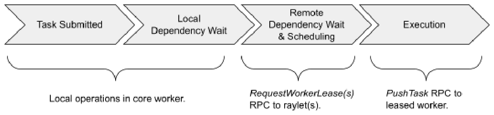
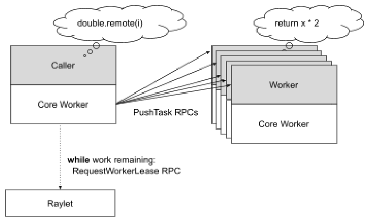
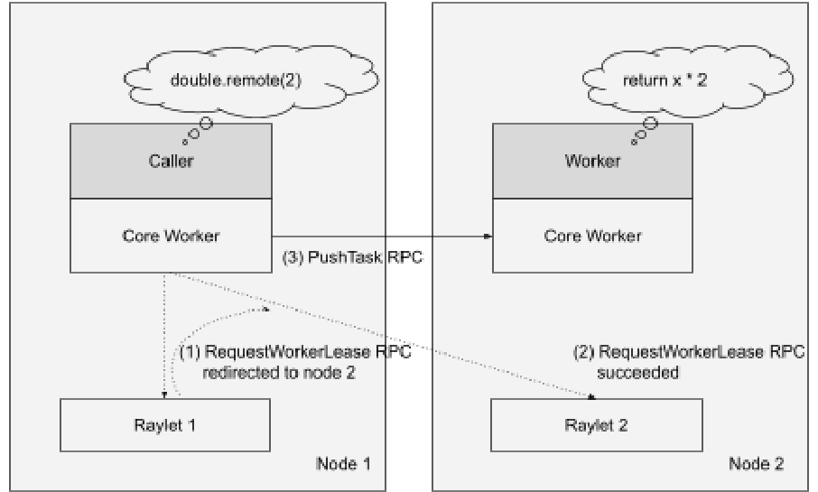

# Ray v2 Architecture 白皮书 · Task Management（任务管理）中英对照

> **来源**：Ray v2 Architecture 白皮书（Ray Team，2022 年 10 月）· Task Management 章
> **原文**：[Ray v2 Architecture（Google Docs）](https://docs.google.com/document/d/1tBw9A4j62ruI5omIJbMxly-la5w4q_TjyJgJL_jN2fI/preview)；英文全文副本见 [original/Ray-2.0-Architecture-whitepaper.md](../original/Ray-2.0-Architecture-whitepaper.md)
> **图片**：存于 `images/` 目录，按原文位置插入

---

## Task execution（任务执行）



*一个普通 Ray 任务的调度流程。*

*The scheduling workflow of a normal Ray task.*

---

## Dependency resolution（依赖解析）

任务调用方在向分布式调度器请求资源之前，会等待所有任务参数被创建。在许多情况下，任务的调用方也是任务参数的 owner。例如，对于像 `foo.remote(bar.remote())` 这样的程序，调用方拥有这两个任务，并且在 `bar` 完成之前不会调度 `foo`。这可以在本地执行，因为调用方会把 `bar` 的结果存储在其[进程内存储](#object-management对象管理)中。

The task caller waits for all task arguments to be created before requesting resources from the distributed scheduler. In many cases, the caller of a task is also the owner of the task arguments. For example, for a program like `foo.remote(bar.remote())`, the caller owns both tasks and will not schedule `foo` until `bar` has completed. This can be executed locally because the caller will [store the result](#object-management) of `bar` in its in-process store.

·

任务的调用方可能正在[*借用*](#reference-counting引用计数)一个任务参数，即它从 owner 那里收到了该参数 `ObjectRef` 的一个反序列化副本。在这种情况下，任务调用方必须通过与参数 owner 执行一个协议，来确定参数是否已被创建。借用者进程在反序列化一个 `ObjectRef` 时会联系 owner。owner 在对象创建后回复，借用者把对象标记为就绪。如果 owner 失败，借用者也会把对象标记为就绪，因为对象与其 owner [命运共享](#application-model应用模型)。

The caller of a task may be [*borrowing*](#reference-counting) a task argument, i.e., it received a deserialized copy of the argument's `ObjectRef` from the owner. In this case, the task caller must determine whether the argument has been created by executing a protocol with the owner of the argument. A borrower process will contact the owner upon deserializing an `ObjectRef`. The owner responds once the object has been created, and the borrower marks the object as ready. If the owner fails, the borrower also marks the object as ready, since objects [fate-share](#application-model) with their owner.

·

```python
@ray.remote
def caller(refs: List[ObjectRef]):
    foo.remote(refs[0])  # caller borrows refs[0] and it will only schedule
                         # foo after the object referenced by refs[0] is created.
```

任务可以有三类参数：普通值、内联对象、非内联对象。

Tasks can have three types of arguments: plain values, inlined objects, and non-inlined objects.

```
普通值 Plain values:        f.remote(2)
内联对象 Inlined object:    f.remote(small_obj_ref)
非内联对象 Non-inlined:     f.remote(large_or_pending_obj_ref)
```

普通值不需要依赖解析。

Plain values don't require dependency resolution.

·

内联对象是足够小、可以存储在进程内存储中的对象（默认阈值 100KB）。调用方可以直接把它们拷贝进任务描述。

Inlined objects are objects small enough to be stored in the in-process store (default threshold is 100KB). The caller can copy these directly into the task specification.

·

非内联对象是存储在分布式对象存储中的对象。这包括大对象，以及被 owner 之外的其他进程借用的对象。在这种情况下，调用方会要求 raylet 在调度决策中考虑这些依赖。raylet 会等待这些对象在其节点上变为本地，然后再为依赖任务授予 worker 租约。这确保了执行任务的 worker 在收到任务时不会因等待对象变为本地而阻塞。

Non-inlined objects are those stored in the distributed object store. These include large objects and objects that have been borrowed by a process other than the owner. In this case, the caller will ask the raylet to account for these dependencies during the scheduling decision. The raylet will wait for those objects to become local to its node before granting a worker lease for the dependent task. This ensures that the executing worker will not block upon receiving the task, waiting for the objects to become local.

---

## Resource fulfillment（资源满足）

任务调用方调度一个任务时，会先向该请求的首选 raylet 发送资源请求。首选 raylet 的选择方式如下：

A task caller schedules a task by first sending a resource request to the preferred raylet for that request. This is chosen either:

1. 按数据局部性：如果任务有存储在共享内存中的对象参数，调用方会选择已本地拥有最多对象参数字节数的节点。这个信息通过调用方的本地对象目录获取，可能是过期的（例如，如果对象传输或驱逐并发发生）。
2. 按节点亲和性：如果目标 raylet 由 [NodeAffinitySchedulingStrategy](#node-affinity-policy) 指定。
3. 默认情况下，选择本地 raylet。

1. By data locality: If the task has object arguments stored in shared memory, then the caller chooses the node that has the most number of object argument bytes already local. This information is retrieved through the caller's local object directory and may be stale (e.g., if an object transfer or eviction occurs concurrently).
2. By node affinity: If a target raylet is specified by the [NodeAffinitySchedulingStrategy](#node-affinity-policy).
3. By default, the local raylet.

·


*Ray 集群中 `double(2)` 任务的资源满足与执行。*

*Resource fulfillment and execution of the `double(2)` task in a Ray cluster.*

·

首选 raylet 把请求排队，如果它选择授予资源，就回复调用方一个现已*租给*调用方的本地 worker 的地址。只要调用方和被租用的 worker 都存活，租约就保持有效，且 raylet 确保在租约有效期间没有其他 client 能使用该 worker。为保证公平，如果不再有任务、或已经过了足够长的时间（例如几百毫秒），调用方会归还空闲的 worker。

The preferred raylet queues the request and if it chooses to grant the resources, responds to the caller with the address of a local worker that is now *leased* to the caller. The lease remains active as long as the caller and leased worker are alive, and the raylet ensures that no other client may use the worker while the lease is active. To ensure fairness, a caller returns the idle worker if no more task remains or if enough time has passed (e.g., a few hundred milliseconds).

·



*调用方可持有多个 worker 租约以提升并行度。worker 租约跨多个任务缓存，作为一种降低调度器负载的优化。*

*Caller can hold multiple worker leases to increase parallelism. Worker leases are cached across multiple tasks as an optimization to reduce the load on the scheduler.*

·

调用方可以把任意数量的任务调度到被租用的 worker 上，只要这些任务与已授予的资源请求兼容。因此，租约可以被看作一种优化，以避免为类似的调度请求与调度器通信。一个调度请求如果满足以下相同条件，就可以复用被租用的 worker：

The caller may schedule any number of tasks onto the leased worker, as long as the tasks are compatible with the granted resource request. Hence, leases can be thought of as an optimization to avoid communication with the scheduler for similar scheduling requests. A scheduling request can reuse the leased worker if it has the same:

1. 资源形状（如 `{"CPU": 1}`），因为这些必须在任务执行期间从节点获取。
2. 共享内存任务参数，因为这些必须在任务执行前在节点上变为本地。注意，小任务参数不需要匹配，因为它们被内联到任务参数中。此外，在数据结构内传递的 ObjectRef 也不需要匹配，因为 Ray 不会在任务开始前使它们变为本地。
3. 运行时环境，因为被租用的 worker 是在该环境中启动的。

1. Resource shape (e.g., {"CPU": 1}), as these must be acquired from the node during task execution.
2. Shared-memory task arguments, as these must be made local on the node before task execution. Note that small task arguments do not need to match since these are inlined into the task argument. Also, ObjectRefs that are passed inside a data structure do not need to match, since Ray does not make these local before the task begins.
3. Runtime environment, as the leased worker is started inside this environment.

·



*在回退调度期间，本地 raylet 把调用方的请求重定向到一个可能有可用资源的远端 raylet。*

*During spillback scheduling, the local raylet redirects the caller's request to a remote raylet that might have resources available.*

·

如果首选 raylet 选择不在本地授予资源，它也可以回复调用方一个远端 raylet 的地址，让调用方在那里重试资源请求。这被称为*回退调度（spillback scheduling）*。远端 raylet 根据其本地资源的当前可用性，可能授予或拒绝该资源请求。如果资源请求被拒绝，调用方会再次向首选 raylet 请求，重复这个过程，直到某个 raylet 授予资源请求。

If the preferred raylet chooses not to grant the resources locally, it may also respond to the caller with the address of a remote raylet at which the caller should retry the resource request. This is known as *spillback scheduling*. The remote raylet may grant or reject the resource request depending on the current availability of its local resources. Should the resource request be rejected, the caller will request again from the preferred raylet and the same process repeats until the resource request is granted by some raylet.

·

代码引用：

Code references:

* [src/ray/core_worker/core_worker.cc](https://github.com/ray-project/ray/blob/master/src/ray/core_worker/core_worker.cc)
* [src/ray/common/task/task_spec.h](https://github.com/ray-project/ray/blob/master/src/ray/common/task/task_spec.h)
* [src/ray/core_worker/transport/direct_task_transport.cc](https://github.com/ray-project/ray/blob/master/src/ray/core_worker/transport/direct_task_transport.cc)
* [src/ray/core_worker/transport/dependency_resolver.cc](https://github.com/ray-project/ray/blob/master/src/ray/core_worker/transport/dependency_resolver.cc)
* [src/ray/core_worker/task_manager.cc](https://github.com/ray-project/ray/blob/master/src/ray/core_worker/task_manager.cc)
* [src/ray/protobuf/common.proto](https://github.com/ray-project/ray/blob/master/src/ray/protobuf/common.proto)
* raylet 的骨干类：[src/ray/raylet/node_manager.cc](https://github.com/ray-project/ray/blob/master/src/ray/raylet/node_manager.cc)
* 每个 raylet 上的分布式调度器：[src/ray/raylet/scheduling/cluster_task_manager.cc](https://github.com/ray-project/ray/blob/master/src/ray/raylet/scheduling/cluster_task_manager.cc)
* 每个 raylet 上的本地任务队列：[src/ray/raylet/local_task_manager.cc](https://github.com/ray-project/ray/blob/master/src/ray/raylet/local_task_manager.cc)
