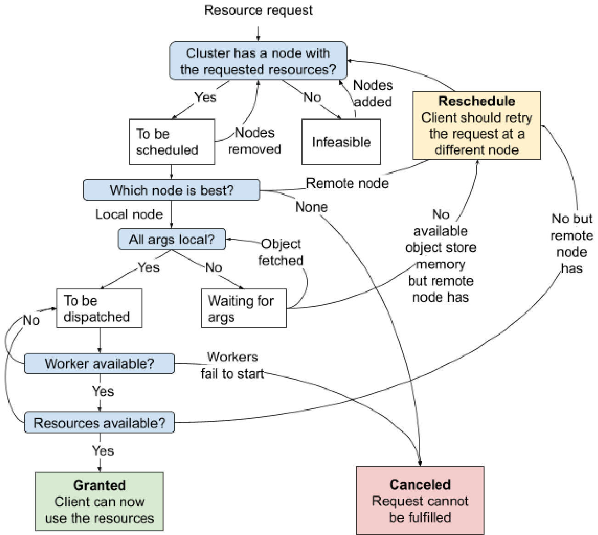
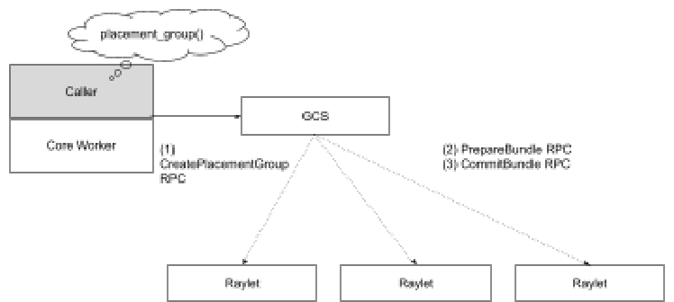

# Ray v2 Architecture 白皮书 · Resource Management and Scheduling（资源管理与调度）中英对照

> **来源**：Ray v2 Architecture 白皮书（Ray Team，2022 年 10 月）· Resource Management and Scheduling 章
> **原文**：[Ray v2 Architecture（Google Docs）](https://docs.google.com/document/d/1tBw9A4j62ruI5omIJbMxly-la5w4q_TjyJgJL_jN2fI/preview)；英文全文副本见 [original/Ray-2.0-Architecture-whitepaper.md](../original/Ray-2.0-Architecture-whitepaper.md)
> **图片**：存于 `images/` 目录，按原文位置插入

---

Ray 中的资源是一个键值对，键表示资源名称，值是浮点数量。为方便起见，Ray 调度器原生支持 CPU、GPU 和内存资源类型。Ray 资源是*逻辑*的，不需要与物理资源一一对应（例如，你可以启动一个 Ray 节点，声称有 3 个 GPU，即便它物理上为零）。默认情况下，Ray 把每个节点上的逻辑资源数量设置为 Ray 自动检测到的物理数量。

A resource in Ray is a key-value pair where the key denotes a resource name, and the value is a float quantity. For convenience, the Ray scheduler has native support for CPU, GPU, and memory resource types. Ray resources are *logical* and don't need to have 1-to-1 mapping with physical resources (e.g. you can start a Ray node with 3 GPUs even if it physically has zero). By default, Ray sets the quantities of logical resources on each node to the physical quantities auto detected by Ray.

·

用户还可以使用任何有效字符串定义自定义资源需求，例如指定 `{"custom_resource": 0.01}` 的资源需求。自定义资源可以在节点启动时添加，例如用来声明一个节点具有某种特定的硬件特性。通过请求该自定义资源，任务或 Actor 就能有效地被约束到在特定节点上运行。

The user may also define custom resource requirements using any valid string, e.g., specifying a resource requirement of {"custom_resource": 0.01}. Custom resources can be added to a node on startup, for example, to advertise that a node has a particular hardware feature. By requesting that custom resource, tasks or actors can effectively be constrained to running on that particular node.

·

分布式调度器的目的是把调用方的资源请求与集群中的资源可用性匹配起来。资源请求是硬性调度约束。例如，`{"CPU": 1.0, "GPU": 1.0}` 表示请求 1 个 CPU 和 1 个 GPU。这个任务只能被调度到同时拥有 ≥1 CPU 和 ≥1 GPU 的节点上。每个 `@ray.remote` 函数默认执行时请求 1 个 CPU（`{"CPU": 1}`）。而 Actor（即 `@ray.remote` 类）默认请求 0 个 CPU 用于执行。这样单个节点就可以承载比核数更多的 Actor，把 CPU 多路复用交给操作系统。Actor 还会请求 1 个 CPU 用于*放置*，这意味着所选节点总资源中必须至少有 1 个 CPU。这是为了让应用能够防止 Actor 被调度到特定节点上，即通过 `--num-cpus=0` 启动节点。

The purpose of the distributed scheduler is to match resource requests from the callers to resource availability in the cluster. Resource requests are hard scheduling constraints. For example, {"CPU": 1.0, "GPU": 1.0} represents a request for 1 CPU and 1 GPU. This task can only be scheduled on a node that has >= 1 CPU and >= 1 GPU. Each `@ray.remote` function requires 1 CPU for execution ({"CPU": 1}) by default. An actor, i.e. a `@ray.remote` class, will request 0 CPU for execution by default. This is so that a single node can host more actors than it has cores, leaving CPU multiplexing to the OS. Actors also request 1 CPUs for *placement*, meaning that the chosen node must have at least 1 CPU in its total resources. This is to enable applications to prevent actors from being scheduled to particular nodes, i.e. by starting the node with `--num-cpus=0`.

·

有几个资源有特殊处理：

There are a few resources with special handling:

* "CPU"、"GPU" 和 "memory" 的数量在 Ray 启动时自动检测。— The quantity of "CPU", "GPU", and "memory" are autodetected during Ray startup.
* 给任务分配 "GPU" 资源会自动在 worker 内设置 `CUDA_VISIBLE_DEVICES` 环境变量，将其限制到特定的 GPU id。— Assigning "GPU" resources to a task will automatically set the CUDA_VISIBLE_DEVICES env var within the worker to limit it to specific GPU ids.

注意，由于资源请求是逻辑的，Ray 并不强制执行物理资源限制。由用户来指定准确的资源需求，例如为有 n 个线程的任务指定 `num_cpus=n`。Ray 资源需求的主要用途是准入控制与智能自动扩缩容。

Note that because resource requests are logical, physical resource limits are not enforced by Ray. It is up to the user to specify accurate resource requirements, e.g., specifying `num_cpus=n` for a task with n threads. The main purposes of Ray's resource requirements are admission control and intelligent autoscaling.

---

## Distributed scheduler（分布式调度器）

### Resource accounting（资源记账）

每个 raylet 跟踪其节点本地的资源。当资源请求被授予时，raylet 相应减少可用的本地资源。一旦资源被归还（或请求者死亡），raylet 相应增加本地资源可用性。因此，raylet 对本地资源可用性始终持有强一致视图。

Each raylet tracks the resources local to its node. When a resource request is granted, the raylet decreases the available local resources accordingly. Once the resources are returned (or the requester dies), the raylet increases the local resource availability accordingly. Thus, the raylet always has a strongly consistent view of the local resource availability.

·

每个 raylet 还会从 [GCS](#resource-management) 接收集群中其他节点资源可用性的信息。这用于分布式调度，例如跨节点负载均衡。为降低收集与分发的开销，这个信息只是最终一致的；它可能是过期的。该信息通过周期性广播发送。GCS 周期性地（默认 100ms）从每个 raylet 拉取资源可用性，然后聚合并重新广播回每个 raylet。

Each raylet also receives information from the [GCS](#resource-management) about resource availability on other nodes in the cluster. This is used for distributed scheduling, e.g., to load-balance across nodes in the cluster. To reduce overheads of collection and dissemination, this information is only eventually consistent; it may be stale. The information is sent through a periodic broadcast. GCS pulls resource availability from each raylet periodically (100ms by default) and then aggregates and rebroadcasts them back to each raylet.

---

### Scheduling state machine（调度状态机）

*raylet 分布式调度的状态机。*

*State machine of raylet distributed scheduling*

当 raylet 收到资源请求（即 `RequestWorkerLease` RPC）时，它会经过上述状态机，并以以下三种状态之一结束：

When a resource request (i.e RequestWorkerLease PRC) is received by the raylet, it will go through the above state machine and end with one of the three states:

* **已授予 Granted**：client 现在可以使用授予的资源和 worker 来执行任务或 Actor。— **Granted**: The client may now use the granted resources and worker to execute a task or actor.
* **重新调度 Reschedule**：根据当前节点对集群的视图，存在一个比当前节点更好的节点。client 应该重新调度该请求。有两种可能：— **Reschedule**: There was a better node than the current one, according to the current node's view of the cluster. The client should reschedule the request. There are two possibilities:
  * 如果当前节点是 client 的首选 raylet（即 client 首先联系的 raylet），那么这是一个[*回退请求（spillback request）*](#resource-fulfillment资源满足)。client 应该在首选 raylet 指定的 raylet 上重试。— If the current node is the client's preferred raylet (i.e. the first raylet that the client contacted), then this is a [*spillback request*](#resource-fulfillment). The client should retry the request at the raylet specified by the first raylet.
  * 否则，当前节点是 client 的首选 raylet 选定的节点。client 应该再次向首选 raylet 重试。— Else, the current node was the one chosen by the client's preferred raylet. The client should retry the request at the preferred raylet again.
* **已取消 Canceled**：资源请求无法运行。这可能发生在请求的调度策略不可行时。例如：— **Canceled:** The resource request could not be run. This can happen if the requested scheduling policy is not feasible. For example:
  * client 请求了[硬节点亲和策略](#node-affinity-policy)，但节点已死。— The client requested a [hard node affinity policy](#node-affinity-policy) but the node is dead.
  * 任务请求的运行时环境创建失败，因此 raylet 无法启动 worker 来满足请求。— The requested runtime env for a task failed to be created, so the raylet could not start workers to fulfill the request.

决定「哪个节点最适合」满足请求的实际逻辑由下述[调度策略](#scheduling-policies)控制。

The actual logic of deciding "Which node is best" to fulfill the request is controlled by the [scheduling policies](#scheduling-policies), described below.

代码引用：

Code references:

* [src/ray/raylet/node_manager.cc](https://github.com/ray-project/ray/blob/master/src/ray/raylet/node_manager.cc)
* [src/ray/raylet/local_task_manager.cc](https://github.com/ray-project/ray/blob/master/src/ray/raylet/local_task_manager.cc)
* [src/ray/raylet/scheduling](https://github.com/ray-project/ray/tree/master/src/ray/raylet/scheduling)
* [src/ray/protobuf/node_manager.proto](https://github.com/ray-project/ray/blob/master/src/ray/protobuf/node_manager.proto)

---

### Scheduling policies（调度策略）

Ray 有几种调度策略，控制任务或 Actor 在哪里运行。提交任务或 Actor 时，用户可以可选地指定要使用的调度策略（如 `task.options(scheduling_strategy=MySchedulingPolicy).remote()`）。

Ray has several scheduling policies that control where to run the task or actor. When a task or actor is submitted, the user can optionally specify a scheduling strategy/policy to use (e.g. `task.options(scheduling_strategy=MySchedulingPolicy).remote()`).

#### Default Hybrid Policy（默认混合策略）

这是未指定其他策略时的默认策略。该策略首先把任务打包到本地节点，直到节点的*关键资源利用率*超过配置阈值（默认 50%）。关键资源利用率是该节点上任何资源的最大利用率，例如，如果一个节点使用了 8/10 CPU 和 70/100GB RAM，那么它的关键资源利用率是 80%。

This is the default policy when nothing else is specified. This policy first tries to pack tasks onto the local node until the node's *critical resource utilization* exceeds a configured threshold (50% by default). The critical resource utilization is the max utilization of any resource on that node, e.g., if a node is using 8/10 CPUs and 70/100GB RAM, then its critical resource utilization is 80%.

在本地节点的阈值被超过后，该策略把任务打包到第一个远端节点（按节点 id 排序），然后是第二个远端节点，依此类推，直到所有节点的关键资源利用率都超过阈值。之后它会选择关键资源利用率最低的节点。

After the threshold is exceeded on the local node, the policy packs tasks onto the first remote node (sorted by the node id), then the second remote node and so on and so forth until the critical resource utilization on all nodes exceeds the threshold. After that it will pick the node with the least critical resource utilization.

该策略的目的是在装箱（bin-packing）与负载均衡（load-balancing）之间取得折中。当节点低于关键资源利用率时，策略偏向装箱。按节点 ID 排序确保所有节点在装箱时使用相同的顺序。当节点超过关键资源利用率时，策略偏向负载均衡，选择负载最低的节点。

The purpose of this policy is to achieve a medium between bin-packing and load-balancing. When nodes are under the critical resource utilization, the policy favors bin-packing. Sorting by node ID ensures that all nodes use the same order when bin-packing. When nodes are over the critical resource utilization, the policy favors load-balancing, picking the least-loaded node.

#### Spread Policy（扩散策略）

该策略用轮询方式在具有可用资源的节点之间扩散任务。注意轮询顺序是每个节点的分布式调度器本地的；没有全局轮询。如果没有节点有可用资源，任务就在可行节点之间轮询扩散。

This policy spreads tasks among nodes with available resources using round-robin. Note that the round-robin order is local to each node's distributed scheduler; there is no global round-robin. If no node has available resources, tasks are spread round-robin among feasible nodes.

#### Node Affinity Policy（节点亲和策略）

使用该策略，用户可以显式指定任务或 Actor 应该运行的目标节点。如果目标节点存活，任务或 Actor 只在那里运行。如果目标节点死亡，那么根据亲和是软还是硬，任务或 Actor 可能被调度到其他节点，或无法被调度。

With this policy, a user can explicitly specify a target node where the task or actor should run. If the target node is alive, the task or actor only runs there. If the target node is dead, then depending on whether the affinity is soft or not, the task or actor may be scheduled to other nodes or fail to be scheduled.

#### Data Locality Policy（数据局部性策略）

Ray 通过让每个任务调用方根据其本地掌握的任务参数位置信息来选择首选 raylet，从而支持数据局部性。raylet 实现的调度策略不考虑数据局部性。这是为了避免给 raylet 增加额外的 RPC 和复杂度，来发现哪些任务参数存储在哪些其他节点上。

Ray supports data locality by having each task caller choose a preferred raylet based on the caller's local information about task argument locations. The scheduling policies implemented by the raylets do not consider data locality. This is to avoid adding extra RPCs and complexity to raylets to discover which task arguments are stored on which other nodes.

#### Placement Group Policy（放置组策略）

该策略把任务或 Actor 运行在给定[放置组](#heading=h.96g6ky77y4f6)所在的位置。

This policy runs the task or actor where the given [placement group](#heading=h.96g6ky77y4f6) is located.

代码引用：

Code references:

* [src/ray/raylet/scheduling/policy](https://github.com/ray-project/ray/tree/master/src/ray/raylet/scheduling/policy)
* [python/ray/util/scheduling_strategies.py](https://github.com/ray-project/ray/blob/master/python/ray/util/scheduling_strategies.py)

---

## Placement Groups（放置组）

自 1.0 起，Ray 支持[放置组](https://docs.ray.io/en/master/placement-group.html)。放置组允许用户跨多个节点原子地预留资源组（即用于 gang 调度）。每个放置组由*资源束（resource bundle）*组成，例如 `{CPU: 2}`。组中的资源束可以尽可能紧密地打包以追求局部性（PACK），或分散开（SPREAD）。组可以被销毁，以释放与该组关联的所有资源。Ray Autoscaler 能感知放置组，并自动扩缩集群以确保待处理的组能按需放置。

Since 1.0, Ray supports [Placement Groups](https://docs.ray.io/en/master/placement-group.html). Placement groups allow users to atomically reserve groups of resources across multiple nodes (i.e., for gang scheduling). Each placement group consists of *resource bundles*, i.e. {CPU: 2}. Bundles in the group can be packed as close as possible for locality (PACK), or spread apart (SPREAD). Groups can be destroyed to release all resources associated with the group. The Ray Autoscaler is aware of placement groups, and auto-scales the cluster to ensure pending groups can be placed as needed.

### Placement Group Creation（放置组创建）

当应用请求创建放置组时，worker 向 [GCS](#global-control-service) 发送一个同步 RPC。GCS 把创建请求刷写到其后备存储，并把创建请求排队。

When the application requests a placement group creation, the worker sends a synchronous RPC to the [GCS](#global-control-service). The GCS flushes the creation request to its backing storage and queues the creation request.

·

由于资源组可能涉及跨多个节点的资源，Ray 使用跨 raylet 的[两阶段提交协议](https://en.wikipedia.org/wiki/Two-phase_commit_protocol)来确保原子性。该协议由 GCS 协调。如果任何 raylet 在协议中途死亡，放置组创建会被回滚，GCS 会再次把请求排队。如果 GCS 死亡且启用了 [GCS 容错](#fault-tolerance-1)，它会在重启后 ping 所有参与者以重新发起协议。

Since resource groups may involve resources across multiple nodes, Ray uses a [two phase commit protocol](https://en.wikipedia.org/wiki/Two-phase_commit_protocol) across the raylets to ensure atomicity. The protocol is coordinated by the GCS. If any raylet dies in the middle of the protocol, the placement group creation is rolled back and the GCS queues the request again. If the GCS dies and [GCS fault tolerance](#fault-tolerance-1) is enabled, it pings all participants upon restart to reinitiate the protocol.

### Placement Group Lifetime（放置组生命周期）

与 Ray 的其他原语（任务、Actor、对象）不同，放置组不做引用计数。它们由创建它们的 job 或 detached Actor 拥有，并在 owner 死亡时自动销毁。用户也可以使用 API `remove_placement_group` 销毁放置组。与 Actor 类似，放置组也支持 detached 放置组，它们可以活过其 owner 的生命周期。

Unlike other Ray primitives (tasks, actors, objects), placement groups are not reference-counted. They are owned by a job or a detached actor that creates them and are automatically destroyed when the owner is dead. Users are also allowed to destroy the placement group using the API `remove_placement_group`. Like actors, placement groups also support detached placement groups, which live beyond the lifetime of their owners.

当放置组被销毁时，所有使用预留资源的 Actor 和任务都会被杀死，所有预留资源都被释放。

When a placement group is destroyed, all actors and tasks that use the reserved resources are killed, and all reserved resources are released.

### Fault Tolerance（容错）

放置组创建时，会在多个节点上预留资源束。当其中一个节点被杀死时，丢失的资源束会以高于任何待处理放置组的优先级被重新调度。在那些资源束被重建之前，放置组保持部分分配状态。

When a placement group is created, it reserves resource bundles across multiple nodes. When one of the nodes is killed, the lost bundles are rescheduled with higher priority than any pending placement groups. Until those bundles are recreated, the placement group remains in a partially allocated state.

代码引用：

Code references:

* [src/ray/gcs/gcs_server/gcs_placement_group_manager.h](https://github.com/ray-project/ray/blob/master/src/ray/gcs/gcs_server/gcs_placement_group_manager.h)
* [src/ray/gcs/gcs_server/gcs_placement_group_scheduler.h](https://github.com/ray-project/ray/blob/master/src/ray/gcs/gcs_server/gcs_placement_group_scheduler.h)
