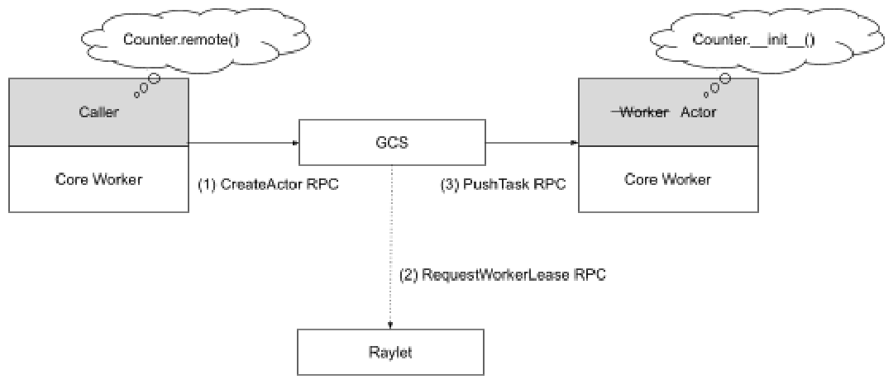
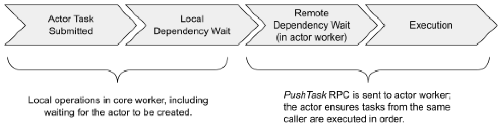
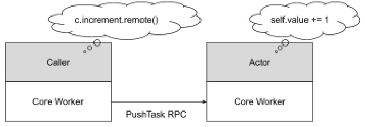
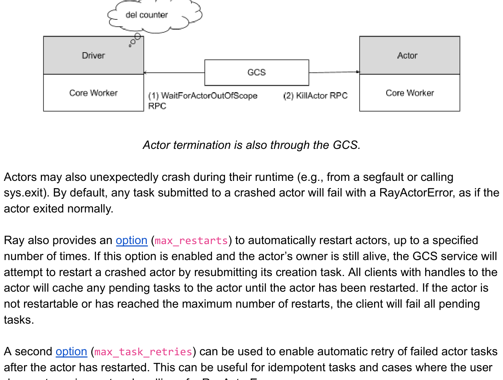

# Ray v2 Architecture 白皮书 · Actor management（Actor 管理）中英对照

> **来源**：Ray v2 Architecture 白皮书（Ray Team，2022 年 10 月）· Actor management 章
> **原文**：[Ray v2 Architecture（Google Docs）](https://docs.google.com/document/d/1tBw9A4j62ruI5omIJbMxly-la5w4q_TjyJgJL_jN2fI/preview)；英文全文副本见 [original/Ray-2.0-Architecture-whitepaper.md](../original/Ray-2.0-Architecture-whitepaper.md)
> **图片**：存于 `images/` 目录，按原文位置插入

---

## Actor creation（Actor 创建）

*Actor 创建任务通过中心化的 GCS 服务调度。*

*Actor creation tasks are scheduled through the centralized GCS service.*

在 Python 中创建 Actor 时，创建它的 worker 首先向 GCS 注册该 Actor。对于 detached Actor，注册以同步方式进行，以避免同名 Actor 之间的竞争条件。对于非 detached Actor（默认），注册为异步进行以提升性能。

When an actor is created in Python, the creating worker first registers the actor with the GCS. For detached actors, the registration is done in a synchronized way to avoid race conditions between actors with the same name. For non-detached actors (the default), registration is asynchronous for performance.

注册之后，一旦 Actor 创建任务的所有输入依赖都解析完成，创建者就把任务描述发送给 GCS 服务。然后 GCS 服务通过与普通任务相同的[分布式调度协议](#resource-fulfillment)来调度 Actor 创建任务，就好像 GCS 是 Actor 创建任务的调用方一样。

After the registration, once all of the input dependencies for an actor creation task are resolved, the creator then sends the task specification to the GCS service. The GCS service then schedules the actor creation task through the same [distributed scheduling protocol](#resource-fulfillment) that is used for normal tasks, as if the GCS were the actor creation task's caller.

句柄的原始创建者可以在 GCS 调度 Actor 创建任务之前，就开始在 Actor 句柄上提交任务，甚至把它作为参数传给其他任务/Actor。注意，对于异步注册，创建者直到 Actor 已在 GCS 注册完成，才会把 Actor 句柄传给其他任务/Actor。这是为了防止创建者在注册完成前死亡；通过阻塞任务提交，我们可以确保持有该 Actor 引用的其他 worker 能够发现这个故障。在这种情况下，任务提交仍然是异步的，因为创建者只是把远程任务缓冲起来，直到 Actor 注册完成。

The original creator of the handle can begin to submit tasks on the actor handle or even pass it as an argument to other tasks/actors before the GCS has scheduled the actor creation task. Note that for asynchronous registration, the creator does not pass the actor handle to other tasks/actors until the actor has been registered with the GCS. This is in case the creator dies before registration finishes; by blocking task submission, we can ensure that other workers with a reference to the actor can discover the failure. In this case, task submission is still asynchronous, as the creator simply buffers the remote task until the actor registration is complete.

一旦 Actor 创建完成，GCS 通过发布-订阅（pub-sub）通知任何持有该 Actor 句柄的 worker。每个句柄缓存新创建的 Actor 的运行时元数据（如 RPC 地址）。任何在 Actor 句柄上提交的待处理任务随后就可以发送给该 Actor 执行。

Once the actor has been created, the GCS notifies any worker that has a handle to the actor via pub-sub. Each handle caches the newly created actor's run-time metadata (e.g., RPC address). Any pending tasks that were submitted on the actor handle can then be sent to the actor for execution.

与任务定义类似，Actor 定义通过 GCS 下载到 worker 上。

Similar to task definitions, actor definitions are downloaded onto workers via the GCS.

---

## Actor task execution（Actor 任务执行）

*一个 Ray Actor 任务的调度流程。*

*The scheduling workflow of a Ray actor task.*

一个 Actor 可以有无限数量的调用方。Actor 句柄代表单个调用方：它包含其所指 Actor 的 RPC 地址。调用方 worker 连接到这个地址并向其提交任务。

An actor can have an unlimited number of callers. An actor handle represents a single caller: it contains the RPC address of the actor to which it refers. The calling worker connects and submits tasks to this address.

·

*一旦创建，Actor 任务就转化为对 Actor 进程的直接 gRPC 调用。一个 Actor 可以处理许多并发调用，尽管这里我们只展示一个。*

*Once created, actor tasks translate into direct gRPC calls to the actor process. An actor can handle many concurrent calls, though here we only show one.*

提交任务的执行顺序在[这里](https://docs.ray.io/en/releases-2.0.0/ray-core/actors/task-orders.html)描述。

The execution order of submitted tasks is described [here](https://docs.ray.io/en/releases-2.0.0/ray-core/actors/task-orders.html).

---

## Actor death（Actor 死亡）

Actor 可以是 detached 或非 detached。非 detached Actor 是默认值，推荐用于大多数用例。当所有句柄离开作用域或 job 退出时，它们会被 Ray 自动垃圾回收。detached Actor 的生命周期不与其原始创建者绑定，不再需要时必须由应用手动删除。

Actors may be detached or non-detached. Non-detached actors are the default and are recommended for most use cases. They are automatically garbage-collected by Ray when all handles go out of scope or the job exits. Detached actors' lifetimes are not tied to their original creator and must be deleted manually by the application once they are no longer needed.

对于非 detached Actor，当 Actor 的所有待处理任务都已结束、且所有指向该 Actor 的句柄都离开作用域（通过[引用计数](#reference-counting)跟踪）时，Actor 的原始创建者会通知 GCS 服务。GCS 服务随后向 Actor 发送一个 `KillActor` RPC，使其退出进程。如果 GCS 检测到创建者已退出（通过心跳表发布），它也会终止该 Actor。此后在该 Actor 上提交的所有待处理和后续任务都会以 `RayActorError` 失败。

For a non-detached actor, when all pending tasks for the actor have finished and all handles to the actor have gone out of scope (tracked through [reference counting](#reference-counting)), the original creator of the actor notifies the GCS service. The GCS service then sends a KillActor RPC to the actor that will cause the actor to exit its process. The GCS also terminates the actor if it detects that the creator has exited (published through the heartbeat table). All pending and subsequent tasks submitted on this actor will then fail with a RayActorError.

·

*Actor 终止也通过 GCS。*

*Actor termination is also through the GCS.*

Actor 在运行时也可能意外崩溃（例如段错误或调用 `sys.exit`）。默认情况下，任何提交给已崩溃 Actor 的任务都会以 `RayActorError` 失败，就像 Actor 正常退出一样。

Actors may also unexpectedly crash during their runtime (e.g., from a segfault or calling sys.exit). By default, any task submitted to a crashed actor will fail with a RayActorError, as if the actor exited normally.

Ray 还提供了一个[选项](https://docs.ray.io/en/latest/ray-core/actors/fault-tolerance.html#fault-tolerance)（`max_restarts`）来自动重启 Actor，最多到指定次数。如果启用了该选项且 Actor 的 owner 仍存活，GCS 服务会通过重新提交其创建任务来尝试重启崩溃的 Actor。所有持有该 Actor 句柄的 client 会把任何待处理任务缓存起来，直到 Actor 被重启。如果 Actor 不可重启或已达到最大重启次数，client 会让所有待处理任务失败。

Ray also provides an [option](https://docs.ray.io/en/latest/ray-core/actors/fault-tolerance.html#fault-tolerance) (max_restarts) to automatically restart actors, up to a specified number of times. If this option is enabled and the actor's owner is still alive, the GCS service will attempt to restart a crashed actor by resubmitting its creation task. All clients with handles to the actor will cache any pending tasks to the actor until the actor has been restarted. If the actor is not restartable or has reached the maximum number of restarts, the client will fail all pending tasks.

第二个[选项](https://docs.ray.io/en/latest/ray-core/actors/fault-tolerance.html#fault-tolerance)（`max_task_retries`）可用于在 Actor 重启后启用失败 Actor 任务的自动重试。这对幂等任务、以及用户不需要自定义处理 `RayActorError` 的情况很有用。

A second [option](https://docs.ray.io/en/latest/ray-core/actors/fault-tolerance.html#fault-tolerance) (max_task_retries) can be used to enable automatic retry of failed actor tasks after the actor has restarted. This can be useful for idempotent tasks and cases where the user does not require custom handling of a RayActorError.

代码引用：

Code references:

* [src/ray/core_worker/core_worker.cc](https://github.com/ray-project/ray/blob/master/src/ray/core_worker/core_worker.cc)
* [src/ray/common/task/task_spec.h](https://github.com/ray-project/ray/blob/master/src/ray/common/task/task_spec.h)
* [src/ray/core_worker/transport/direct_actor_transport.cc](https://github.com/ray-project/ray/blob/master/src/ray/core_worker/transport/direct_actor_transport.cc)
* [src/ray/gcs/gcs_server/gcs_actor_manager.cc](https://github.com/ray-project/ray/blob/master/src/ray/gcs/gcs_server/gcs_actor_manager.cc)
* [src/ray/gcs/gcs_server/gcs_actor_scheduler.cc](https://github.com/ray-project/ray/blob/master/src/ray/gcs/gcs_server/gcs_actor_scheduler.cc)
* [src/ray/protobuf/core_worker.proto](https://github.com/ray-project/ray/blob/master/src/ray/protobuf/core_worker.proto)
