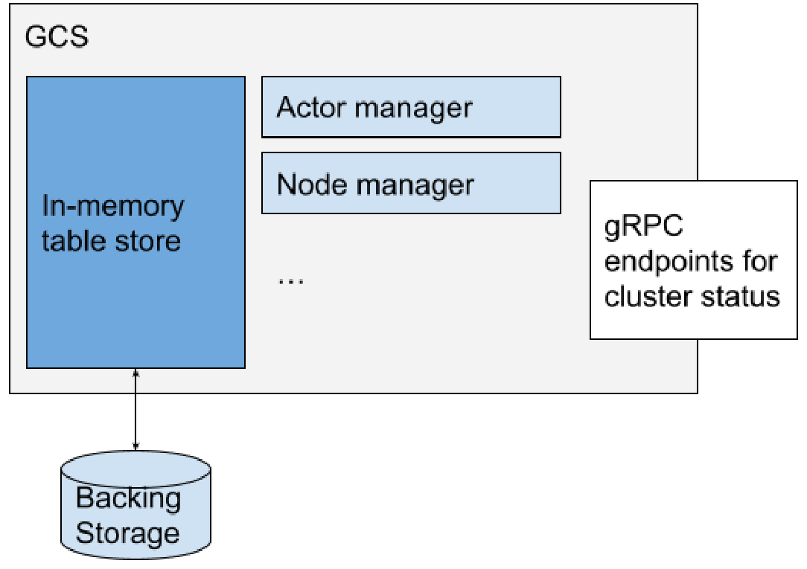
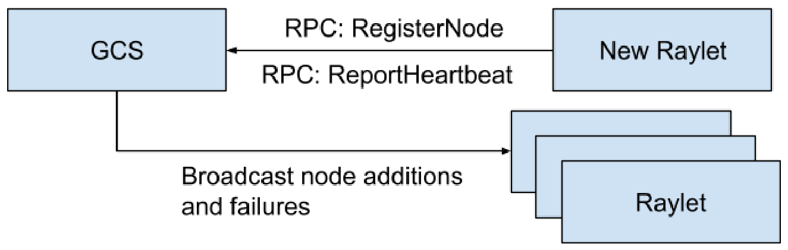
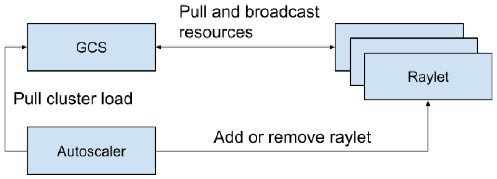

# Ray v2 Architecture 白皮书 · Global Control Service（全局控制服务）中英对照

> **来源**：Ray v2 Architecture 白皮书（Ray Team，2022 年 10 月）· Global Control Service 章
> **原文**：[Ray v2 Architecture（Google Docs）](https://docs.google.com/document/d/1tBw9A4j62ruI5omIJbMxly-la5w4q_TjyJgJL_jN2fI/preview)；英文全文副本见 [original/Ray-2.0-Architecture-whitepaper.md](../original/Ray-2.0-Architecture-whitepaper.md)
> **图片**：存于 `images/` 目录，按原文位置插入

---

## Overview（概述）

全局控制服务（Global Control Service，即 GCS）是 Ray 的集群控制面。它管理 Ray 集群，并作为协调 raylet、发现其他集群进程的中心化枢纽。GCS 还作为外部服务（如 autoscaler 和 dashboard）与 Ray 集群通信的入口。GCS 目前除心跳检查和资源轮询外是单线程的；通过多线程扩展其他操作（如 Actor 管理）的工作正在进行中。

The Global Control Service, also known as the GCS, is Ray's cluster control plane. It manages the Ray cluster and serves as a centralized place to coordinate raylets and discover other cluster processes. The GCS also serves as an entry point for external services like the autoscaler and dashboard to communicate with the Ray cluster. The GCS is currently single-threaded except for heartbeat checks and resource polling; there are ongoing efforts to scale other operations such as actor management via multithreading.

·

如果 GCS 失败，涉及 GCS 的功能将无法工作。这些功能是：

If the GCS fails, features involving the GCS won't work. These are:

* **节点管理 Node management**：管理节点加入和移出集群。它还会把这些信息广播给所有 raylet，让 raylet 感知节点变化。— **Node management:** Manage addition and deletion of nodes to the cluster. It also broadcasts this information to all raylets so the raylets will be aware of the node changes.
* **资源管理 Resource management**：把每个 raylet 的资源可用性广播到整个集群，确保每个 raylet 的资源使用视图得到更新。— **Resource management:** Broadcast the resource availability of each raylet to the whole cluster to make sure each raylet's view of the resource usage is updated.
* **Actor 管理 Actor management**：管理 Actor 的创建和删除请求。它还会监控 Actor 存活，并在 Actor 失败时触发重建（如果配置了）。— **Actor management:** Manage actor creation and deletion requests. It also monitors the actor liveness and triggers recreation (if configured) in case of an actor failure.
* **放置组管理 Placement group management**：协调 Ray 集群中放置组的创建和删除。— **Placement group management:** Coordinate placement group creation and deletion in the Ray cluster.
* **元数据存储 Metadata store**：提供任何 worker 都可以访问的键值存储。注意这只是用于小元数据，并非可扩展的存储系统。例如，任务和对象元数据直接存储在 [worker](#ownership) 中。— **Metadata store:** Provide a key-value store which can be accessed by any worker. Note that this is meant for small metadata only and is not meant to be a scalable storage system. Task and object metadata, for example, are stored directly in the [workers](#ownership).
* **Worker 管理器 Worker manager**：处理 raylet 上报的 worker 失败。— **Worker manager:** Handle worker failure reported by raylet.
* **运行时环境 Runtime env**：GCS 是管理 runtime env 包的地方，包括统计包的使用次数和垃圾回收。— **Runtime env**: GCS is the place managing the runtime env package, including counting the number of usage of the packages and the garbage collection.

GCS 还提供几个 gRPC 端点，用于获取 Ray 集群的当前状态，如 Actor、worker 和节点信息。

GCS also provides several gRPC endpoints to retrieve the current status of the ray cluster, like actor, worker and node information.

GCS 可以可选地由外部存储系统支撑。默认使用一个简单的内存哈希表，但可以配置为写穿（write-through）到 Redis 存储。

GCS can be optionally backed by an external storage system. By default, a simple in-memory hash map is used, but it can be configured to write-through to a Redis store.

---

## Node management（节点管理）

raylet 启动时，会向 GCS 注册。GCS 把 raylet 的信息写入存储。raylet 在 GCS 注册后，该事件会广播给所有其他 raylet。

When a raylet starts, it registers with the GCS. The GCS writes the raylet's information to storage. Once the raylet is registered to the GCS, the event is broadcasted to all other raylets.

节点注册后，GCS 通过周期性健康检查来监控 raylet 的存活。GCS 还会拉取 raylet 的资源视图并广播给其他 raylet。如果 raylet 失败，GCS 也会把 raylet 的死亡广播到集群。raylet 收到信息后，会按需[清理任何相关状态](#failure-model)。

After the node is registered, the GCS monitors the liveness of the raylet by doing periodic health checks. The GCS also pulls the resource view of the raylet and broadcasts it to the other raylets. If the raylet fails, the GCS also broadcasts the death of the raylet to the cluster. Once raylets receive the information, they [clean up any related state](#failure-model) as needed.

raylet 还会把任何本地 worker 进程的死亡上报给 GCS，以便广播给其他 raylet。这用于清理任何相关的系统状态，例如杀死由该 worker 提交的任务。

Raylets also report deaths of any local worker processes to the GCS so it can be broadcasted to the other raylets. This is used to clean up any related system state, e.g., killing tasks that were submitted by that worker.

代码引用：

Code references:

* [src/ray/gcs/gcs_server/gcs_node_manager.cc](https://github.com/ray-project/ray/blob/releases/2.0.0/src/ray/gcs/gcs_server/gcs_node_manager.cc)
* [src/ray/gcs/gcs_server/gcs_heartbeat_manager.cc](https://github.com/ray-project/ray/blob/releases/2.0.0/src/ray/gcs/gcs_server/gcs_heartbeat_manager.cc)

---

## Resource management（资源管理）

GCS 负责确保 raylet 拥有集群资源使用的最新视图。[分布式调度](#resource-accounting)的效率依赖于此：如果视图不够新，raylet 可能会错误地把任务调度到另一个没有资源运行该任务的 raylet。

The GCS is responsible for making sure raylets have the latest view of the resource usage in the cluster. [Distributed scheduling](#resource-accounting) efficiency depends on this: if the view is not fresh enough a raylet might mistakenly schedule a task to another raylet which doesn't have resources to run the task.

GCS 默认每 100ms 从已注册的 raylet 拉取资源使用情况。它还会每 100ms 把全局视图广播给所有 raylet。

The GCS will pull the resource usage from registered raylets every 100ms by default. It also broadcasts the global view to all the raylet every 100ms.

GCS 也是 autoscaler 获取当前集群负载的入口。autoscaler 用它来为集群分配或移除节点。

The GCS is also the entrypoint for the autoscaler to get the current cluster load. The autoscaler uses this to allocate or remove nodes from the cluster.

代码引用：

Code references:

* [src/ray/gcs/gcs_server/gcs_resource_manager.cc](https://github.com/ray-project/ray/blob/releases/2.0.0/src/ray/gcs/gcs_server/gcs_resource_manager.cc)
* [src/ray/gcs/gcs_server/gcs_resource_report_poller.cc](https://github.com/ray-project/ray/blob/releases/2.0.0/src/ray/gcs/gcs_server/gcs_resource_report_poller.cc)
* [src/ray/gcs/gcs_server/ray_syncer.h](https://github.com/ray-project/ray/blob/releases/2.0.0/src/ray/gcs/gcs_server/ray_syncer.h)

---

## Actor management（Actor 管理）

GCS 在 Actor 管理中扮演重要角色。所有 Actor 在被调度前都必须先在 GCS 中注册。GCS 也是 detached Actor 的 owner。更多信息见 [Actor 管理](#actor-management)。

The GCS plays an important role in actor management. All actors need to be registered in the GCS first before being scheduled. GCS is also the owner of the detached actors. Refer to [actor management](#actor-management) for more information.

代码引用：

Code references:

* [src/ray/gcs/gcs_server/gcs_actor_manager.cc](https://github.com/ray-project/ray/blob/releases/2.0.0/src/ray/gcs/gcs_server/gcs_actor_manager.cc)
* [src/ray/gcs/gcs_server/gcs_actor_scheduler.cc](https://github.com/ray-project/ray/blob/releases/2.0.0/src/ray/gcs/gcs_server/gcs_actor_scheduler.cc)

---

## Placement group management（放置组管理）

GCS 还管理放置组的生命周期。GCS 实现了一个两阶段提交协议来创建放置组。更多细节见[放置组章节](#heading=h.96g6ky77y4f6)。

The GCS also manages the lifecycle of the placement groups. The GCS implements a two phase commit protocol to create placement groups. For more details, please check the [placement groups section](#heading=h.96g6ky77y4f6).

代码引用：

Code reference:

* [src/ray/gcs/gcs_server/gcs_placement_group_manager.cc](https://github.com/ray-project/ray/blob/releases/2.0.0/src/ray/gcs/gcs_server/gcs_placement_group_manager.cc)
* [src/ray/gcs/gcs_server/gcs_placement_group_scheduler.cc](https://github.com/ray-project/ray/blob/releases/2.0.0/src/ray/gcs/gcs_server/gcs_placement_group_scheduler.cc)

---

## Metadata store（元数据存储）

GCS 在内置的键值存储中存储某些集群级元数据。这包括：

The GCS stores certain cluster-level metadata in an internal key-value store. This includes:

* 集群的 dashboard 地址。— The cluster's dashboard address.
* 远程函数定义。每当语言前端定义一个远程函数，Ray worker 进程会检查它是否已存储在 GCS 中，如果没有就添加。被分配运行任务的 worker 随后从 GCS 加载函数定义。— Remote function definitions. Whenever a remote function is defined in the language frontend, the Ray worker process will check whether it's stored in the GCS and add it if not. The worker assigned to run a task then loads the function definition from the GCS.
* [运行时环境](#runtime-environments-and-multitenancy)数据。默认情况下，运行时环境的工作目录存储在 GCS 中。GCS 通过统计使用该环境的 detached Actor 和 job 的数量来垃圾回收运行时环境。— [Runtime environment](#runtime-environments-and-multitenancy) data. By default, the runtime environment's working dir is stored in the GCS. The GCS garbage collects runtime environments by counting the number of detached actors and jobs using the environment.
* 一些 Ray 库也用 GCS 存储元数据。例如，Ray Serve 把部署元数据存储在 GCS 中。— Some Ray libraries also use the GCS to store metadata. For example, Ray Serve stores deployment metadata in the GCS.

代码引用：

Code reference:

* [src/ray/gcs/gcs_server/gcs_kv_manager.cc](https://github.com/ray-project/ray/blob/releases/2.0.0/src/ray/gcs/gcs_server/gcs_kv_manager.cc)

---

## Fault tolerance（容错）

GCS 是 Ray 集群的关键组件，如果它失败，上述所有功能都将无法工作。

The GCS is a critical component of the Ray cluster, and if it fails, all functions mentioned above will not work.

在 Ray v2.0 中，GCS 可以可选地从故障中恢复。然而，在恢复期间，上述功能会暂时不可用。

In Ray v2.0, the GCS can optionally recover from failure. However, during recovery the above functions will be temporarily unavailable.

默认情况下，GCS 把所有内容存储到内存存储中，故障时丢失。要使 GCS 具备容错能力，它必须把数据写入持久存储。Ray 支持 Redis 作为外部存储系统。要支持 GCS 容错，GCS 应该由一个高可用（HA）Redis 实例支撑。然后，当 GCS 重启时，它先从 Redis 存储加载信息，包括故障时正在集群中运行的任何 raylet、Actor 和放置组。随后 GCS 恢复健康检查和资源管理等常规功能。

By default, the GCS stores everything into an in-memory store, which is lost upon failure. To make the GCS fault-tolerant, it has to write the data into a persistent store. Ray supports Redis as an external storage system. To support GCS fault tolerance, the GCS should be backed by an HA Redis instance. Then, when the GCS restarts, it loads the information from the Redis store first, including any Raylets, actors, and placement groups that were running in the cluster at the time of the failure. Then the GCS will resume regular functions like health checks and resource management.

因此，在 GCS 恢复期间，以下功能不可用：

Thus, the following features won't be available while the GCS recovers:

* Actor 创建/删除/重建 — Actor creation/deletion/reconstruction
* 放置组创建/删除/重建 — Placement group creation/deletion/reconstruction
* 资源管理 — Resource management
* 新 raylet 无法注册 — New raylets won't be able to register
* 新 Ray worker 无法启动 — New Ray workers won't be able to start

注意，任何正在运行的 Ray 任务和 Actor 都会保持存活，因为这些组件不需要读写 GCS。同样，任何现有对象也会继续可用。

Note that any running Ray tasks and actors will remain alive since these components do not require reading or writing the GCS. Similarly, any existing objects will continue to be available.

代码引用：

Code references:

* [src/ray/gcs/gcs_server/gcs_server.cc](https://github.com/ray-project/ray/blob/master/src/ray/gcs/gcs_server/gcs_server.cc)
* [src/ray/protobuf/gcs.proto](https://github.com/ray-project/ray/blob/master/src/ray/protobuf/gcs.proto)
* [src/ray/protobuf/gcs_service.proto](https://github.com/ray-project/ray/blob/master/src/ray/protobuf/gcs_service.proto)
