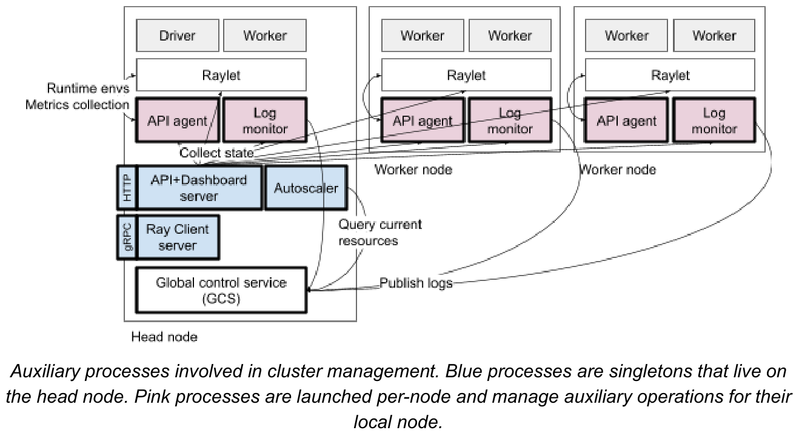
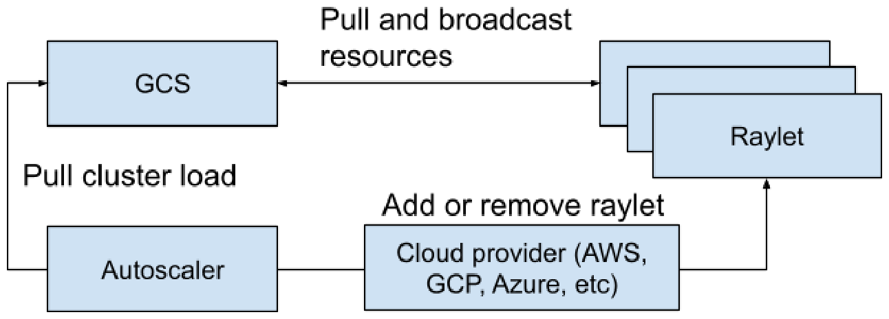
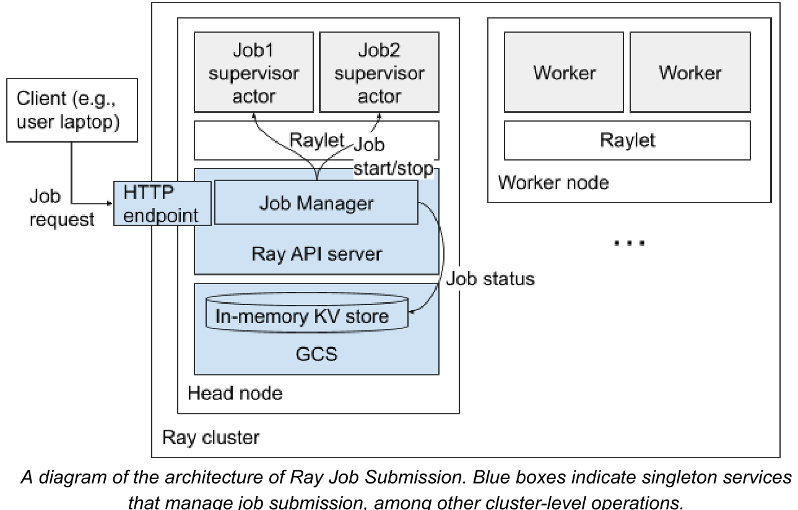
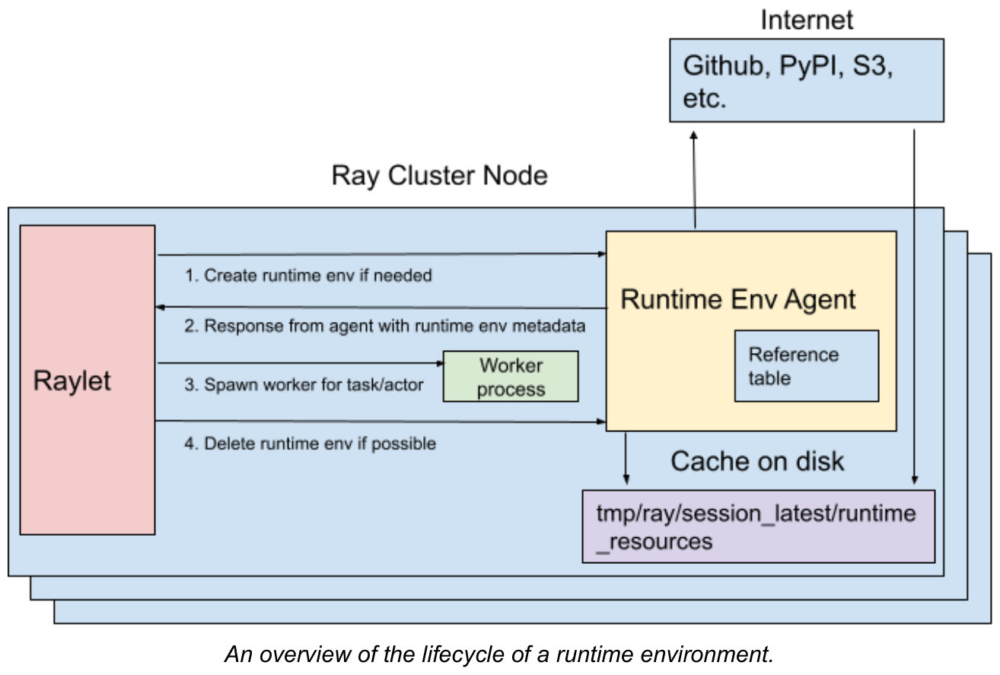
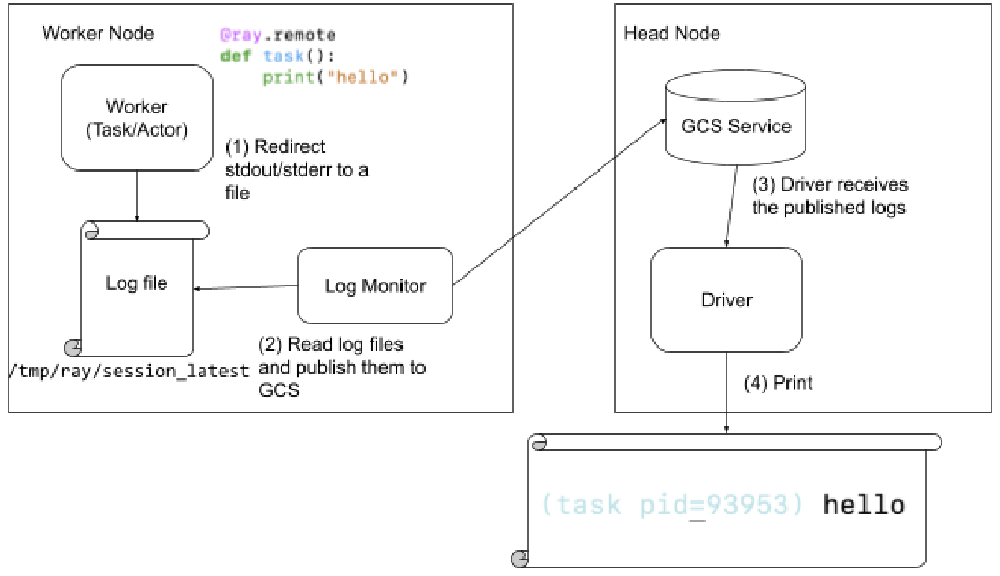
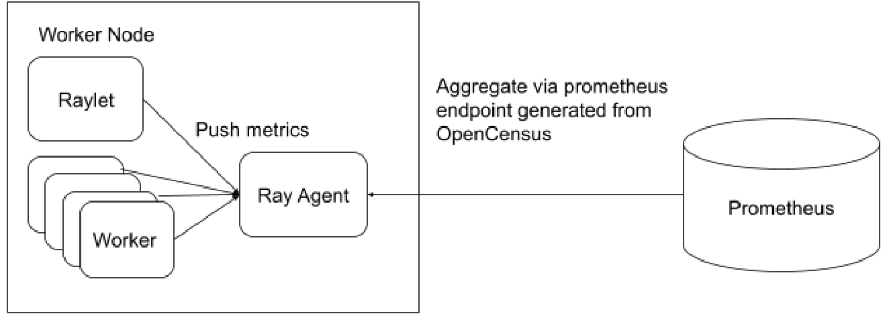

# Ray v2 Architecture 白皮书 · Cluster Management（集群管理）中英对照

> **来源**：Ray v2 Architecture 白皮书（Ray Team，2022 年 10 月）· Cluster Management 章
> **原文**：[Ray v2 Architecture（Google Docs）](https://docs.google.com/document/d/1tBw9A4j62ruI5omIJbMxly-la5w4q_TjyJgJL_jN2fI/preview)；英文全文副本见 [original/Ray-2.0-Architecture-whitepaper.md](../original/Ray-2.0-Architecture-whitepaper.md)
> **图片**：存于 `images/` 目录，按原文位置插入

---

前面几节描述了 Ray 任务、Actor 和对象执行的系统设计。然而，实际使用 Ray 还需要额外的操作，用于部署应用、添加和移除节点、观察集群状态等。这里我们描述这些与管理和部署 Ray 集群相关的辅助操作。

The previous sections described the system design for execution of Ray tasks, actors, and objects. However, realistic Ray usage requires additional operations for deploying applications, adding and removing nodes, observing cluster state, etc. Here, we describe these auxiliary operations related to managing and deploying Ray clusters.

·

*集群管理涉及的辅助进程。蓝色进程是驻留在 head 节点上的单例。粉色进程按节点启动，为其本地节点管理辅助操作。*

*Auxiliary processes involved in cluster management. Blue processes are singletons that live on the head node. Pink processes are launched per-node and manage auxiliary operations for their local node.*

下面是 Ray 集群启动的辅助进程及其进程名的总结：

Here is a summary of the auxiliary processes that Ray clusters launch and the process name

- **[Autoscaler](#autoscaler)（也称集群启动器）** — [autoscaler/_private/monitor.py](https://github.com/ray-project/ray/blob/ray-2.0.0/python/ray/autoscaler/_private/monitor.py) — 根据集群资源和利用率添加与移除节点。— Adds and removes nodes based on cluster resources and utilization.
- **Ray Client server** — [ray.util.client.server](https://github.com/ray-project/ray/blob/ray-2.0.0/python/ray/util/client/server/server.py) — [Ray Client](https://docs.ray.io/en/latest/cluster/running-applications/job-submission/ray-client.html) 的代理服务器，用于在集群上进行交互式开发。— Proxy server for Ray Client, which is used for interactive development on a cluster.
- **API server（也称 Dashboard server）** — [dashboard/dashboard.py](https://github.com/ray-project/ray/blob/ray-2.0.0/dashboard/dashboard.py) — 以前主要作用是托管 dashboard 服务器，但现在它也是集群 API 调用的主端点，包括[作业提交](#job-submission)和 [state API](#ray-state-api)。— Previously the main role was to host the dashboard server, but today it is also the main endpoint for API calls to the cluster, including job submission and the state API.
- **API agent（也称 Ray agent）** — [dashboard/agent.py](https://github.com/ray-project/ray/blob/ray-2.0.0/dashboard/agent.py) — 在本地节点上收集[指标](#metrics)用于集群级聚合，并为任务和 Actor 执行安装[运行时环境](#runtime-environments-and-multitenancy)。— Collects metrics on the local node for cluster-level aggregation, installs runtime environments for task and actor execution.
- **Log monitor** — [log_monitor.py](https://github.com/ray-project/ray/blob/ray-2.0.0/python/ray/_private/log_monitor.py) — 监控本地[日志](#log-aggregation)（默认存储在 /tmp/ray/session_latest/logs），并向 driver 发布错误。— Monitors local logs (by default stored in /tmp/ray/session_latest/logs) and publishes errors to the driver.

---

## Autoscaler（自动扩缩容）

Ray [Autoscaler](https://docs.ray.io/en/master/cluster/key-concepts.html#autoscaling) 负责向集群添加和移除节点。它查看[分布式调度器](#distributed-scheduler)暴露的逻辑资源需求、集群当前节点、集群的节点配置，计算期望的集群配置，并执行操作使集群移动到期望状态。

The Ray [Autoscaler](https://docs.ray.io/en/master/cluster/key-concepts.html#autoscaling) is responsible for adding and removing nodes from the cluster. It looks at the logical resource demands exposed by the [distributed scheduler](#distributed-scheduler), the nodes currently in the cluster, the node profiles of the cluster, calculates the desired cluster configuration and performs the operations to move the cluster to the desired state.

·

*Autoscaler 从 GCS 拉取当前集群负载，并调用云提供商来添加或移除机器。*

*Autoscaler pulls current cluster load from the GCS and invokes cloud providers to add or remove machines*

自动扩缩容循环的工作方式如下：

The autoscaling loop works as follows:

* 应用提交任务、Actor、放置组，它们请求 cpu 等资源。— The application submits tasks, actors, placement groups, which requests resources such as cpu.
* 调度器查看需求和可用性，决定放置任务执行，或在无法满足时将其放入待处理。这些信息快照到 GCS 中。— The scheduler looks at the demand and availability and makes a decision to place the task for execution or puts it into pending if it cannot be satisfied. This information is snapshotted into GCS.
* autoscaler 作为独立进程运行，会周期性地从 GCS 获取快照。它查看集群可用资源、请求的资源、待处理的内容、为集群指定的 worker 节点配置，并运行装箱算法来计算满足运行中和待处理的任务、Actor 和放置组请求所需的节点数量。— The autoscaler, running as a separate process, will periodically fetch the snapshot from GCS. It looks at the resources available in the cluster, resources requested, what is pending, the worker node configuration specified for the cluster, and runs a bin-packing algorithm to calculate the number of nodes to satisfy both running and pending tasks, actors, and placement group requests.
* 然后 autoscaler 通过节点提供者接口向集群添加或移除节点。节点提供者接口允许 Ray 接入不同的云提供商（如 AWS、GCP、Azure）、集群管理器（如 Kubernetes）或本地数据中心。— The autoscaler then adds or removes nodes from the cluster via the node provider interface. The node provider interface allows Ray to plug into different cloud providers (e.g. AWS, GCP, Azure), cluster managers (e.g. Kubernetes), or on-premise data centers.
* 节点启动后，它向集群注册并接受应用工作负载。— When the node comes up it registers with the cluster and accepts application workload.

**缩容 Downscaling**

如果一个节点空闲超过一个超时时间（默认 5 分钟），它就会被移出集群。当一个节点上没有活跃的任务、Actor 或对象主副本时，就认为它是空闲的。

If a node is idle for a timeout (5 minutes by default), it is removed from the cluster. A node is considered idle when there are no active tasks, actors, or primary copies of the objects.

**扩容速度 Upscaling speed**

待处理节点数量有一个限制，由扩容速度决定。该速度定义为待处理节点数与当前节点数的比率。值越高，扩容越激进。例如，如果设置为 1.0，集群在任何时候最多可以增长 100%，所以如果集群当前有 20 个节点，最多允许 20 个待处理的启动。待处理节点的最小数量是 5，以确保即使对小集群也有足够的扩容速度。

There is a limit on the number of pending nodes, determined by the upscaling speed. The speed is defined as the ratio of the number of nodes pending to the current number of nodes. The higher the value, the more aggressive upscaling will be. For example, if this is set to 1.0, the cluster can grow in size by at most 100% at any time, so if the cluster currently has 20 nodes, at most 20 pending launches are allowed. The minimum number of pending nodes is 5 to ensure sufficient upscaling speed even for small clusters.

**异构节点类型 Heterogeneous node types**

Ray 还支持[多种集群节点类型](https://docs.ray.io/en/master/cluster/autoscaling.html#multiple-node-type-autoscaling)。集群节点类型的概念既涵盖物理实例类型（如 AWS p3.8xl GPU 节点 vs m4.16xl CPU 节点），也涵盖其他属性（如 IAM 角色、机器镜像等）。可以为每个节点类型指定[自定义资源](#heading=h.dev8u6tyozfz)，以便 Ray 在应用层面感知对特定节点类型的需求（例如，任务可以通过自定义资源请求被放置到具有特定角色或机器镜像的机器上）。

Ray also supports [multiple cluster node types](https://docs.ray.io/en/master/cluster/autoscaling.html#multiple-node-type-autoscaling). The concept of a cluster node type encompasses both the physical instance type (e.g., AWS p3.8xl GPU nodes vs m4.16xl CPU nodes), as well as other attributes (e.g., IAM role, the machine image, etc). [Custom resources](#heading=h.dev8u6tyozfz) can be specified for each node type so that Ray is aware of the demand for specific node types at the application level (e.g., a task may request to be placed on a machine with a specific role or machine image via custom resource).

代码引用：

Code references:

* [python/ray/autoscaler/_private/autoscaler.py](https://github.com/ray-project/ray/blob/master/python/ray/autoscaler/_private/autoscaler.py)
* [python/ray/autoscaler/_private/resource_demand_scheduler.py](https://github.com/ray-project/ray/blob/master/python/ray/autoscaler/_private/resource_demand_scheduler.py)
* [python/ray/autoscaler/node_provider.py](https://github.com/ray-project/ray/blob/master/python/ray/autoscaler/node_provider.py)

---

## Job Submission（作业提交）

[作业](https://docs.ray.io/en/latest/cluster/running-applications/job-submission/index.html)可以通过命令行接口（CLI）、Python SDK 或 REST API 提交到 Ray 集群。CLI 调用 Python SDK，后者再向 Ray 集群上的 Jobs REST API 服务器发起 HTTP 请求。REST API 目前托管在 Ray dashboard 后端，但未来可能迁移到独立的 API 服务器。

[Jobs](https://docs.ray.io/en/latest/cluster/running-applications/job-submission/index.html) can be submitted to the Ray cluster via a command line interface (CLI), a Python SDK, or a REST API. The CLI calls into the Python SDK, which in turn makes HTTP requests to the Jobs REST API server on the Ray cluster. The REST API is currently hosted in the Ray dashboard backend, but may be moved to a standalone API server in the future.

·

*Ray 作业提交的架构图。蓝色方框表示管理作业提交及其他集群级操作的单例服务。*

*A diagram of the architecture of Ray Job Submission. Blue boxes indicate singleton services that manage job submission, among other cluster-level operations.*

每个作业由运行在 Ray head 节点上的、专属的 job supervisor Actor 管理。这个 Actor 运行在作业用户指定的运行时环境中，作业用户指定的入口命令在一个继承该运行时环境的子进程中运行。如果这个命令包含一个 Ray 脚本，该 Ray 脚本会附加到正在运行的 Ray 集群。

Each job is managed by its own dedicated job supervisor actor that runs on the Ray head node. This actor runs in the job's user-specified runtime environment, and the job's user-specified entrypoint command is run in a subprocess that inherits this runtime environment. If this command contains a Ray script, the Ray script will attach to the running Ray cluster.

作业报告结构化的状态（如 PENDING、RUNNING、SUCCEEDED）和消息，可以通过 API 获取。这些存储在 GCS 中。

Jobs report structured statuses (e.g. PENDING, RUNNING, SUCCEEDED) and messages that can be fetched via the API. These are stored in the GCS.

job supervisor Actor 和它启动的子进程彼此命运共享。如果 job Actor 死亡，最新的作业状态会保留。状态会在用户下次请求作业状态时更新为 FAILED。

The job supervisor actor and the subprocess it starts fate-share with each other. If the job actor dies, the latest job status remains. The status is updated to FAILED the next time the user requests the job status.

停止作业是异步进行的，通过在对应的 job supervisor Actor 上设置一个 "stop" 事件。这个 Actor 负责终止作业子进程、更新其状态，然后退出。

Stopping a job happens asynchronously by setting a "stop" event on the corresponding job supervisor actor. This actor is responsible for terminating the job subprocess, updating its status, then exiting.

job 管理器管理 job supervisor Actor 和日志。入口脚本的输出直接写入 head 节点上的一个文件，该文件可以通过 HTTP 端点读取或流式传输。

The job manager manages job supervisor actors and logs. The output of the entrypoint script is written directly to a file on the head node, and this file can be read or streamed via the HTTP endpoint.

作业提交在 Ray 2.0 中处于 beta 阶段。退出 beta 路线图上的一个关键步骤是：让 job supervisor Actor 能够被调度到 head 节点以外的节点，以降低多租户场景下 head 节点的压力。

Job Submission is in beta as of Ray 2.0. A key step on the roadmap for exiting beta is enabling job supervisor actors to be scheduled on nodes other than the head node to reduce pressure on the head node in multi-tenant setups.

---

## Runtime Environments and Multitenancy（运行时环境与多租户）

[运行时环境](https://docs.ray.io/en/latest/ray-core/handling-dependencies.html#runtime-environments)定义了 Python 脚本运行所需的依赖，如文件、包、环境变量。它在运行时动态安装到集群上，可以为 Ray 作业、或特定的 Actor 和任务指定。

A [runtime environment](https://docs.ray.io/en/latest/ray-core/handling-dependencies.html#runtime-environments) defines dependencies such as files, packages, environment variables needed for a Python script to run. It is installed dynamically on the cluster at runtime, and can be specified for a Ray job, or for specific actors and tasks.

运行时环境的安装和删除由运行在每个节点上的 RuntimeEnvAgent gRPC 服务器处理。RuntimeEnvAgent 与 raylet 命运共享，以简化故障模型，并且因为它是调度任务和 Actor 的核心组件。

Installation and deletion of runtime environments are handled by a RuntimeEnvAgent gRPC server that runs on each node. The RuntimeEnvAgent fate-shares with the raylet to simplify the failure model and because it is a core component for scheduling tasks and actors.

当任务或 Actor 需要某个运行时环境时，raylet 会向 RuntimeEnvAgent 发送 gRPC 请求来创建该环境（如果它尚不存在）。

When a task or actor requires a runtime environment, the raylet sends a gRPC request to the RuntimeEnvAgent to create the environment if it does not already exist.

创建一个环境可能涉及：

Creating an environment may entail:

* 通过 `pip install` 下载和安装包 — Downloading and installing packages via `pip install`
* 为 Ray worker 进程设置环境变量 — Setting environment variables for a Ray worker process
* 在启动 Ray worker 进程前调用 `conda activate` — Calling `conda activate` before starting a Ray worker process
* 从远程云存储下载文件 — Downloading files from remote cloud storage

运行时环境资源（如下载的文件和安装的 conda 环境）缓存在每个节点上，以便在不同任务、Actor 和作业之间共享。当缓存大小限制被超过时，当前未被任何 Actor、任务或作业使用的资源会被删除。

Runtime environment resources such as downloaded files and installed conda environments are cached on each node so that they can be shared between different tasks, actors and jobs. When the cache size limit is exceeded, resources not currently used by any actor, task or job will be deleted.

在正在进行的工作中，正在添加对用户自定义第三方插件的支持，用于设置和安装自定义资源（例如 [PEX](https://pex.readthedocs.io/en/v2.1.102/) 文件）。

In ongoing work, support is being added for user-defined third-party plugins for setup and installation of custom resources (such as [PEX](https://pex.readthedocs.io/en/v2.1.102/) files, for example).

·

*一个运行时环境的生命周期概览。*

*An overview of the lifecycle of a runtime environment.*

---

## KubeRay

KubeRay operator 在 Kubernetes 环境中管理 Ray 集群。每个 Ray 节点作为一个 Kubernetes pod 运行。KubeRay 遵循 Kubernetes Operator 模式：

The KubeRay operator manages Ray clusters in a Kubernetes setting. Each Ray node runs as a Kubernetes pod. KubeRay follows the Kubernetes Operator Pattern:

* 一个称为 *RayCluster* 的自定义资源，描述 Ray 集群的期望状态。— A custom resource, called a *RayCluster*, describes the desired state of a Ray cluster.
* 一个自定义控制器，*KubeRay operator*，管理 Ray pod 以匹配 RayCluster 的规格。— A custom controller, the *KubeRay operator*, manages Ray pods in order to match the RayCluster's specification.

更多信息见 KubeRay 的[文档](https://docs.ray.io/en/latest/cluster/kubernetes/index.html)。

See the [docs](https://docs.ray.io/en/latest/cluster/kubernetes/index.html) on KubeRay for more information.

---

## Ray Observability（可观测性）

Ray 提供了[各种工具](https://docs.ray.io/en/master/ray-observability/index.html)和特性，为集群提供更多可见性。

Ray provides [various tools](https://docs.ray.io/en/master/ray-observability/index.html) and features to give more visibility into the cluster.

### Ray Dashboard

Ray 提供了一个内置的 [dashboard](https://docs.ray.io/en/master/ray-core/ray-dashboard.html)，作为 head 节点上的 HTTP 服务器运行。Ray dashboard 周期性地从集群聚合系统状态，组织和存储数据，并提供 Web UI 来可视化集群状态。

Ray provides a built-in [dashboard](https://docs.ray.io/en/master/ray-core/ray-dashboard.html) that runs as an HTTP server on the head node. The Ray dashboard periodically aggregates system state from the cluster, organizes and stores data, and provides the web UI to visualize the cluster state.

### Log Aggregation（日志聚合）

Ray driver 聚合并打印从 Actor 和任务打印的所有日志消息。当任务或 Actor 向其 stdout 或 stderr 打印日志时，它们会自动重定向到对应的 worker 日志文件。每个节点上运行一个称为 log monitor 的 Python 进程。log monitor 周期性地读取本地 Ray 日志文件，并通过 GCS pubsub 把日志消息发布到 driver 程序。

The Ray driver aggregates and prints all log messages printed from actors and tasks. When a task or actor prints logs to its stdout or stderr, they are automatically redirected to the corresponding worker log file. A Python process known as a log monitor runs on each node. The log monitor periodically reads local Ray log files and publishes the log messages to the driver program via GCS pubsub.

### Metrics（指标）

Ray 原生集成 OpenCensus，默认支持导出到 Prometheus。所有 Ray 组件（GCS 服务、raylet、worker）都向其本地 Ray agent 进程发送指标。每个 Ray agent 通过 OpenCensus 暴露这些指标（默认作为 Prometheus 端点）。

Ray has native integration with OpenCensus and supports export to Prometheus by default. All Ray components (GCS Service, Raylet, Workers) emit metrics to their local Ray agent process. Each Ray agent exposes the metrics via OpenCensus (by default as a Prometheus endpoint).

### Ray State API

自 Ray 2.0 起，Ray 支持 [state API](https://docs.ray.io/en/master/ray-observability/state/state-api.html)，允许用户通过 CLI 或 Python SDK 方便地访问当前 Ray 状态的快照。State API 支持对特定 Ray 任务、Actor 等的汇总和查询。

Since Ray 2.0, Ray supports [state APIs](https://docs.ray.io/en/master/ray-observability/state/state-api.html) that allow users to conveniently access snapshots of the current Ray state through a CLI or the Python SDK. State APIs support summaries and queries of specific Ray tasks, actors, etc.

支持类似 API 的系统（如 Kubernetes）通常把这类执行元数据（如当前 pod）写入持久键值存储或数据库。相比之下，Ray 不持久化执行信息（如当前正在运行的任务）。这是因为 Ray 任务、对象等要轻量得多，把这类元数据写入数据库的代价会高得难以承受。相反，执行元数据通过[所有权模型](#ownership)分布在 worker 之间，并且这些元数据与 worker 命运共享。因此，要执行「列出所有任务」这类查询，state API 必须按需从数据源（如 worker）查询数据。

Systems like Kubernetes that support similar APIs often write such execution metadata, e.g., the current pods, to a persistent key-value store or database. In contrast, Ray does not persist execution information such as currently running tasks. This is because Ray tasks, objects, etc. are much lighter-weight, and the cost of writing such metadata to a database would be prohibitively high. Instead, the execution metadata is distributed across workers via the [ownership model](#ownership), and the metadata fate-shares with the workers. Thus, to perform a query such as "list all tasks", the state APIs must query the data from the data source (e.g., workers) on demand.

目前，API 服务器从以下数据源收集信息：

Currently, the API server collects the following information from these data sources:

* Raylet：任务（Tasks）、对象（Objects）— Raylet · Tasks · Objects
* Ray agent：运行时环境（Runtime environments）— Ray agent · Runtime environments
* GCS：Actor、节点（Nodes）、放置组（Placement groups）、Worker（进程）— GCS · Actors · Nodes · Placement groups · Worker (processes)
