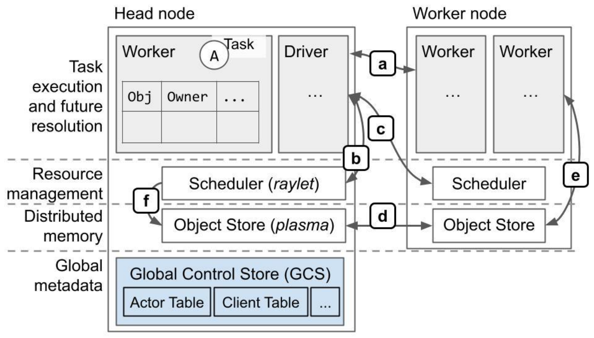
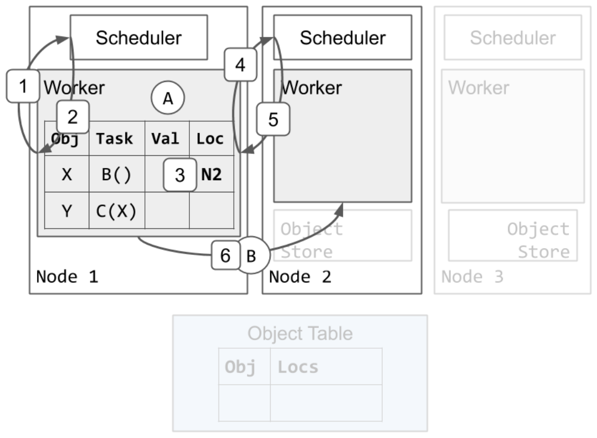
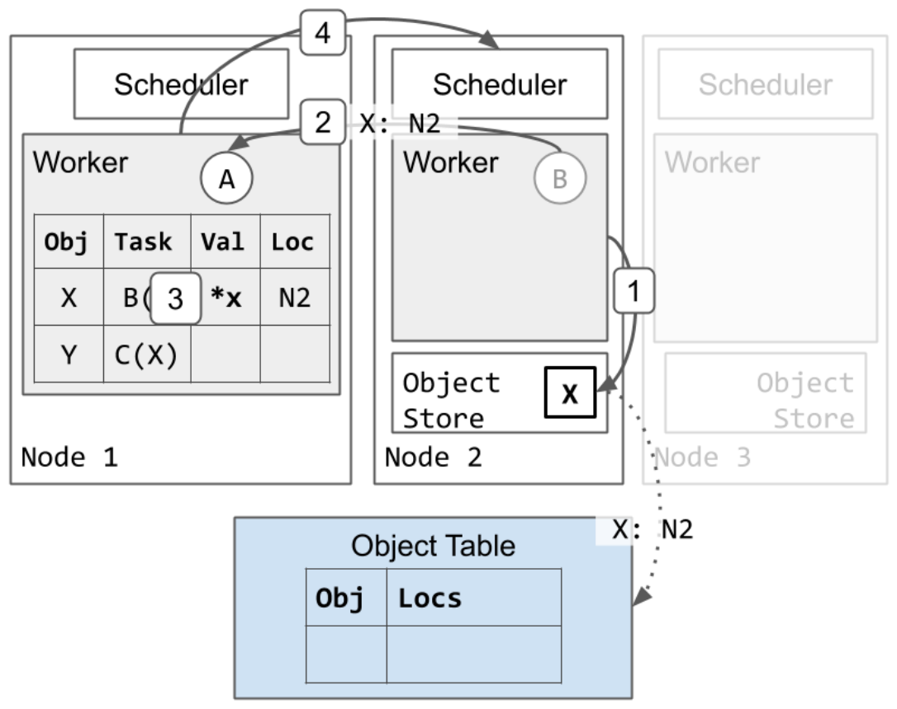
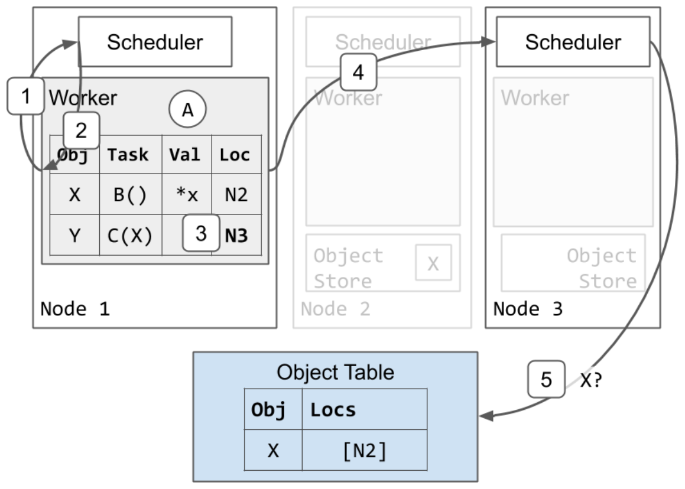
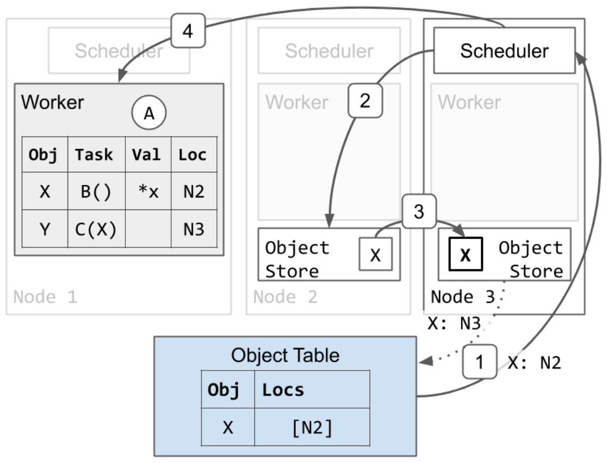
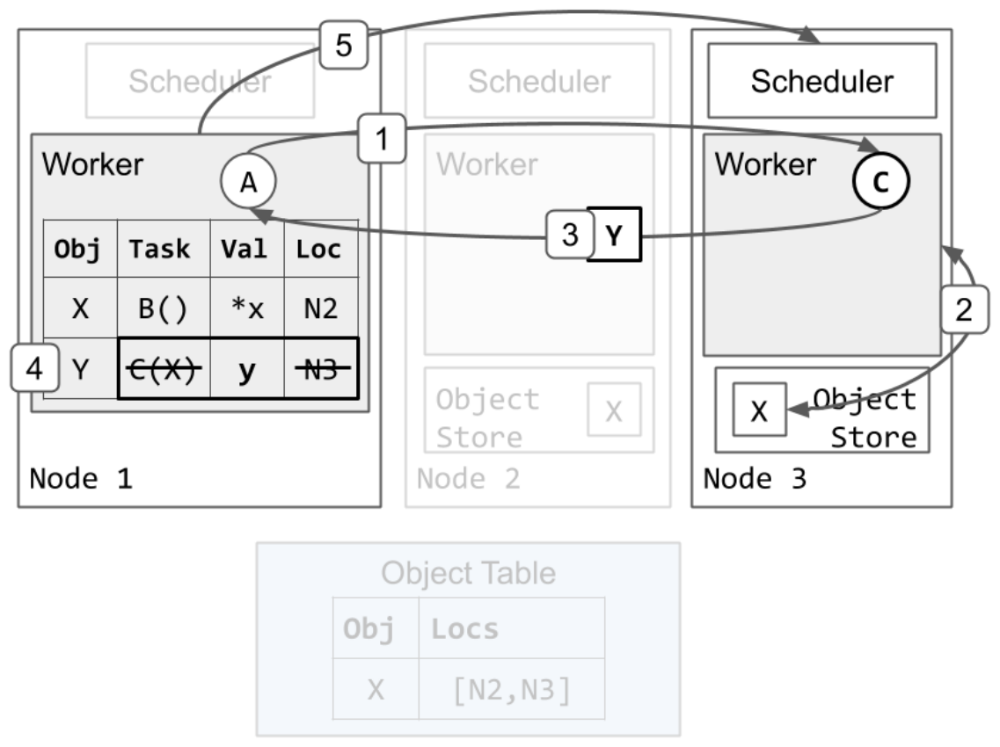
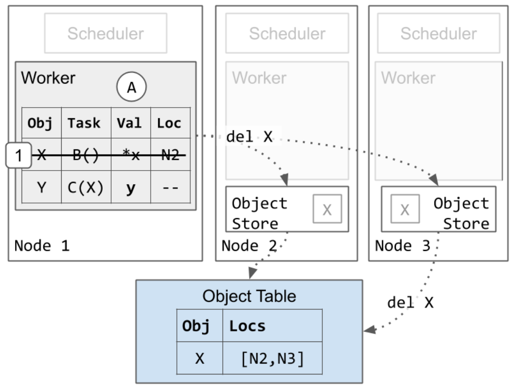

# Ray v2 Architecture 白皮书 · Appendix（附录）中英对照

> **来源**：Ray v2 Architecture 白皮书（Ray Team，2022 年 10 月）· Appendix 章
> **原文**：[Ray v2 Architecture（Google Docs）](https://docs.google.com/document/d/1tBw9A4j62ruI5omIJbMxly-la5w4q_TjyJgJL_jN2fI/preview)；英文全文副本见 [original/Ray-2.0-Architecture-whitepaper.md](../original/Ray-2.0-Architecture-whitepaper.md)
> **图片**：存于 `images/` 目录，按原文位置插入

---

下面是系统架构更详细的图表和示例。

Below are more detailed diagrams and examples of the system architecture.

---

## Architecture diagram（架构图）



**架构与协议 Architecture and protocols**

协议概览（大多基于 gRPC）：

Protocol overview (mostly over gRPC):

1. [任务执行](#heading=h.h46i1eirsu4j)、[对象引用计数](#reference-counting)。— [Task execution](#heading=h.h46i1eirsu4j), [object reference counting](#reference-counting).
2. [本地资源管理](#heading=h.jamwh5yjnwj9)。— [Local resource management](#heading=h.jamwh5yjnwj9).
3. [远程/分布式资源管理](#heading=h.jamwh5yjnwj9)。— [Remote/distributed resource management](#heading=h.jamwh5yjnwj9).
4. [分布式对象传输](#object-resolution)。— [Distributed object transfer](#object-resolution).
5. [大对象的存储与获取](#heading=h.qublyjcqqurz)。获取通过 `ray.get`，或在任务执行期间把任务的 ObjectID 参数替换为对象值时进行。— [Storage and retrieval of large objects](#heading=h.qublyjcqqurz). Retrieval is via `ray.get` or during task execution, when replacing a task's ObjectID argument with the object's value.
6. 调度器从远端节点获取对象，以[满足依赖](#heading)本地排队任务的依赖。— Scheduler fetches objects from remote nodes to [fulfill dependencies](#heading) of locally queued tasks.

---

## Example of task scheduling and object storage（任务调度与对象存储示例）

我们将走查一个 Ray 程序的物理执行过程，该程序如下所示：

We'll walk through the physical execution of a Ray program that looks like this:

```python
@ray.remote
def A():
    y_id = C.remote(B.remote())
    y = ray.get(y_id)
```

在这个例子中，任务 A 提交任务 B 和 C，而 C 依赖 B 的输出。为了说明，我们假设 B 返回一个大对象 X，C 返回一个小对象 Y。这将让我们展示进程内存储和共享内存对象存储之间的区别。我们还会展示如果任务 A、B、C 都在不同节点上执行会发生什么，以说明分布式调度是如何工作的。

In this example, task A submits tasks B and C, and C depends on the output of B. For illustration purposes, let's suppose that B returns a large object X, and C returns a small object Y. This will allow us to show the difference between the in-process and shared-memory object stores. We'll also show what happens if tasks A, B, and C all execute on different nodes, to show how distributed scheduling works.

### Distributed task scheduling（分布式任务调度）

我们从 worker 1 执行 A 开始。任务 B 和 C 已经提交给 worker 1。因此，worker 1 的本地*所有权表*已经包含 X 和 Y 的条目。首先，我们走查调度 B 执行的示例：

We'll start off with worker 1 executing A. Tasks B and C have already been submitted to worker 1. Thus, worker 1's local *ownership table* already includes entries for both X and Y. First, we'll walk through an example of scheduling B for execution:



1. Worker 1 向其本地调度器请求执行 B 的资源。— Worker 1 asks its local scheduler for resources to execute B.
2. 调度器 1 响应，告诉 worker 1 在节点 2 上重试调度请求。— Scheduler 1 responds, telling worker 1 to retry the scheduling request at node 2.
3. Worker 1 更新其本地所有权表，表示任务 B 在节点 2 上待处理。— Worker 1 updates its local ownership table to indicate that task B is pending on node 2.
4. Worker 1 向节点 2 上的调度器请求执行 B 的资源。— Worker 1 asks the scheduler on node 2 for resources to execute B.
5. 调度器 2 把资源授予 worker 1，并回复 worker 2 的地址。调度器 2 确保在 worker 1 仍持有资源期间，不会把其他任务分配给 worker 2。— Scheduler 2 grants the resources to worker 1 and responds with the address of worker 2. Scheduler 2 ensures that no other tasks will be assigned to worker 2 while worker 1 still holds the resources.
6. Worker 1 把任务 B 发送给 worker 2 执行。— Worker 1 sends task B to worker 2 for execution.

### Task execution（任务执行）

接下来，我们展示一个 worker 执行任务并把返回值存储到分布式对象存储的示例：

Next, we'll show an example of a worker executing a task and storing the return value in the distributed object store:



1. Worker 2 完成执行 B，并把返回值 X 存储到其本地对象存储。— Worker 2 finishes executing B and stores the return value X in its local object store.
   1. 节点 2 异步更新对象表，表示 X 现在在节点 2 上（虚线箭头）。— Node 2 asynchronously updates the object table to indicate that X is now on node 2 (dotted arrow).
   2. 由于这是 X 被创建的第一份副本，节点 2 也会固定（pin）它的 X 副本，直到 worker 1 通知节点 2 可以释放该对象（未显示）。这确保了对象值在其仍被引用期间可达。— Since this is the first copy of X to be created, node 2 also pins its copy of X until worker 1 notifies node 2 that it is okay to release the object (not shown). This ensures that the object value is reachable while it is still in reference.
2. Worker 2 回复 worker 1，表示 B 已完成。— Worker 2 responds to worker 1 indicating that B has finished.
3. Worker 1 更新其本地所有权表，表示 X 存储在分布式内存中。— Worker 1 updates its local ownership table to indicate that X is stored in distributed memory.
4. Worker 1 把资源归还给调度器 2。Worker 2 现在可以被复用来执行其他任务。— Worker 1 returns the resources to scheduler 2. Worker 2 may now be reused to execute other tasks.

### Distributed task scheduling and argument resolution（分布式任务调度与参数解析）

既然 B 已经完成，任务 C 可以开始执行。Worker 1 接下来调度 C，使用与任务 B 类似的协议：

Now that B has finished, task C can start execution. Worker 1 schedules C next, using a similar protocol as for task B:



1. Worker 1 向其本地调度器请求执行 C 的资源。— Worker 1 asks its local scheduler for resources to execute C.
2. 调度器 1 响应，告诉 worker 1 在节点 3 上重试调度请求。— Scheduler 1 responds, telling worker 1 to retry the scheduling request at node 3.
3. Worker 1 更新其本地所有权表，表示任务 C 在节点 3 上待处理。— Worker 1 updates its local ownership table to indicate that task C is pending on node 3.
4. Worker 1 向节点 3 上的调度器请求执行 C 的资源。— Worker 1 asks the scheduler on node 3 for resources to execute C.
5. 调度器 3 看到 C 依赖 X，但它的本地对象存储中没有 X 的副本。调度器 3 把 C 排队，并向对象表查询 X 的位置。— Scheduler 3 sees that C depends on X, but it does not have a copy of X in its local object store. Scheduler 3 queues C and asks the object table for a location for X.

任务 C 需要 X 的本地副本才能开始执行，所以节点 3 获取一份 X 的副本：

Task C requires a local copy of X to begin execution, so node 3 fetches a copy of X:



1. 对象表响应调度器 3，表示 X 位于节点 2。— Object table responds to scheduler 3 indicating that X is located on node 2.
2. 调度器请求节点 2 上的对象存储发送一份 X 的副本。— Scheduler asks object store on node 2 to send a copy of X.
3. X 从节点 2 拷贝到节点 3。— X is copied from node 2 to node 3.
   1. 节点 3 也异步更新对象表，表示 X 也在节点 3 上（虚线箭头）。— Node 3 also asynchronously updates the object table to indicate that X is also on Node 3 (dotted arrow).
   2. 节点 3 的 X 副本被缓存但不固定。当本地 worker 使用它时，对象不会被驱逐。然而，与节点 2 上的 X 副本不同，当对象存储 3 处于内存压力时，节点 3 的副本可能按 LRU 被驱逐。如果发生这种情况，节点 3 之后再次需要该对象时，可以使用此处展示的相同协议从节点 2 或其他副本重新获取它。— Node 3's copy of X is cached but not pinned. While a local worker is using it, the object will not be evicted. However, unlike the copy of X on node 2, node 3's copy may be evicted according to LRU when object store 3 is under memory pressure. If this occurs and node 3 later needs the object again, it can re-fetch it from node 2 or a different copy using the same protocol shown here.
4. 由于节点 3 现在有了 X 的本地副本，调度器 3 把资源授予 worker 1，并回复 worker 3 的地址。— Since node 3 now has a local copy of X, scheduler 3 grants the resources to worker 1 and responds with the address of worker 3.

### Task execution and object inlining（任务执行与对象内联）

任务 C 执行并返回一个足够小、可以存储在进程内内存存储中的对象：

Task C executes and returns an object small enough to be stored in the in-process memory store:



1. Worker 1 把任务 C 发送给 worker 3 执行。— Worker 1 sends task C to worker 3 for execution.
2. Worker 3 从其本地对象存储获取 X 的值（类似 `ray.get`），并运行 C(X)。— Worker 3 gets the value of X from its local object store (similar to a `ray.get`) and runs C(X).
3. Worker 3 完成 C 并返回 Y，这次是按值返回，而不是存储到其本地对象存储。— Worker 3 finishes C and returns Y, this time by value instead of storing it in its local object store.
4. Worker 1 把 Y 存储到其进程内内存存储。它还擦除了任务 C 的描述和位置，因为 C 已经执行完成。此时，任务 A 中未完成的 `ray.get` 调用会从 worker 1 的进程内存储中找到并返回 y 的值。— Worker 1 stores Y in its in-process memory store. It also erases the specification and location of task C, since C has finished execution. At this point, the outstanding `ray.get` call in task A will find and return the value of y from worker 1's in-process store.
5. Worker 1 把资源归还给调度器 3。Worker 3 现在可以被复用来执行其他任务。这可以在第 4 步之前完成。— Worker 1 returns the resources to scheduler 3. Worker 3 may now be reused to execute other tasks. This may be done before step 4.

### Garbage collection（垃圾回收）

最后，我们展示 worker 如何清理内存：

Finally, we show how memory is cleaned up by the workers:



1. Worker 1 擦除它关于对象 X 的条目。这样做是安全的，因为待处理的任务 C 是 X 的唯一引用，而 C 现在已经完成。Worker 1 保留它关于 Y 的条目，因为应用仍然持有对 y 的 ObjectID 的引用。— Worker 1 erases its entry for object X. This is safe to do because the pending task C had the only reference to X and C has now finished. Worker 1 keeps its entry for Y because the application still has a reference to y's ObjectID.
   1. 最终，X 的所有副本都会从集群中删除。这可以在第 1 步之后的任何时间进行。如上所述，如果节点 3 的对象存储处于内存压力下，节点 3 的 X 副本也可能在第 1 步之前被删除。— Eventually, all copies of X are deleted from the cluster. This can be done at any point after step 1. As noted above, node 3's copy of X may also be deleted before step 1, if node 3's object store is under memory pressure.

---

**脚注 Footnotes**

[^1] 默认小于 100KiB。— Less than 100KiB by default.

[^2] 注意，如果 `ObjectRef` 包含在数据结构中（如 Python 列表），或以其他方式序列化在参数中，它将不会被解析。这允许通过任务传递引用而不阻塞其解析。— Note that if the `ObjectRef` is contained within a data structure (e.g., Python list), or otherwise serialized within an argument, it will not be resolved. This allows passing references through tasks without blocking on their resolution.

[^3] 除非使用异步 Actor 或线程化 Actor。— Unless using async actors or threaded actors.

[^4] 任务标识符计算为其父任务 ID 和该父任务之前调用的任务数量的哈希。根 driver 任务的 ID 是一个单调递增的整数，基于该集群之前执行过的 job 数量。— Task identifiers are computed as a hash of their parent task ID and the number of tasks invoked by that parent before. The root driver task's ID is a monotonically increasing integer, based on the number of jobs that have executed on that cluster before.
